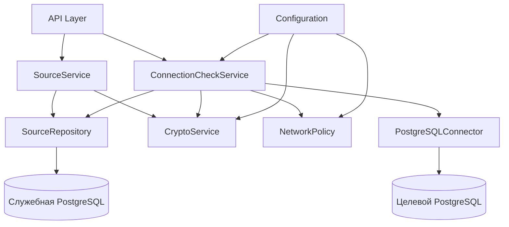

# DataFlow Manager v0.1 — техническая архитектура

Дата обновления: 10.11.2026. B05/B06/B07 утверждены владельцем продукта с CR-015–017. Production CRUD/ORM/миграции не реализованы; ограниченные исследования не доказывают production-гарантии. Декларативная схема — [TASK-002](TASK-002.md).

## 1. Architecture Overview

Источники требований: [PRD](PRD.md), [AGENTS.md](../AGENTS.md), [README.md](../README.md), текущий код и утверждённые решения задачи Architecture Design. PRD определяет бизнес-поведение. Утверждённые при архитектурном проектировании решения синхронизированы с PRD; статусы вопросов приведены в его разделе Open Questions.

### Статусы решений и согласованность с PRD

- **Утверждено:** решение задано пользователем или уже содержится в PRD.
- **Предложено:** технический вариант для согласования, не новое обязательное продуктовое требование.
- **Требует проверки:** механизм описан, но его работоспособность и гарантии ещё не доказаны на стенде.

| Вопрос PRD | Синхронизированное решение |
|---|---|
| OQ-01 | История проверок не хранится |
| OQ-02 | Missing password сохраняет старый; null/empty запрещены B07 |
| OQ-03 | B06: server-generated NFC(casefold(NFC(name))), оригинал сохраняется; профиль/ограничения — TASK-002 |
| OQ-04 | Список без пагинации в v0.1 |
| OQ-08 | TLS `verify-full`: проверяются сертификат и имя сервера |
| OQ-09 | Allowlist хранится в локальном файле; схема и DNS/IP-механизм ещё не утверждены |

В PRD вопросы OQ-01–OQ-04 и OQ-08 закрыты, OQ-09 частично закрыт. OQ-06 закрыт продуктово B05; точность реальной классификации DEFERRED. OQ-05, OQ-07 и прочие неутверждённые технические детали остаются открытыми. Статусы не означают, что соответствующие механизмы уже реализованы или проверены.

### Стиль и границы

**Утверждено:** модульный монолит на Python 3.12 и FastAPI. Один локальный API, служебная PostgreSQL, логически отдельные целевые PostgreSQL-источники. SQLAlchemy 2.x отвечает за служебные данные, Alembic — за миграции, Fernet — за пароли, psycopg 3 — за подключения к источникам.

Преимущества: понятные границы ответственности, общие транзакции для конфигураций, простой локальный запуск, возможность тестирования без распределённой инфраструктуры. Ограничения: API и проверки делят ресурсы машины; блокирующая проверка способна повлиять на весь процесс; служебная БД остаётся внешней зависимостью. Это не решение для публичного многопользовательского сервиса.

Изолированный дочерний процесс для проверки рассматривается ниже как техническое предложение внутри монолита, а не отдельный сервис или очередь задач. ETL, CSV/REST-источники, расписания, Airflow, веб-интерфейс, авторизация, роли и мониторинг качества данных не добавляются.

Текущее состояние: `src/dataflow_manager/main.py` содержит только `/health`, `tests/test_health.py` — три теста; `__init__.py` содержит демонстрационную CLI-функцию. SQLAlchemy, Alembic, cryptography и psycopg пока не объявлены в `pyproject.toml`. Ни установка, ни изменение зависимостей этим документом не выполняются.

## 2. Component Architecture

| Компонент | Ответственность | Зависимости |
|---|---|---|
| API Layer | Входные/выходные схемы, маршруты, безопасное отображение ошибок; исключение секретов из ответов | SourceService, ConnectionCheckService; сборка зависимостей в composition root |
| SourceService | CRUD, валидация бизнес-правил, атомарные изменения, PATCH с сохранением отсутствующего пароля | SourceRepository, CryptoService |
| ConnectionCheckService | Загрузка сохранённого снимка, оркестрация проверки, общий дедлайн, безопасный результат; без истории | SourceRepository, CryptoService, NetworkPolicy, PostgreSQLConnector, Configuration; предлагаемый исполнитель проверки |
| SourceRepository | Чтение/запись служебной БД, перевод ошибок ограничений в доменные ошибки | SQLAlchemy 2.x, служебная PostgreSQL |
| CryptoService | Fernet encrypt/decrypt; закрытый доступ к ключу; безопасные ошибки | Configuration, cryptography |
| NetworkPolicy | Нормализация хоста, проверка локальной политики, DNS и проверка каждого фактического IP; выдача проверенного назначения | Configuration, ограничиваемый дедлайном resolver |
| PostgreSQLConnector | Только подключение и закрытие, TLS, привязка к проверенному IP; без SQL изменения данных | psycopg 3/libpq; проверенное назначение и TLS-настройки |
| Configuration | Загрузка служебного DSN, источника ключа, пути allowlist, CA, loopback-настроек; безопасная валидация | Локальная конфигурация; конкретный канал ключа предлагается в разделе 5 |

Направления вызовов:



Диаграмма показывает логические зависимости; при изолированном исполнении NetworkPolicy и PostgreSQLConnector работают в дочернем процессе. API не вызывает драйвер напрямую. Connector получает не произвольный DSN, а структурированные параметры и проверенное назначение: исходное TLS-имя, один IP, порт, версию политики, deadline. Это предлагаемый внутренний контракт, не публичный API.

**Утверждённая логическая граница B05/B07:** SourceService управляет атомарной единицей работы; repository не делает самостоятельный commit посреди операции. Ошибка ведёт к rollback. [B08](B08-SESSION-UOW.md) APPROVED: sync SQLAlchemy/psycopg, независимая Session на одноразовую UoW, явный commit и управление Engine через lifespan. Реализация и проверки TASK-005 приняты в указанном offline/live scope. Параметризованные операции исключают конкатенацию SQL с пользовательскими значениями.

Блокирующий служебный DB I/O не выполняется непосредственно в event loop; синхронные обработчики FastAPI — подходящий вариант будущего CRUD. Доступ к служебной БД имеет отдельные ограничения ожидания, сессия и транзакция закрываются до внешнего подключения. Модель будущего connector определяется отдельно; AsyncSession вне TASK-005.

## 3. Data Model

**Утверждено B06/B07:** одна `public.data_sources`, без истории; UUIDv4, original name,
STORED generated name_key, encrypted password и PostgreSQL timestamps.
Полная спецификация типов/defaults/CHECK/предела/ответственности — [TASK-002](TASK-002.md#2-колонки-генерация-и-api--dto--db).
Она описывает целевую схему, а не уже созданную таблицу.

| Колонка | Тип (все NOT NULL) | Назначение |
|---|---|---|
| id | uuid | PK, UUIDv4 приложения, read-only |
| name | text | Original, 1–255 Unicode scalars, без trim/NFC отображения |
| name_key | text COLLATE "C" | STORED generated, ≤1024 UTF-8 bytes, не публичный |
| host | text | Canonical ASCII hostname/IPv4/IPv6; ≤253 ASCII chars |
| port | integer | CHECK 1–65535; strict integer на входе API |
| database_name | text | API database, 1–63 UTF-8 bytes, literal |
| username | text | 1–63 UTF-8 bytes, original case/Unicode |
| password_encrypted | text | Только Fernet; plaintext 1–4096 UTF-8 bytes проверяет application |
| created_at | timestamptz(6) | PostgreSQL transaction_timestamp(), read-only |
| updated_at | timestamptz(6) | Тот же INSERT-default; UPDATE/no-op по CR-015 |

Уточнение B07: четыре полностью числовые непустые метки через точки допускаются только как валидный canonical IPv4; DNS fallback для остальных таких строк запрещён. Будущий API-validator обязан применять это правило. После применения initial revision в изолированной тестовой БД изменение CHECK оформляется отдельной `0002_host_policy`, без переписывания `0001_data_sources`.

### Уникальность имени

B06: `NFC(casefold(NFC(name)))`, casefold через `pg_catalog.pg_unicode_fast`,
ключ сравнивается с `COLLATE "C"`. Каноническое [точное generated expression](TASK-002.md#3-original-name-ключ-и-collation--b06)
и [именованные инварианты](TASK-002.md#6-именованные-db-инварианты) определены в TASK-002.
`uq_data_sources_name_key` — UNIQUE(name_key), NOT DEFERRABLE. Writer не задаёт ключ.
SELECT до записи не заменяет UNIQUE. `23505` + точное имя и ожидаемые schema/table,
если доступны, означает конфликт имени; прочий IntegrityError не маскируется.

Историческое предложение `ux_data_sources_name_ci` по `lower(name)` **заменено ADR-003**:
R004 выявил расхождения с эталоном у lower/citext. Только приложение вычислять ключ не может:
серверный generated invariant обязателен. Исследовательский citext не нужен целевой схеме.

Поддерживаемый исходный профиль: PostgreSQL 18.6, UTF8, builtin pg_unicode_fast version 1.
Новые CHECK/пределы/время не VERIFIED. E6 обязателен до изменения профиля; один REINDEX
не пересчитывает stored values. Ограниченная матрица не доказывает полную Unicode-совместимость.

### Timestamps и атомарность

Источник времени — PostgreSQL. INSERT-default transaction_timestamp() для обоих столбцов
даёт одинаковое значение. PATCH получает row lock, сравнивает literal canonical значения;
при фактическом изменении один UPDATE ставит updated_at=clock_timestamp(), при no-op UPDATE нет.
Переданный новый password encrypt считается изменением без decrypt старого ради сравнения.
Trigger не выбран. Это DB/application-контракт, а не гарантия любых прямых SQL-writers;
подробности и обязательные проверки — [CR-015](TASK-002.md#4-postgresql-time-и-cr-015).

## 4. API Design

**Утверждено B05/B07.** CRUD TASK-015–019 реализован и принят в проверенном scope; endpoint check остаётся будущей функциональностью.
Реестр экспериментальных доказательств и DEFERRED — [BACKLOG §15](BACKLOG.md#15-approved-decisions-and-evidence).

### Схемы

CreateSource: обязательные strict string name/host/database/username/password и strict integer port.
PatchSource: непустой JSON object из этих полей; missing сохраняет значение; null/empty password,
extra/read-only поля запрещены. Password whitespace-only допустим, без нормализации.
SourceRead: id, name, host, port, database, username, created_at, updated_at — явная проекция,
никогда password/password_encrypted/encrypted_password/token/key/name_key или ORM diagnostics.
ID canonical lowercase hyphenated UUIDv4; времена RFC3339 UTC с шестью дробными знаками и Z.
Полная [матрица DTO → DB](TASK-002.md#2-колонки-генерация-и-api--dto--db) и [правила полей](TASK-002.md#5-остальные-входные-поля).

### Операции

| Method / path | Вход | Успешный ответ | Ошибки операции / эффекты |
|---|---|---|---|
| GET /health | Существующий контракт без новых ограничений | 200, {"status":"ok"}, application/json | Без БД/ключа/DNS/сети; не readiness |
| POST /api/v1/sources | CreateSource JSON | 201 SourceRead; Location: /api/v1/sources/{id} | 400/415/422, 409, 503, 500; encrypt + INSERT/commit, без check |
| GET /api/v1/sources | Без body/query | 200 массив SourceRead, включая [] | 422, 503, 500; DB read, без decrypt; без пагинации |
| GET /api/v1/sources/{id} | Path UUID; без body/query | 200 SourceRead | 422, 404 source, 503, 500; DB read, без decrypt |
| PATCH /api/v1/sources/{id} | Path UUID + PatchSource JSON | 200 SourceRead | 400/415/422, 404 source, 409, 503, 500; одна атомарная операция |
| DELETE /api/v1/sources/{id} | Path UUID; без body/query | 204 без тела | 422, 404 source (включая повторный DELETE), 503, 500; физический DELETE/commit |
| POST /api/v1/sources/{id}/check | Только Path UUID; без body/query | 200 CheckResult | 422, 404 source, 503, 500; DB snapshot/Crypto/NetworkPolicy/исполнитель/connector; без истории/updated_at |

Все source routes запрещают лишние query-параметры. Непустое тело (включая JSON {}) там,
где оно не разрешено, →422. Для Create/Patch отсутствующее/пустое обязательное тело →422;
JSON должен быть object, а не scalar/list/null. Location относительный, не строится из клиентского Host.
CRUD не запускает target DNS/connector и не проверяет allowlist: разрешено сохранить синтаксически допустимый host,
который нельзя проверять по политике. DB failure никогда не выглядит как []/404/успешная запись.

### Порядок валидации

1. Routing/method: неизвестный маршрут 404, метод 405; безопасный Allow для 405.
2. Разрешённость body; отсутствие обязательного Create/Patch body →422.
3. Content-Type: application/json с допустимым charset UTF-8; иной формат тела →415.
4. Синтаксис непустого JSON: ошибка →400.
5. DTO/path/query: ошибка →422; несколько ошибок этой стадии агрегируются.
6. Lookup/operation/commit.
7. Safe error mapping.

Ошибки разных стадий не агрегируются. Validation fields — закрытый allowlist в порядке:
id, name, host, port, database, username, password, request; без дубликатов.
request обозначает model/body/unknown-extra error. Произвольный loc/имя extra-key не возвращается.
У /health сохраняется существующее поведение, включая отсутствие новых обязательных зависимостей.

### OperationError и фиксированный каталог

```json
{"error":{"code":"validation_error","message":"Некорректные параметры","fields":["port"]}}
```

fields присутствует **только** при validation_error. Публичные сообщения фиксированы:

| code | HTTP | message |
|---|---|---|
| malformed_json | 400 | Некорректный JSON |
| unsupported_media_type | 415 | Неподдерживаемый формат тела |
| validation_error | 422 | Некорректные параметры |
| route_not_found | 404 | Маршрут не найден |
| method_not_allowed | 405 | Метод не поддерживается |
| source_not_found | 404 | Источник не найден |
| source_name_conflict | 409 | Имя занято |
| operation_unavailable | 503 | Операция временно недоступна |
| internal_error | 500 | Внутренняя ошибка |

Контролируемая временная DB/crypto/executor недоступность →503; неизвестный дефект,
повреждённый токен/внутренние данные →500. Чужой UNIQUE/CHECK или отсутствующая надёжная диагностика
не объявляются name conflict. Точный mapping — [TASK-002 §8](TASK-002.md#8-error-mapping-и-безопасность).
Неоднозначный commit не доказывает, что запись не состоялась; Create не повторять автоматически.

### CheckResult и категории

```json
{"status":"success"}
```

```json
{"status":"failed","error_category":"tls_error"}
```

Закрытый каталог: network_policy_denied, dns_error, connection_error, tls_error,
authentication_error, timeout, unknown_error. Выбор только по надёжным техническим признакам,
не по свободному exception text. Неподтверждённая точная причина →безопасная более общая категория.
Target failure — 200 failed; невозможность загрузить конфигурацию/выполнить crypto/получить исполнителя —
OperationError до target stage. Неизвестный дефект приложения не скрывать как failed/unknown_error.
Общий бюджет самой проверки ≤5 секунд; verify-full и allowlist обязательны. Граница измерения/lifecycle остаются B03/B09.
Реальные driver/network-категории DEFERRED до интеграционных испытаний, не доказываются synthetic mapping.

### Безопасность ответов и диагностики

Никогда не раскрывать password/ciphertext/key, DSN, SQL, SQLSTATE, constraint names,
raw exception/traceback, input/ctx/msg/пользовательский loc. Ответы создаются заново из allowlist,
не удалением пары полей из exception JSON. Request validation отличается от response validation;
последняя — безопасная 500. Не журналировать request body, SQL parameters или headers целиком,
не использовать сырые repr/str(exception)/exc_info на чувствительных путях.
Обычные логи: фиксированные stage/category и безопасный ID операции.
R006 проверил prototype HTTP headers/body/logs/stdout/stderr; production logging/access logs DEFERRED,
обязательны до приёмки API. SecretStr/repr masking не заменяют этот аудит.

## 5. Security Architecture

### Пароли и ключ

**Утверждено:** Fernet, ключ вне служебной БД и Git. CryptoService шифрует перед сохранением; decrypt доступен только сценарию проверки, не чтению API. Fernet обеспечивает аутентифицированное симметричное шифрование; токен содержит открытый timestamp и не должен считаться полностью непрозрачными метаданными. Потеря ключа делает пароли недоступными. Свойства формата и возможность MultiFernet описаны в [документации cryptography](https://cryptography.io/en/latest/fernet/).

**Утверждено B04:** внешний локальный secret source доставляет ключ процессу через `DATAFLOW_FERNET_KEY`, без значения по умолчанию, автогенерации на старте и вывода в диагностику. Окружение — канал, а не защищённое хранилище; ограничения, backup, восстановление и ротация описаны в [B04](B04-FERNET-KEY.md).

Отсутствующий/некорректный ключ блокирует операции, которым он нужен, безопасной ошибкой. Повреждённый токен и неверный ключ не приводят к plaintext fallback. B05 сохраняет работоспособность чистого `/health` и чтения несекретных полей без decrypt; процедуры канала и восстановления зафиксированы в B04. Ротация ключа, резервное копирование ключа отдельно от дампа и согласованное восстановление требуют процедуры до эксплуатации; нельзя менять ключ без перешифрования данных. Полное гарантированное стирание Python-строк из памяти не обещается.

### TLS и параметры драйвера

**Утверждено:** `sslmode=verify-full`, проверка цепочки доверия и имени сервера, без fallback к `require`, `prefer` или plaintext. CA поступает из доверенной локальной настройки, не из тела запроса. Путь CA и политика обновления ещё требуют согласования. Для IP-литерала требуется подходящая идентичность IP в сертификате; точное поведение закреплённой версии libpq проверяется отдельно. Семантика проверки описана в [PostgreSQL SSL Support](https://www.postgresql.org/docs/18/libpq-ssl.html).

**Предложение:** передавать psycopg именованные параметры, а не собирать DSN строковой интерполяцией; `host` — исходное согласованное имя, `hostaddr` — ровно один проверенный IP, `port` — сохранённый порт, `sslrootcert` — доверенный CA. Такая пара сохраняет имя для TLS, направляя соединение на конкретный адрес; это поддерживается [libpq](https://www.postgresql.org/docs/18/libpq-connect.html#LIBPQ-PARAMKEYWORDS). Требуется стендовая проверка именно выбранной комбинации psycopg/libpq.

Не допускать списка хостов, Unix-socket путей, `@`-socket имён, URI/conninfo в `host`, пустого hostaddr и клиентских overrides сетевых/TLS-настроек. Отдельно проверить `database`: некоторые пути libpq интерпретируют conninfo вместо буквального имени БД; итоговые параметры не должны позволять подменить hostaddr, TLS или добавить резервные хосты. B07 запрещает = и URI-префиксы в database; отдельная передача параметров и отсутствие dbname expansion обязательны. Фактический путь psycopg/libpq ещё требует доказательства T-14.

Ambient-конфигурация libpq (`PG*`, service/passfile, параметры окружения, GSS) не должна менять проверенное назначение или обходить TLS. Предлагается изолировать окружение исполнителя, явно задать критичные параметры, отключить GSS-шифрование как альтернативу TLS (`gssencmode=disable`) и автоматические сторонние механизмы, способные создать дополнительные сетевые обращения. Допустимые методы аутентификации и отсутствие чтения чужих credential-файлов нужно проверить на выбранной сборке. Проверка peer после соединения полезна как диагностика, но не заменяет предотвращение запрещённой попытки.

### Allowlist и DNS

**Утверждено:** локальный конфигурационный файл и контроль hostname вместе с фактическим IP. **Предлагаемая схема:** TOML-файл со списком точных имён и разрешёнными для каждого IPv4/IPv6 CIDR, опционально портами; без wildcard, удалённой загрузки и неявного «разрешить всё». TOML позволяет использовать стандартный `tomllib` Python 3.12. Это не утверждение конкретного формата.

Предлагаемый алгоритм NetworkPolicy:

1. Прочитать и валидировать политику локально; взять неизменяемый снимок на одну проверку. Для v0.1 предложена перезагрузка при перезапуске, без hot reload.
2. Разобрать одиночное имя/IP. Применить утверждённый B07 ASCII/IP-профиль, lowercase hostname и запрет trailing dot; Unicode U-label input вне v0.1. Сопоставление с локальной политикой ещё относится к B01. Не применять DNS для хоста, отсутствующего в allowlist.
3. Для разрешённого имени получить A/AAAA в оставшемся бюджете; разобрать IPv4, IPv6, IPv4-mapped IPv6 через одну каноническую модель. IP-литерал проходит те же правила разрешённости.
4. Проверить адреса по политике именно этого имени. Предлагается отклонять весь результат при наличии хотя бы одного запрещённого адреса; альтернатива — использовать только разрешённое подмножество. Выбор требует согласования, обе схемы обязаны исключить любые попытки к запрещённому IP.
5. Выбрать один разрешённый адрес и передать его в `hostaddr`; в рамках одной проверки предлагается одна попытка без автоматического failover. Не передавать драйверу DNS-имя без hostaddr и не разрешать драйверу новое DNS-разрешение.
6. Если повторное разрешение всё же требуется в будущем, оно снова проходит полную проверку в том же deadline. Изменение DNS не даёт права использовать ранее не проверенный адрес.

Так предотвращается классическая гонка «проверили один DNS-ответ, подключились по другому». Это проектный механизм, ещё не доказанная защита. Необходимы захват сетевых попыток, отрицательные IPv4/IPv6-тесты и проверка libpq defaults. Неприменимая/невалидная политика и невозможность подтвердить IP означают отказ, не разрешение по умолчанию.

Сетевое ограничение здесь относится к проверке источника. Доступ приложения к служебной БД и обращения к доверенному DNS-resolver — отдельные инфраструктурные направления; их адреса также задаются локально. Политика дополнительных сетевых обращений TLS/аутентификации требует проверки. Система не обещает защиту от администратора ОС, изменившего маршруты или конфигурацию.

### Локальный доступ

v0.1 предназначена для доверенной локальной среды с тестовыми учётными данными. API по умолчанию привязывается к `127.0.0.1` или явно выбранному IPv6 loopback, не к `0.0.0.0`/`::`. Loopback не заменяет авторизацию и не предотвращает обращения других локальных процессов. Публичное развёртывание, туннели и проксирование наружу требуют отдельного проектирования безопасности. Дополнительная защита локального API (OQ-05) остаётся открытой; ограничение CORS само по себе её не решает.

## 6. Connection Check Design

### Поток операции

1. API принимает только ID. ConnectionCheckService загружает сохранённую конфигурацию, закрывает служебную транзакцию. Отсутствующий ID/ошибка БД не запускают проверку.
2. Берётся согласованный снимок полей. Последующий PATCH относится к следующей проверке; текущая использует загруженный снимок. Предлагаемая конкурентная семантика: DELETE не отменяет уже начатую проверку, но новые проверки удалённой записи не запускаются. Это уточнение требует согласования.
3. Устанавливается монотонный deadline. Предложено начинать пятисекундный бюджет после получения снимка, до decrypt, запуска исполнителя и DNS. Время чтения служебной БД не называется временем проверки и ограничивается отдельно; полный HTTP latency не обещается равным 5 секундам. Такое разделение нужно подтвердить как границу измерений PRD.
4. В оставшемся времени расшифровать пароль, применить NetworkPolicy, выполнить DNS, проверить IP, подключиться через psycopg 3 с `verify-full`.
5. Достаточно успешного TLS и PostgreSQL startup/authentication. Предлагается не выполнять SQL вообще: ни DDL/DML, ни `SELECT`/health query, ни проверки схемы. Закрыть соединение и вернуть `success`; контролируемые ошибки target stage переводятся в `failed`; API/crypto/executor ошибки остаются OperationError по B05.
6. На любом пути закрыть ресурсы, удалить ссылки на секреты, не сохранять результат или историю; `updated_at` не меняется. Системные логи сервера о подключении не считаются изменением пользовательских данных.

### Единый бюджет и блокировки

Для каждой стадии вычисляется `remaining = deadline - monotonic_now`. Нельзя выдавать по 5 секунд каждому IP, DNS и TLS или начинать новый бюджет на retry. Проверка после дедлайна не может вернуться как поздний `success`.

`connect_timeout` — вспомогательный параметр драйвера, не доказательство общего дедлайна. Неблокирующий libpq требует корректного hostaddr; polling требует управления временем со стороны приложения. Это следует из [Connection Control Functions](https://www.postgresql.org/docs/18/libpq-connect.html). Параметры имеют собственную семантику и округление, поэтому остаток менее секунды нельзя превращать в неограниченный timeout.

psycopg сообщает о неблокирующем DNS в AsyncConnection начиная с 3.1, однако это не гарантирует прекращения фоновой работы resolver и очистку на deadline. См. [Concurrent operations](https://www.psycopg.org/psycopg3/docs/advanced/async.html). Точные версии psycopg/libpq должны быть зафиксированы при реализации; документация веток latest/dev не является гарантией установленной сборки.

| Вариант | Ограничения и оценка |
|---|---|
| Синхронный connect в обработчике | Блокирует исполнение; не принимается как механизм общего дедлайна |
| Thread + timeout ожидания | Возвращает управление, но поток с DNS/connect может продолжать сетевую работу; не удовлетворяет требованию прекращения попытки |
| AsyncConnection + `asyncio.timeout_at` | Перспективная основа для отзывчивости; отмена cooperative, блокирующий C/OS-вызов и cleanup могут задержать выход |
| Отдельный процесс под надзором родителя | Позволяет прекратить зависший resolver/драйвер вместе с сокетами; сложнее IPC, запуск, остановка и защита секретов |

Python предупреждает, что `wait_for` может ждать фактической отмены сверх timeout. Поэтому обёртка ожидания не доказывает пятисекундный предел и освобождение ресурсов: [Python 3.12, asyncio tasks](https://docs.python.org/3.12/library/asyncio-task.html).

### Предлагаемый основной кандидат: изолированный исполнитель

Для прототипа проверки рекомендуется короткоживущий дочерний процесс, создаваемый методом spawn без наследования открытых SQLAlchemy/libpq-соединений. Родитель владеет абсолютным deadline; процесс выполняет DNS, NetworkPolicy и AsyncConnection, получая снимок политики и параметры через приватный IPC. Секреты не передаются в аргументах командной строки, файлах или логах. Ключ предпочтительно не передавать: пароль расшифровать в родителе непосредственно перед IPC. Запуск и IPC включены в бюджет.

Исполнитель обязан закрыть соединение до отправки результата. Родитель принимает только безопасную ограниченную структуру результата. При зависании он прекращает исполнителя, при необходимости принудительно, и проверяет завершение; после дедлайна новые попытки и фоновая работа недопустимы. Отключение клиента также должно инициировать остановку. Обычная отмена SQL-запроса не нужна: SQL не выполняется; автоматические cancel-запросы драйвера не должны открывать неконтролируемые соединения.

Для остановки/подтверждения завершения необходимо зарезервировать часть оставшегося бюджета, а не начинать cleanup после пятой секунды. Конкретный резерв, стратегия terminate/kill/join, поведение IPC и ограничение числа исполнителей **не утверждены**. Запрос при исчерпании локального лимита предлагается отклонять 503 до старта проверки, без неограниченной очереди.

Это кандидат, а не гарантия: ОС общего назначения не предоставляет абсолютного hard real-time. Если процесс не остановлен и ресурсы не освобождены в пределах 5 секунд, AC-006.3 не считается выполненным; нельзя просто вернуть `timeout` и скрыть продолжающуюся работу. До стендового доказательства или согласования изменения требований механизм дедлайна остаётся блокирующим риском реализации.

### Обязательный контролируемый стенд

Проверить комбинацию ОС/Python/psycopg/libpq: успешный TLS при `host=имя`, `hostaddr=проверенный IP`; отказ на неверное имя/CA/просроченный сертификат; отсутствие plaintext/GSS fallback; отсутствие дополнительного DNS в драйвере. Для IP-литералов проверить идентичность IP. На стенде контролировать resolver, TCP/TLS-серверы и исходящие попытки, а не только возвращённый JSON.

Инъекции: зависший resolver, SYN без ответа, сервер принял TCP и завис на TLS, медленная аутентификация, зависший cleanup, задержка запуска процесса, обрыв IPC, отмена HTTP, много одновременных проверок. Измерять время от принятой границы бюджета до остановки попыток и освобождения ресурсов, отдельно HTTP latency и погрешность часов. Погрешность измерений не увеличивает утверждённый бюджет. После теста не должно оставаться процессов, потоков resolver или сокетов, продолжающих работу этой проверки.

## 7. Database Migrations

**Утверждено:** Alembic управляет схемой служебной PostgreSQL. **Согласованная цель TASK-004:** начальная ревизия создаёт только `data_sources` по [TASK-002](TASK-002.md), generated key, PK, CHECK, defaults и UNIQUE; таблица версии Alembic — инфраструктурная. Автоматический `create_all` при запуске API не заменяет миграции.

Миграции запускаются отдельно от API, не конкурентно каждым worker. До применения — проверка ревизии, резервная копия служебных данных и доступности отдельного ключа. Секреты и реальные пароли не включаются в ревизии, тестовые fixtures и SQL-логи.

Autogenerate — черновик для ручной проверки, особенно выражений индекса, collation, ограничений и потенциально разрушительных изменений; таков и подход [Alembic](https://alembic.sqlalchemy.org/en/latest/autogenerate.html). Проверки: upgrade пустой БД, upgrade предыдущего состояния с данными, сохранность шифротекста/ID, ошибки конфликтующих имён. Downgrade с потерей данных не объявляется безопасным rollback; обратимость оценивается для каждой ревизии. Перешифрование и смена ключа — отдельная контролируемая операция, не автоматическое побочное действие DDL.

## 8. Project Structure

Предлагаемая будущая структура; перечисленные файлы сейчас не создаются:

```text
src/dataflow_manager/
  main.py                    # composition root, FastAPI, текущий health
  config.py                  # Configuration
  api/
    sources.py               # маршруты
    schemas.py               # публичные DTO
    errors.py                # безопасные ответы
  services/
    sources.py               # SourceService
    connection_check.py      # ConnectionCheckService
  domain/
    models.py                # внутренние структуры, не API-ответы
    errors.py                # безопасные доменные ошибки
  repositories/
    sources.py               # SourceRepository
  db/
    session.py
    models.py                # SQLAlchemy mapping
  security/
    crypto.py                # CryptoService
    network_policy.py        # NetworkPolicy
  connectors/
    postgresql.py            # PostgreSQLConnector
    check_runner.py          # кандидат изолированного исполнения
tests/
  test_health.py             # существующие тесты
  unit/                      # сервисы, crypto, политика, deadline
  integration/               # PostgreSQL, TLS/DNS, процессы, миграции
  api/                       # контракты, ошибки, секреты
migrations/
  env.py
  versions/
docs/
  PRD.md
  ARCHITECTURE.md
```

Предполагается конфигурация Alembic в корне, а allowlist и ключ — локально с разными правилами доступа. Реальный путь/формат не фиксируется как утверждённый. Пустые абстракции и универсальный framework коннекторов не нужны для единственного типа источника.

## 9. Testing Strategy

Все тесты ниже **планируемые**. Реальные внешние источники не используются: контролируемые локальные PostgreSQL, CA, DNS и сетевые заглушки. SQLite не заменяет PostgreSQL при проверке выражений индекса и конкурентных транзакций. Установка БД или Docker в этой задаче не выполняется.

| ID | Уровень | Проверка и ожидаемое доказательство |
|---|---|---|
| T-01 | API + integration | Создание, список, чтение, PATCH, DELETE, сохранность после перезапуска; пустой список, неизвестный ID |
| T-02 | Integration | Одновременные INSERT и переименования в разных сессиях с `Name`/`name`: одна успешная запись, второй конфликт; Unicode по согласованной семантике |
| T-03 | Unit + API | Обязательные поля, диапазон порта, неоднозначные host/DSN; отсутствующий PATCH password не меняет токен; переданный меняет; null/пустой по согласованной политике |
| T-04 | Unit + integration | Fernet round-trip, неверный ключ/повреждённый токен, недоступный ключ, отсутствие открытого пароля в строке БД |
| T-05 | API + integration | Все ответы/ошибки/обычные логи с уникальным тестовым секретом; включая validation input, driver/ORM exception, SQL bind params, notices, process crash; нет пароля, ключа и шифротекста в ответах |
| T-06 | Integration | TLS verify-full: доверенный CA и имя дают success; неверное имя, CA, срок и отсутствие TLS дают failed; нет downgrade |
| T-07 | Unit + integration | Запрещённое имя/IP, IPv4/IPv6/mapped IP, некорректная/пустая allowlist; отсутствие исходящих попыток к запрещённым адресам |
| T-08 | Integration | DNS rebinding, несколько A/AAAA со смешанной разрешённостью, смена ответа между validate/connect; libpq использует только pinned hostaddr, без скрытого retry |
| T-09 | Unit + integration | Монотонный deadline и все зависания раздела 6; суммарный бюджет, остановка фоновой работы, отсутствие позднего success, утечек сокетов/процессов |
| T-10 | Integration | Отсутствие SQL DDL/DML и вообще SQL при проверке; наблюдение протокола/журнала стенда, сравнение пользовательских таблиц до/после; тестовая роль без прав изменения |
| T-11 | Integration | Alembic upgrade, сохранность записей, атомарный rollback при ошибках; физическое удаление токена, не soft delete |
| T-12 | API + process | Loopback при стандартном запуске, нет внешнего listener; health остаётся точным и независимым при недоступных БД/ключе/DNS |
| T-13 | Unit + API | CRUD не вызывает connector/resolver; check принимает только ID, не сохраняет историю/updated_at; различение failed и ошибки операции |
| T-14 | Integration | Окружение PG*, service/passfile, conninfo в database, автоматическая аутентификация/отмена не меняют назначение и TLS и не открывают неожиданные сокеты |

Unit-тесты deadline с подменёнными часами доказывают оркестрацию, но не прерываемость реального resolver/libpq. Приёмка TLS/DNS/5 секунд требует integration-стенда и наблюдения сетевых попыток. Конкурентная уникальность требует реальных commit разных транзакций, а не последовательного mock repository.

## 10. Architecture Decision Records

ADR встроены в документ; отдельные файлы не создаются. Статус «утверждено» относится только к явно заданному решению, не к предложенным техническим деталям внутри него.

### ADR-001 — Модульный монолит

- **Контекст:** учебный локальный продукт, один тип источника, небольшой объём CRUD.
- **Решение:** Python 3.12/FastAPI, модульный монолит, бизнес-логика вне маршрутов.
- **Альтернативы:** микросервисы, вся логика внутри API.
- **Последствия:** проще запуск и транзакции; нужна дисциплина границ и защита общего процесса от блокировок.
- **Статус:** утверждено.

### ADR-002 — Служебная PostgreSQL и доступ к данным

- **Контекст:** долговечность конфигураций, атомарные изменения, конкурентные запросы.
- **Решение:** PostgreSQL, SQLAlchemy 2.x, Alembic; repository отделён от сервиса. B07 утвердил UUIDv4, PostgreSQL timestamps и типы/пределы; декларативная спецификация — TASK-002. [B08](B08-SESSION-UOW.md) уточняет sync Session, UoW, конфигурацию и lifespan.
- **Альтернативы:** память/файл, SQLite, прямой SQL; async Session вместо sync.
- **Последствия:** нужна отдельная БД и миграции; PostgreSQL-специфичные тесты и подтверждение условий B08.
- **Статус:** стек и правила схемы B07 утверждены; TASK-002 AGREED 2026-11-10, TASK-003 и TASK-004 ACCEPTED владельцем, TASK-004 — 2026-11-11. B08 APPROVED; TASK-005 ACCEPTED в проверенном offline/live scope. D01–D05 остаются DEFERRED в непроверенном объёме.

### ADR-003 — Регистронезависимая уникальность

- **Контекст:** имена эквивалентны по NFC(casefold(NFC(name))); concurrent Create/rename не создают дубликаты.
- **Решение B06, утверждено 10.11.2026:** original name + PostgreSQL STORED generated name_key;
  pg_catalog.pg_unicode_fast для casefold, COLLATE "C" для key; uq_data_sources_name_key UNIQUE NOT DEFERRABLE.
  [Канонический expression, профиль и CHECK](TASK-002.md#3-original-name-ключ-и-collation--b06).
- **История:** первоначальный proposal ux_data_sources_name_ci по lower(name) без второго поля заменён этим решением.
  В R004 lower/citext расходились с эталоном на M05–M08; они не являются действующими альтернативами схемы v0.1.
  Только SELECT/Python-key не обеспечивает требуемый серверный инвариант.
- **Последствия:** key не публичен, writer не задаёт его; точный 23505/constraint mapping и rollback.
  Name 1–255 scalars, key ≤1024 UTF-8 bytes, original не trim/NFC; whitespace/control policy — TASK-002.
- **Доказательства:** R004 — ограниченная Unicode-матрица, generated bypass, реальные concurrent commit/rollback.
  Полная Unicode-корректность не заявлена; новые CHECK/лимиты ещё NOT RUN.
- **Статус:** B06 APPROVED. E6 DEFERRED, обязателен до изменения поддерживаемого профиля;
  пересчёт stored values не заменяется одним REINDEX. [Реестр](BACKLOG.md#15-approved-decisions-and-evidence).

### ADR-004 — Fernet и внешний ключ

- **Контекст:** пароль нужен для реального подключения, но не должен храниться открыто.
- **Решение:** Fernet, ключ вне БД/Git; внешний secret source передаёт ключ через `DATAFLOW_FERNET_KEY`.
- **Альтернативы:** хеширование непригодно для восстановления; plaintext нарушает PRD; локальный файл ключа — альтернатива окружению.
- **Последствия:** потеря ключа лишает доступа к паролям; нужны ротация, резервирование и отсутствие утечек в диагностике.
- **Статус:** B04 утверждён; процедуры и ограничения — в [B04](B04-FERNET-KEY.md).

### ADR-005 — API и PATCH

- **Контекст:** CRUD и явная проверка сохранённого источника, без UI.
- **Решение:** `/api/v1/sources`, отдельный POST check; PATCH без password сохраняет прежнее; без пагинации и истории.
- **Альтернативы:** PUT с обязательным паролем, проверка несохранённого тела, автоматическая проверка при CRUD.
- **Последствия:** B05/B07 утвердили HTTP/JSON/error catalog, null/empty/extra запреты, UUIDv4/timestamps, PATCH/no-op semantics; точный контракт — §4 и TASK-002. R006 не заменяет production-тесты.
- **Статус:** B05/B07 APPROVED 10.11.2026; реализация и real driver/crypto/network/production logging проверки DEFERRED до feature/integration gates.

### ADR-006 — TLS verify-full

- **Контекст:** шифрование без аутентификации сервера недостаточно для согласованной политики.
- **Решение:** обязательный TLS с проверкой цепочки и имени, без отката; исходное имя сохраняется при hostaddr.
- **Альтернативы:** require/verify-ca, отключение проверки, plaintext.
- **Последствия:** нужны доверенный CA, подходящий сертификат и проверка комбинации драйвер/libpq.
- **Статус:** verify-full утверждён; конфигурация доверия и интеграция требуют согласования/проверки.

### ADR-007 — Allowlist и фиксация IP

- **Контекст:** разрешённое имя может разрешиться в запрещённый адрес; DNS может измениться между проверкой и connect.
- **Решение:** локальный файл утверждён; предлагается точное имя + CIDR, проверка DNS и одиночный hostaddr, без fallback.
- **Альтернативы:** только hostname (недостаточно), только постпроверка peer (слишком поздно), внешний egress proxy (избыточен для MVP).
- **Последствия:** нужны канонизация адресов, политика mixed DNS, стенд с наблюдением сетевых попыток.
- **Статус:** принцип ограничений утверждён; схема и механизм предложены и требуют проверки.

### ADR-008 — Общий пятисекундный deadline

- **Контекст:** DNS, TLS, auth и cleanup могут зависнуть; timeout отдельного вызова недостаточен.
- **Решение:** единый deadline утверждён; основной кандидат — контролируемый дочерний процесс с резервом времени на остановку.
- **Альтернативы:** connect_timeout, thread timeout, только cooperative async cancellation.
- **Последствия:** усложнение lifecycle/IPC и защита секрета в памяти; процессная изоляция не доказывает hard real-time сама по себе.
- **Статус:** бюджет утверждён; механизм не утверждён, блокирующий риск до стендовой проверки.

### ADR-009 — Локальная граница доверия

- **Контекст:** авторизации нет, публичный сервис исключён из MVP.
- **Решение:** loopback по умолчанию, доверенная локальная среда, тестовые учётные данные; безопасные ответы и обычные логи.
- **Альтернативы:** публичный bind без auth неприемлем; проектирование полноценной авторизации — отдельный объём.
- **Последствия:** loopback не защищает от других локальных процессов; остаётся OQ-05.
- **Статус:** локальные ограничения утверждены; дополнительная защита ожидает согласования.

## 11. Traceability Matrix

Матрица описывает план покрытия, а не результаты тестов. AC не перенумеровываются.

| FR | Критерии PRD | Компоненты | Планируемые тесты |
|---|---|---|---|
| FR-001 | AC-001.1–AC-001.3 | API Layer, SourceService, SourceRepository, CryptoService | T-01, T-02, T-04, T-11, T-13 |
| FR-002 | AC-002.1–AC-002.2 | API Layer, SourceService, SourceRepository | T-01, T-05, T-13 |
| FR-003 | AC-003.1–AC-003.2 | API Layer, SourceService, SourceRepository | T-01, T-05, T-13 |
| FR-004 | AC-004.1–AC-004.3 | API Layer, SourceService, SourceRepository, CryptoService | T-01, T-02, T-03, T-04, T-11, T-13 |
| FR-005 | AC-005.1–AC-005.2 | API Layer, SourceService, SourceRepository | T-01, T-11, T-13 |
| FR-006 | AC-006.1–AC-006.5 | ConnectionCheckService, SourceRepository, CryptoService, NetworkPolicy, PostgreSQLConnector | T-06, T-09, T-10, T-13, T-14 |
| FR-007 | AC-007.1–AC-007.2 | API Layer, SourceService, SourceRepository | T-02, T-03, T-05, T-11, T-13 |
| FR-008 | AC-008.1–AC-008.3 | CryptoService, Configuration, API Layer, безопасное отображение ошибок всех компонентов | T-04, T-05, T-14 |
| FR-009 | AC-009.1–AC-009.4 | NetworkPolicy, Configuration, PostgreSQLConnector, ConnectionCheckService | T-07, T-08, T-09, T-14 |
| FR-010 | AC-010.1–AC-010.2 | PostgreSQLConnector, Configuration, ConnectionCheckService | T-05, T-06, T-14 |
| FR-011 | AC-011.1–AC-011.2 | Configuration, API Layer, эксплуатационная документация | T-12; ручная проверка локальных ограничений в документации |

Покрыты все 11 FR и диапазоны всех 30 AC. Утверждённые решения, включая verify-full, отражены в актуальном PRD без изменения ID требований; связанные сценарии входят в план проверки.

## 12. Open Decisions & Risks

### Утверждённые решения

Модульный монолит Python 3.12/FastAPI; служебная PostgreSQL; SQLAlchemy 2.x/Alembic; Fernet с ключом вне БД/Git; psycopg 3; TLS verify-full; уникальность имён без учёта регистра; сохранение старого password при отсутствии в PATCH; отсутствие истории и пагинации; локальный файл allowlist; заданные API-пути; loopback по умолчанию; общий бюджет 5 секунд; B05 HTTP/JSON/error catalog, B06 generated Unicode key и B07 UUIDv4/timestamps/поля/пределы/PATCH по TASK-002. [B08](B08-SESSION-UOW.md) APPROVED; проверки TASK-005 выполнены в указанном offline/live scope. Безопасность и ограничения из PRD сохраняются.

### Технические предложения

Канал ключа через окружение; TOML с hostname/CIDR; отказ всего mixed DNS-результата; одна попытка с hostaddr; изолированный процесс; проверка подключения без SQL (B10). B05/B06/B07 утверждены; модель и миграции приняты в пределах TASK-003/004, production API и остальные компоненты ещё не реализованы. Предложения ключа/сети/no-SQL этим обновлением не утверждаются.

### Открытые решения и отложенные доказательства

1. Реальные надёжные признаки driver/crypto/network и production logging: контракт B05 уже принят, доказательства DEFERRED.
2. Дополнительная защита локального API (OQ-05), лимиты конкурентных проверок и ресурсов.
3. Показатели CRUD/нагрузки и точная граница измерения пятисекундного бюджета относительно чтения служебной БД (OQ-07).
4. E6 до изменения Unicode/provider/версии; реализация и проверка новых CHECK/предела key/timestamp no-op по CR-015–017. Продуктовые правила B06/B07 закрыты.
5. Канал ключа, ротация/резервирование/восстановление; CA trust store и обновление сертификатов.
6. Схема файла allowlist, допустимость CIDR/портов/IP-литералов в allowlist, mixed DNS-ответы и порядок изменения политики (остаток OQ-09).
7. Фактические версии и возможности psycopg/libpq, поддерживаемые ОС и подтверждение профиля B08 (исходный профиль БД B06 — PostgreSQL 18.6).
8. Механизм остановки проверки, резерв на cleanup и конкурентная семантика PATCH/DELETE во время проверки.

### Риски, требующие проверки

| Риск | Условие закрытия |
|---|---|
| Блокирующий resolver/драйвер или затяжной cleanup нарушает 5 секунд | T-09 на реальном стеке, включая остановку фоновых попыток, не только быстрый HTTP-ответ |
| Повторное DNS/неявный fallback обходит allowlist | T-07/T-08/T-14 с наблюдением исходящих сокетов |
| hostaddr теряет TLS-идентичность или конфигурация допускает downgrade | T-06 с исходным именем, IP, неверными сертификатами и отсутствием TLS |
| Conninfo/ambient PG*/auth переопределяют назначение | T-14; доказательство окончательных параметров и отсутствия сторонних обращений |
| Изменение generated key/Unicode/provider или новые CHECK не покрыты R004 | E6 до изменения профиля; CR-017 и конкурентный T-02 на production-схеме |
| Validation/ORM/драйвер/IPC раскрывают секреты | T-05 на всех ошибочных путях; отсутствие сырых exceptions в обычных логах |
| Потеря ключа или несовместимое восстановление | Проверенная процедура отдельного резервирования и восстановления данных/ключа |
| Удаление/изменение во время проверки вызывает неожиданное поведение | Согласование снимка и конкурентные тесты жизненного цикла |
| Много процессов проверки истощают локальные ресурсы | Согласованный лимит, тест нагрузки и остановки, отсутствие неограниченной очереди |

До закрытия рисков нельзя заявлять гарантированную защиту DNS/TLS и выполнение AC-006.3. В существующем приложении этих механизмов пока нет.

### Выполненные проверки документа

Прочитаны AGENTS.md, README.md, pyproject.toml, PRD, текущий main.py, __init__.py и тесты health; проверена структура репозитория. Технические ограничения сверены с официальной документацией по ссылкам выше. Полнота структуры, ADR-001–ADR-009, матрица FR и ссылки на тесты проверяются статически при подготовке документа.

Статусы OQ синхронизированы с PRD. 10.11.2026 выполнено только статическое документационное review B05/B06/B07 и TASK-002; SQL, тесты и исследования в этом цикле не запускались. Исторические R004/R006 из сессии отражены в BACKLOG §15. Deadline/DNS/TLS/production logging не доказаны. Python-код, зависимости, миграции и БД не изменялись.
