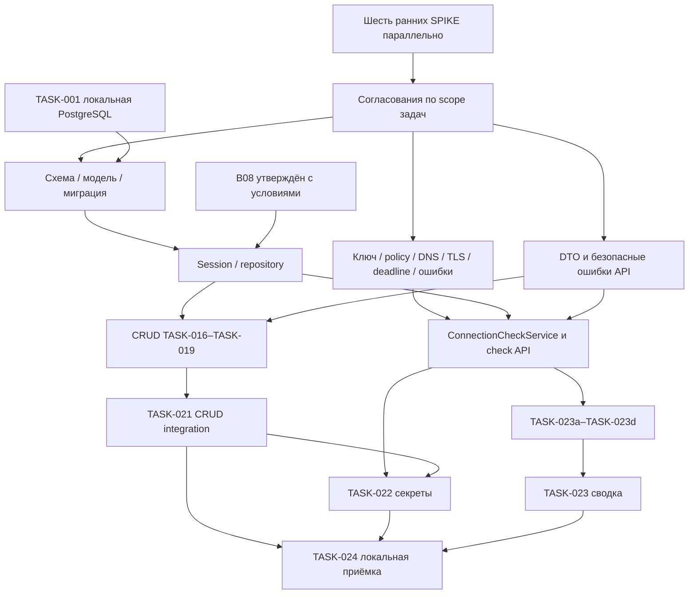

# DataFlow Manager v0.1 — Product Backlog

## 1. Overview & Scope

Статус документа: план реализации и реестр решений; не свидетельство готовности продукта. Обновлено 10.11.2026.
B05/B06/B07 утверждены владельцем с CR-015–017. TASK-002 AGREED (2026-11-10);
исследовательские результаты/DEFERRED — [§15](#15-approved-decisions-and-evidence). Production-задачи не объявлены выполненными.

Источники: [AGENTS.md](../AGENTS.md), [PRD](PRD.md) (бизнес-требования, §6–13),
[ARCHITECTURE.md](ARCHITECTURE.md) (компоненты, предложения, ADR и риски),
[README.md](../README.md), текущие `pyproject.toml`, `src/` и `tests/`.
В репозитории сейчас только FastAPI `GET /health`, демонстрационная CLI-функция и три health-теста;
конфигурация локальной PostgreSQL TASK-001 интегрирована коммитом 860aecfda49cb34fcd8f1050e771f3a7064c6f8b;
продуктовой data_sources, CRUD, миграций и production-защитных механизмов нет. В зависимостях уже FastAPI/uvicorn,
в dev — pytest/httpx; SQLAlchemy, Alembic, cryptography и psycopg ещё не добавлены.

Цель v0.1: конфигурации PostgreSQL в служебной PostgreSQL, CRUD, обратимое шифрование
пароля, явная проверка сохранённого источника с allowlist, TLS verify-full и общим бюджетом
5 секунд, loopback по умолчанию. Служебная и целевая БД имеют разные логические назначения.

Исключены: ETL-исполнение, Airflow, Spark, Kafka, расписания, веб-интерфейс,
авторизация и роли, CSV/REST-источники, мониторинг качества данных, публичное развёртывание,
история проверок и пагинация. Физическое удаление записи не обещает стирание WAL и резервных копий.

**Согласованность источников.** Противоречий, требующих изменения источников, не выявлено:
«PostgreSQL (later)» и широкое ETL-название объяснены в PRD §11. Правило AGENTS.md
не добавлять БД/Docker без запроса соблюдено: здесь только план, не разрешение запускать инфраструктуру.
Предложение архитектуры проверять подключение вообще без SQL строже запрета изменения данных
в PRD; оно сохраняется предложением до согласования, а не становится новым бизнес-требованием.
При обнаружении противоречия во время реализации остановить затронутую работу, сообщить владельцу
продукта и не переписывать PRD/архитектуру самостоятельно.

## 2. Backlog Conventions

- Четыре Epic: E1 Infrastructure & Persistence; E2 Security & Networking;
  E3 Sources API; E4 Testing & Release. В карточках используется соответствующий полный заголовок.
- TASK-001–TASK-024 — постоянные родительские ID. Для крупной TASK-023 введены полные
  дочерние карточки TASK-023a–TASK-023d. Родитель закрывается только после всех детей;
  его оценка не прибавляется к оценкам детей. Три часа — ориентир планирования,
  а не обязательное основание для декомпозиции; задачи разделяются при критической
  технической или архитектурной необходимости. Связанные этапы допускается объединять.
  Ранее записанные в карточках требования разделить только из-за превышения трёх
  часов являются рекомендациями, а не обязательными условиями.
- SPIKE-001–SPIKE-006 — исследования с ограниченным временем, без обещания положительного результата.
  Исследовательский прототип не заменяет реализацию, тесты feature-задачи или согласование решения.
- **P0** — обязательно для приёмки/защиты данных; **P1** — обеспечение воспроизводимости и эксплуатации;
  **P2** — необязательное улучшение. P2 в согласованный объём не добавлены.
  P1 также обязателен в этом бэклоге; приоритет не означает порядок или разрешение пропустить зависимость.
- **Planned** — работа запланирована без известного открытого решения, блокирующего её собственный scope;
  это не Ready. **Blocked** — есть открытое решение Bxx или незавершённая обязательная зависимость,
  указанная в Dependencies. **Specification Ready** — документ ждёт приёмки, не AGREED/реализация.
  **AGREED** — владелец принял декларативную спецификацию; документальная задача завершена,
  но схема/код/миграции не реализованы и DEFERRED-проверки не становятся выполненными.
  **Experiment PASS / DEFERRED** — принятый ограниченный исследовательский вход и отдельный остаток,
  не выполнение всех feature/релизных AC. **Merged** фиксирует интеграцию, не новый операционный DoD.
  Реализации с незавершёнными предшественниками Blocked; Planned не означает Ready.
- Dependencies — обязательные предшественники до приёмки карточки; «нет» означает отсутствие
  задач-предшественников, но не отменяет DoR. Bxx — решения/риски, не task-ID.
  Карточки и список рёбер §9 задают один граф. Дети TASK-023 предшествуют родителю, обратного ребра нет.
- Ссылки вида FR-xxx / AC-xxx.y отсылают к [нормативным формулировкам PRD §7](PRD.md#7-functional-requirements).
  Точная привязка каждого из 30 AC к работе и доказательству приведена в §12.
  T-01–T-14 — **план проверок архитектуры §9**, а не уже пройденные тесты.
- Общие DoR/DoD применяются ко всем TASK; в карточке записаны дополнительные условия.
  Согласование делает владелец продукта/технических решений; исследователь лишь предъявляет доказательства.
  Изменение статуса решения фиксируется явно, не выводится из успешного прототипа.

## 3. Definition of Ready

Для начала реализации конкретного scope: прочитан актуальный код и обязательные источники;
согласованы затрагивающие его Bxx и контракт; приняты обязательные предшественники;
есть проверяемые AC, необходимые fixtures и безопасный контролируемый стенд;
обоснованы новые зависимости и их версии; оценка реалистична и включает проверки.
Частичное исследование/черновик допускаются до Ready, но не выдаются за завершённую feature.
Неизвестные правила валидации, HTTP-коды, форматы ID и окружение не выбираются молча.

## 4. Definition of Done

Scope и минимум два локальных критерия приёмки выполнены; добавлены и **реально запущены**
тесты нового поведения, включая отрицательные пути; записаны команда, среда, версии и результат.
Сохранены бизнес-логика вне API, атомарность и безопасные ошибки; секреты не попали в Git,
ответы и обычные логи. Существующие три теста `/health` проходят: HTTP 200,
JSON `{"status": "ok"}`, Content-Type `application/json`, без БД, ключа, DNS и внешних сервисов.
Документация и трассировка соответствуют итоговой реализации, открытых блокеров своего scope нет.
Интеграционный результат не заменяется mock-тестом, недоступная среда означает непройденную проверку.
Для задач документации/исследования вместо тестов кода — проверка артефактов и доказательств;
финальная приёмка требует всех 30 AC. Commit/push требуют отдельного разрешения.

## 5. Epic Overview

| Epic | Результат | Задачи | Главные ограничения |
|---|---|---|---|
| Infrastructure & Persistence | Долговечная атомарная служебная модель | TASK-001–TASK-007; SPIKE-004 | Схема, Unicode/уникальность, Session, ресурсы ноутбука |
| Security & Networking | Шифрование и контролируемая проверка | TASK-008–TASK-014; SPIKE-001–SPIKE-003, SPIKE-005 | Ключ, фактический IP, TLS, прекращение работы за 5 секунд |
| Sources API | CRUD и check по согласованному контракту | TASK-015–TASK-020; SPIKE-006 | Форматы, безопасные ошибки, PATCH, только сохранённый ID |
| Testing & Release | Совокупные доказательства и локальная приёмка | TASK-021–TASK-024, дети TASK-023 | Не заменяет тесты feature-задач; все блокеры закрыты |

## 6. Task Summary

| ID | Название | Epic | Priority | Status | Dependencies | Блокеры решений | Оценка |
|---|---|---|---|---|---|---|---|
| TASK-001 | Локальный стенд служебной PostgreSQL | Infrastructure & Persistence | P1 | Merged | нет | нет | 2–3 часа |
| TASK-002 | Согласование схемы data_sources | Infrastructure & Persistence | P0 | AGREED | SPIKE-004, SPIKE-006 | нет открытых Bxx | 2 часа |
| TASK-003 | SQLAlchemy-модель | Infrastructure & Persistence | P0 | ACCEPTED | TASK-002 | нет открытых Bxx | 1–2 часа |
| TASK-004 | Начальная миграция Alembic | Infrastructure & Persistence | P0 | ACCEPTED | TASK-001, TASK-003 | нет открытых Bxx | 2–3 часа |
| TASK-005 | Session и транзакции | Infrastructure & Persistence | P0 | Blocked | TASK-004, TASK-005b2, TASK-005c, TASK-005e2 | B08 conditions / DoR | Родитель; оценки детей |
| TASK-006 | Repository: создание и чтение | Infrastructure & Persistence | P0 | Blocked | TASK-005 | B08 conditions | 2–3 часа |
| TASK-007 | Repository: изменение и удаление | Infrastructure & Persistence | P0 | Blocked | TASK-006 | B08 conditions | 2–3 часа |
| TASK-005a1 | DB config и PG* | Infrastructure & Persistence | P0 | ACCEPTED | TASK-004 | B08 conditions / DoR | 2–3 часа |
| TASK-005a2 | Capability gate и Engine | Infrastructure & Persistence | P0 | ACCEPTED | TASK-005a1, TASK-005a2.1, TASK-005a2.2 | B08 conditions / DoR | Родитель; оценки детей |
| TASK-005a2.1 | libpq capability gate | Infrastructure & Persistence | P0 | ACCEPTED | TASK-005a1 | B08 conditions / DoR | 2–3 часа |
| TASK-005a2.2 | Engine/sessionmaker и do_connect | Infrastructure & Persistence | P0 | ACCEPTED | TASK-005a2.1, TASK-005a2.2.2 | B08 conditions / DoR | Родитель; оценки детей |
| TASK-005a2.2.1 | Engine и sessionmaker | Infrastructure & Persistence | P0 | ACCEPTED | TASK-005a2.1 | B08 conditions / DoR | 2–3 часа |
| TASK-005a2.2.2 | do_connect и диагностика | Infrastructure & Persistence | P0 | ACCEPTED | TASK-005a2.2.1, TASK-005a2.2.2b | B08 conditions / DoR | Родитель; оценки детей |
| TASK-005a2.2.2a | Protected Engine и первый connect | Infrastructure & Persistence | P0 | ACCEPTED | TASK-005a2.2.1 | B08 conditions / DoR | 1,8–2,5 часа |
| TASK-005a2.2.2b | Pool lifecycle и повторный PG*-gate | Infrastructure & Persistence | P0 | ACCEPTED | TASK-005a2.2.2a, TASK-005a2.2.2b2 | B08 conditions / DoR | Родитель; оценки детей |
| TASK-005a2.2.2b1 | Fake DBAPI и базовый lifecycle | Infrastructure & Persistence | P0 | ACCEPTED | TASK-005a2.2.2a | B08 conditions / DoR | 1,9–2,8 часа |
| TASK-005a2.2.2b2 | Pre-ping и безопасность pool diagnostics | Infrastructure & Persistence | P0 | ACCEPTED | TASK-005a2.2.2b1, TASK-005a2.2.2b2c | B08 conditions / DoR | Родитель; оценки детей |
| TASK-005a2.2.2b2a | Failed pre-ping и replacement | Infrastructure & Persistence | P0 | ACCEPTED | TASK-005a2.2.2b1 | B08 conditions / DoR | 1,4–2,5 часа |
| TASK-005a2.2.2b2b | Ограниченный канал pool diagnostics | Infrastructure & Persistence | P0 | ACCEPTED | TASK-005a2.2.2b2a, TASK-005a2.2.2b2b2 | B08 conditions / DoR | Родитель; оценки детей |
| TASK-005a2.2.2b2b1 | Защищённый канал pool diagnostics | Infrastructure & Persistence | P0 | ACCEPTED | TASK-005a2.2.2b2a | B08 conditions / DoR | 1,8–2,9 часа |
| TASK-005a2.2.2b2b2 | Lifecycle канала pool diagnostics | Infrastructure & Persistence | P0 | ACCEPTED | TASK-005a2.2.2b2b1 | B08 conditions / DoR | 1,6–2,8 часа |
| TASK-005a2.2.2b2c | Проверка pool diagnostics и PG* | Infrastructure & Persistence | P0 | ACCEPTED | TASK-005a2.2.2b2b | B08 conditions / DoR | 1,5–2,7 часа |
| TASK-005b1 | UoW lifecycle и outcome | Infrastructure & Persistence | P0 | ACCEPTED | TASK-005b1.1, TASK-005b1.2 | B08 conditions / DoR | Родитель; оценки детей |
| TASK-005b1.1 | UoW contract model | Infrastructure & Persistence | P0 | ACCEPTED | TASK-005a2 | B08 conditions / DoR | 1,5–2,5 часа |
| TASK-005b1.2 | UoW runtime lifecycle | Infrastructure & Persistence | P0 | ACCEPTED | TASK-005b1.1 | B08 conditions / DoR | 4,1–6,2 часа |
| TASK-005b2 | UoW ошибки и безопасность | Infrastructure & Persistence | P0 | ACCEPTED | TASK-005b1 | B08 conditions / DoR | 2–3 часа |
| TASK-005c | Lifespan и health | Infrastructure & Persistence | P0 | ACCEPTED | TASK-005a2 | B08 conditions / DoR | 1–3 часа |
| TASK-005d1 | Процедура и integration fixtures | Infrastructure & Persistence | P0 | Planned | TASK-004 | B08 conditions / DoR | 2–3 часа |
| TASK-005d2 | Подготовка стенда | Infrastructure & Persistence | P0 | Blocked | TASK-005d1 | разрешение / DoR | 2–3 часа |
| TASK-005e1 | PostgreSQL: транзакции и изоляция | Infrastructure & Persistence | P0 | Blocked | TASK-005a2, TASK-005b2, TASK-005c, TASK-005d2 | разрешение / DoR | 2–3 часа |
| TASK-005e2 | Auth, pool, ресурсы и приёмка | Infrastructure & Persistence | P0 | Blocked | TASK-005e1 | разрешение / DoR | 2–3 часа |
| TASK-008 | Fernet CryptoService | Security & Networking | P0 | Blocked | SPIKE-005 | B04 | 2–3 часа |
| TASK-009 | Загрузка и валидация allowlist | Security & Networking | P0 | Blocked | SPIKE-002 | B01 | 1–2 часа |
| TASK-010 | NetworkPolicy и DNS/IP | Security & Networking | P0 | Blocked | TASK-009, SPIKE-001, SPIKE-002 | B01, B03 | 3 часа; при расширении матрицы разделить под родителем на нормализацию и resolver до старта |
| TASK-011 | PostgreSQLConnector с TLS verify-full | Security & Networking | P0 | Blocked | TASK-010, SPIKE-003 | B01, B02, B10 | Условно 1–3 часа; при превышении до старта — дочерние проверяемые карточки под TASK-011 |
| TASK-012 | Исполнитель проверки с общим дедлайном | Security & Networking | P0 | Blocked | SPIKE-001 | B03, B09 | Условно 1–3 часа; при превышении до старта — дочерние проверяемые карточки под TASK-012 |
| TASK-013 | Безопасная классификация ошибок подключения | Security & Networking | P0 | Planned | SPIKE-006 | нет открытых Bxx | 1–2 часа |
| TASK-014 | ConnectionCheckService | Security & Networking | P0 | Blocked | TASK-006, TASK-008, TASK-011, TASK-012, TASK-013 | B01, B02, B03, B04, B09, B10 | 2–3 часа |
| TASK-015 | DTO/Pydantic и безопасные ошибки API | Sources API | P0 | Blocked | TASK-002, SPIKE-006 | нет открытых Bxx | 2–3 часа |
| TASK-016 | POST /api/v1/sources | Sources API | P0 | Blocked | TASK-006, TASK-008, TASK-015 | B04, B08 conditions | 2–3 часа |
| TASK-017 | GET список и GET по ID | Sources API | P0 | Blocked | TASK-006, TASK-015 | B08 conditions | 2 часа |
| TASK-018 | PATCH источника | Sources API | P0 | Blocked | TASK-007, TASK-008, TASK-015 | B04, B08 conditions | 2–3 часа |
| TASK-019 | DELETE источника | Sources API | P0 | Blocked | TASK-007, TASK-015 | B08 conditions | 1–2 часа |
| TASK-020 | POST /api/v1/sources/{id}/check | Sources API | P0 | Blocked | TASK-014, TASK-015, TASK-018 | B01, B02, B03, B04, B09, B10 | 2–3 часа |
| TASK-021 | Интеграционные CRUD-тесты | Testing & Release | P0 | Blocked | TASK-016, TASK-017, TASK-018, TASK-019 | B04, B08 conditions | Условно 1–3 часа; при превышении до старта — дочерние проверяемые карточки под TASK-021 |
| TASK-022 | Проверки секретов и ошибок | Testing & Release | P0 | Blocked | TASK-020, TASK-021 | B04 | 2–3 часа на готовых feature-fixtures |
| TASK-023 | Интеграционные DNS/TLS/deadline-тесты | Testing & Release | P0 | Blocked | TASK-023a, TASK-023b, TASK-023c, TASK-023d | B01, B02, B03, B09, B10 | Необходимое разделение выполнено: TASK-023a–TASK-023d по 2–3 часа; отдельная сверка родителя до 1 часа |
| TASK-024 | Локальный запуск и релизная приёмка | Testing & Release | P1 | Blocked | TASK-021, TASK-022, TASK-023 | B01, B02, B03, B04, B08 conditions, B09, B10, B11 | 3 часа на готовых отчётах; иначе разделить runbook и приёмку под TASK-024 до старта |
| TASK-023a | DNS/IP и rebinding | Testing & Release | P0 | Blocked | TASK-020 | B01 | 2–3 часа |
| TASK-023b | TLS и изоляция параметров libpq | Testing & Release | P0 | Blocked | TASK-020 | B01, B02, B10 | 2–3 часа |
| TASK-023c | Общий дедлайн и lifecycle | Testing & Release | P0 | Blocked | TASK-020 | B03, B09 | 2–3 часа при готовых инъекциях SPIKE-001/TASK-012; иначе разделить до запуска |
| TASK-023d | Неизменность данных и конкурентный lifecycle | Testing & Release | P0 | Blocked | TASK-020, TASK-019 | B09, B10 | 2 часа |

## 7. Detailed Task Cards

Карточки отражают текущие статусы; будущие проверки не считаются выполненными. Общие DoR/DoD из §3–4 обязательны.
B05/B06/B07 сняты как продуктовые блокеры; зависимости и gates реализации сохраняются.

### TASK-001 — Локальный стенд служебной PostgreSQL

- **Epic:** Infrastructure & Persistence
- **Priority:** P1
- **Status:** Merged (интеграция подтверждена HEAD; операционные измерения в этом цикле не повторялись)
- **Цель:** Подготовить минимальную воспроизводимую среду хранения.
- **Scope:** Одна служебная PostgreSQL, локальные параметры доступа, отдельная тестовая БД/роль, сохранение данных и инструкция остановки. Зафиксировать доступные CPU/RAM/диск и измерить потребление. Предложить нативную установку либо один контейнер; способ и лимиты согласовать до запуска, Docker не подразумевается.
- **Out of Scope:** Kafka/Spark/Airflow; кластер, оркестратор; сетевой TLS/DNS-стенд; установка в текущей документационной работе.
- **Dependencies:** нет.
- **FR/AC:** FR-001 / AC-001.3; FR-005 / AC-005.1; FR-011 / AC-011.1. См. [PRD §7](PRD.md#7-functional-requirements) и §12 ниже.
- **Acceptance Criteria задачи:**
  1. После остановки/старта служебной БД контрольная запись сохраняется; доступ ограничен локальной средой.
  2. Инструкция воспроизводима, содержит выбранную версию PostgreSQL, фактическое потребление и порядок освобождения ресурсов; секреты не отслеживаются Git.
- **Definition of Ready:** общий DoR + Есть разрешение на конкретный способ установки/запуска и согласованные лимиты ноутбука; это операционное условие, не утверждённый выбор Docker.
- **Definition of Done:** общий DoD + Приняты инструкция и протокол запуска/перезапуска/остановки с замером ресурсов.
- **План проверки:** Локальный smoke БД, перезапуск, проверка bind и отслеживаемых файлов; T-11/T-12 в части стенда.
- **Оценка сложности:** 2–3 часа.
- **Открытые решения, блокирующие реализацию:** нет известных открытых архитектурных решений; операционные условия DoR обязательны.

### TASK-002 — Согласование схемы data_sources

- **Epic:** Infrastructure & Persistence
- **Priority:** P0
- **Status:** AGREED — [TASK-002.md](TASK-002.md).
- **Approval:** 2026-11-10, Product Owner / пользователь; утверждены итоговая спецификация и проверочные примеры на основе B05/B06/B07 и CR-015–017.
- **Acceptance review:** ACCEPTANCE RECOMMENDED; BLOCKER / MAJOR / MINOR — 0. Review документов/diff выполнен без SQL; реализация схемы не выполнялась.
- **Цель:** Зафиксировать утверждённые B05/B06/B07 и CR-015–017 в декларативной спецификации без DDL.
- **Scope:** Согласовать ID, типы/длины, непустоту, пробелы, Unicode, имена столбцов, зашифрованный пароль, наличие timestamps, ограничения и механизм уникальности; сопоставить API database и БД.
- **Out of Scope:** Создание таблицы/миграции; самовольное изменение принятых UUIDv4/timestamps/generated key; выбор sync/async Session (B08) — он не влияет на согласование схемы.
- **Dependencies:** SPIKE-004, SPIKE-006 — результаты приняты как вход; остатки DEFERRED по §15.
- **FR/AC:** FR-001 / AC-001.1–AC-001.2; FR-004 / AC-004.3; FR-007 / AC-007.1–AC-007.2; FR-008 / AC-008.1. См. [PRD §7](PRD.md#7-functional-requirements) и §12 ниже.
- **Acceptance Criteria задачи:**
  1. Согласованная таблица полей однозначно сопоставляется PRD и DTO; открытые варианты явно разрешены владельцем решения.
  2. Указаны constraint/index, collation, матрица эквивалентности имён и правила отклонения данных без добавления plaintext-поля.
- **Definition of Ready:** общий DoR + Предъявлены выводы исследований по уникальности и контракту; есть согласующий.
- **Definition of Done:** общий DoD + Принята спецификация схемы и проверочных примеров, без DDL в этой задаче.
- **План проверки:** Ревью относительно PRD §6–7 и архитектуры §3/ADR-002–003; сверка каждого поля и примеров.
- **Оценка сложности:** 2 часа.
- **Открытые решения, блокирующие реализацию:** нет открытых Bxx своего scope; предшественники и DoR сохраняются.

- **Артефакт:** [TASK-002](TASK-002.md): поля/defaults/CHECK, CR-015–017, API→DTO→DB→Error, acceptance checklist.
- **Приёмка:** оба AC и документационный DoD выполнены; владелец принял документ. D01–D05 остаются [DEFERRED](TASK-002.md#d01d05--сохранённые-технические-проверки). TASK-003 не начинается автоматически.

### TASK-003 — SQLAlchemy-модель

- **Epic:** Infrastructure & Persistence
- **Priority:** P0
- **Status:** ACCEPTED — модель принята владельцем продукта 10.11.2026.
- **Implementation:** COMPLETE в области декларативной модели и offline-тестов; CR-024 устранил MAJOR-01 в metadata.
- **Цель:** Отобразить принятую схему на SQLAlchemy 2.x.
- **Scope:** Модель и metadata; именованные принятые ограничения, отображение database, секретный токен без plaintext; обосновать SQLAlchemy-зависимость.
- **Out of Scope:** API, create_all при старте, миграция, новый слой универсальных ORM-абстракций; Session и выполнение I/O (B08) — декларативная модель и metadata проектируются независимо от sync/async.
- **Dependencies:** TASK-002.
- **FR/AC:** FR-001 / AC-001.1; FR-004 / AC-004.3; FR-007 / AC-007.1; FR-008 / AC-008.1. См. [PRD §7](PRD.md#7-functional-requirements) и §12 ниже.
- **Acceptance Criteria задачи:**
  1. Metadata соответствует принятой схеме по типам, nullable, PK и ограничениям.
  2. Модель не содержит хранимого plaintext и её диагностическое представление не раскрывает токен.
- **Definition of Ready:** общий DoR + Схема принята; выбрана совместимая версия SQLAlchemy.
- **Definition of Done:** общий DoD + Модель и тесты metadata/repr готовы; несогласованные поля не добавлены.
- **План проверки:** Unit metadata/repr, T-04/T-05 в части ORM; health-регрессия.
- **Оценка сложности:** 1–2 часа.
- **Открытые решения, блокирующие реализацию:** нет открытых Bxx своего scope; предшественники и DoR сохраняются.

- **Приёмка:** владелец принял TASK-003 после CR-024; 23 offline metadata/security-теста и три health-теста прошли. PostgreSQL-проверки не выполнялись; [D01–D05](TASK-002.md#d01d05--сохранённые-технические-проверки) остаются DEFERRED.
- **Результат:** SQLAlchemy 2.0.57, установленная транзитивная greenlet 3.5.6; `public.data_sources` содержит десять NOT NULL колонок, UUIDv4 application default, STORED `name_key` с `pg_catalog.pg_unicode_fast` и `COLLATE "C"`, именованные PK/UNIQUE/CHECK и два server defaults `transaction_timestamp()`. ORM onupdate, Engine/Session при импорте и plaintext-колонка отсутствуют. Offline-тесты проверяют metadata, не исполнение PostgreSQL.
- **CR-024 / MAJOR-01:** RESOLVED IN METADATA; `(left(name, 1) COLLATE "C") <> ' ' AND (right(name, 1) COLLATE "C") <> ' '` проверяет буквальный U+0020; collation колонки `name` не менялась. Добавлен отдельный regression-тест: 23 offline PASS, 3 health PASS. Фактическое выполнение CHECK и допустимые Unicode whitespace остаются D01.

### TASK-004 — Начальная миграция Alembic

- **Epic:** Infrastructure & Persistence
- **Priority:** P0
- **Status:** ACCEPTED — финальная приёмка владельцем 11.11.2026.
- **Implementation:** initial `0001_data_sources` и корректирующая `0002_host_policy` применены к изолированной тестовой БД; production-развёртывание не выполнялось.
- **Цель:** Создать версионируемую схему отдельно от запуска API.
- **Уточнение B07:** четыре полностью числовые непустые метки через точки допустимы только как canonical IPv4; проверить `999.1.1.1`, `256.1.1.1`, `001.2.3.4` и обычные hostname. API-validator ещё не реализован и должен следовать тому же правилу. Поскольку `0001_data_sources` уже применена в изолированной тестовой БД, история сохраняется через отдельную `0002_host_policy`.
- **Scope:** Alembic, начальная ревизия только принятой data_sources и служебная таблица версии; ручное ревью autogenerate; обосновать Alembic.
- **Out of Scope:** create_all как замена; автоматическая миграция каждым worker; объявление разрушительного downgrade безопасным.
- **Dependencies:** TASK-001, TASK-003.
- **FR/AC:** FR-001 / AC-001.2–AC-001.3; FR-005 / AC-005.1; FR-007 / AC-007.2. См. [PRD §7](PRD.md#7-functional-requirements) и §12 ниже.
- **Acceptance Criteria задачи:**
  1. Upgrade пустой PostgreSQL создаёт согласованные ограничения; повторная проверка текущей ревизии не меняет записи.
  2. Сохранённые ID/токены переживают перезапуск; ограничения реально отклоняют некорректные записи; опасность downgrade документирована.
- **Definition of Ready:** общий DoR + Доступна изолированная тестовая БД; приняты metadata и процедура работы с ревизиями.
- **Definition of Done:** общий DoD + Приложены результаты upgrade, сверки constraints и проверки данных; миграция без секретов.
- **План проверки:** T-11: upgrade, ограничения, перезапуск; проверка чистой БД и уже применённой начальной ревизии, без выдуманной предыдущей production-версии.
- **Доказательства:** offline metadata/migration и health-тесты PASS; в тестовой PostgreSQL 18.6 подтверждены revisions, каталог, CHECK/Unicode/boundary в проверенном объёме, конкурентные INSERT/UPDATE, rollback и повторный upgrade. 11.11.2026 один restart `dataflow-postgres` подтвердил неизменность revision `0002_host_policy`, схемы и четырёх синтетических строк, включая ID, name, host, timestamps, generated key и SHA-256 ciphertext. Сервер вернулся healthy; backup-копия физического кластера ранее восстановлена в изоляции. Полный disaster recovery внешней Docker-конфигурации и secret mounts не проверен; владелец принял этот остаточный риск для restart.
- **Приёмка:** владелец утвердил TASK-004 11.11.2026 после успешной persistence-проверки; оставшиеся D01–D05 не объявлены завершёнными.
- **Downgrade policy APPROVED:** автоматический разрушительный downgrade запрещён; `downgrade()` сохраняет защитное исключение. Восстановление — только по отдельно утверждённой процедуре из проверенной резервной копии. Downgrade не выполнялся. D01/D03 остаются открытыми за пределами проверенной матрицы, repository-часть D02 и D04/D05 — DEFERRED.
- **Оценка сложности:** 2–3 часа.
- **Открытые решения, блокирующие реализацию:** нет открытых Bxx своего scope; предшественники и DoR сохраняются.

### TASK-005 — Session и транзакции

- **Epic:** Infrastructure & Persistence
- **Priority:** P0
- **Status:** Blocked
- **Цель:** Обеспечить изоляцию операций и атомарный commit/rollback.
- **Scope:** Принятые [B08/M1/M2](B08-SESSION-UOW.md): sync Session, UoW, безопасная структурированная конфигурация, lifespan и ограничения ожидания БД; выполнение через дочерние карточки.
- **Out of Scope:** Совместная Session запросов; сырые SQL-ошибки клиенту; внешние подключения внутри служебной транзакции.
- **Dependencies:** TASK-004, TASK-005b2, TASK-005c, TASK-005e2; остальные дети входят транзитивно. Родитель не принимается до завершения всех детей.
- **FR/AC:** FR-001 / AC-001.3; FR-004 / AC-004.3; FR-007 / AC-007.2; FR-008 / AC-008.3. См. [PRD §7](PRD.md#7-functional-requirements) и §12 ниже.
- **Acceptance Criteria задачи:**
  1. Ошибка в середине записи откатывает всю операцию; разные запросы не используют общую Session.
  2. Session/соединения закрываются при успехе и исключении; DSN и bind-параметры не попадают в обычные логи.
- **Definition of Ready:** общий DoR + Утверждены модель исполнения, владелец commit и безопасная конфигурация БД.
- **Definition of Done:** общий DoD + Реальные PostgreSQL-тесты rollback/изоляции и закрытия ресурсов приложены.
- **План проверки:** T-11, T-05: инъекции исключений, отказ БД, конкурирующие Session; health без БД.
- **Оценка сложности:** родитель; предварительные оценки детей по 1–3 часа, при превышении разделить до старта.
- **Открытые условия:** B08 APPROVED WITH CONDITIONS; подтвердить применимые DoR, capability gate, таблицу переходов и fixtures, согласовать операции. TASK-005 не Ready.

Предварительные оценки ниже включают проверки и требуют уточнения до старта: при превышении 3 часов соответствующую карточку дополнительно разделить. Все дети относятся к Infrastructure & Persistence, P0; общий DoR/DoD обязателен, `Planned` не означает Ready. Группы 005a, 005b, 005d и 005e обозначают направления и состоят из карточек a1/a2, b1/b2, d1/d2 и e1/e2 соответственно; отдельные промежуточные карточки и рёбра для групп не создаются. FR/AC родителя: FR-001/AC-001.3, FR-004/AC-004.3, FR-007/AC-007.2, FR-008/AC-008.3; контракты — [B08/M1/M2](B08-SESSION-UOW.md). Тесты и операции с ресурсами не разрешаются самим backlog.

### TASK-005a1 — DB config и PG*

- **Epic / Priority / Status:** Infrastructure & Persistence / P0 / ACCEPTED.
- **Цель и Scope / Out of Scope:** Валидация двенадцати параметров и запрет PG*; без подключения и Engine.
- **Dependencies:** TASK-004.
- **FR/AC:** см. родительскую TASK-005; [B08/M1/M2](B08-SESSION-UOW.md).
- **Acceptance Criteria:** Поля и диапазоны валидируются без утечки; любое PG*, включая пустое, вызывает fail-closed.
- **Definition of Ready:** общий DoR + Утверждён M1, известен offline scope, получено разрешение на файлы и тесты.
- **Definition of Done:** общий DoD + Границы, окружение и безопасные коды проверены offline.
- **План проверки:** Границы, окружение и безопасные коды проверены offline.
- **Приёмка:** владелец принял TASK-005a1; предыдущий offline-запуск — 133 passed: 130 тестов конфигурации и три health-теста.
- **Оценка:** 2–3 часа; при превышении разделить до старта.
- **Разрешения:** изменение файлов и тесты отдельно; SQL, подключения, миграции, подготовка и очистка ресурсов требуют отдельных разрешений.

### TASK-005a2 — Capability gate и Engine

- **Epic / Priority / Status:** Infrastructure & Persistence / P0 / ACCEPTED.
- **Цель и Scope / Out of Scope:** Проверка поддержки libpq, Engine/sessionmaker; без реального подключения и UoW.
- **Dependencies:** TASK-005a1, TASK-005a2.1, TASK-005a2.2; родитель принимается после обеих дочерних задач.
- **FR/AC:** см. родительскую TASK-005; [B08/M1/M2](B08-SESSION-UOW.md).
- **Acceptance Criteria:** Неподдерживаемый require_auth отклонён без fallback; Engine создаётся с точными параметрами без сети.
- **Definition of Ready:** общий DoR + Готов 005a1, согласована проверка capability и разрешены файлы и offline-тесты.
- **Definition of Done:** общий DoD + Offline spy подтверждает параметры и отсутствие I/O; версии/API capability gate проверены на установленном стеке.
- **План проверки:** Offline spy подтверждает параметры и отсутствие I/O; версии/API capability gate проверены на установленном стеке.
- **Приёмка:** владелец принял задачу после принятия 005a1, 005a2.1 и 005a2.2; основание — offline-доказательства дочерних задач. Реальный PostgreSQL, SCRAM и server-side fallback остаются integration gate.
- **Оценка:** родитель; оценки дочерних карточек, без двойного подсчёта.
- **Разрешения:** изменение файлов и тесты отдельно; SQL, подключения, миграции, подготовка и очистка ресурсов требуют отдельных разрешений.

### TASK-005a2.1 — libpq capability gate

- **Epic / Priority / Status:** Infrastructure & Persistence / P0 / ACCEPTED.
- **Цель / Scope:** определить фактически загруженные реализацию и версию libpq, проверить распознавание require_auth и обеспечить безопасный отказ при неизвестности; offline-тесты.
- **Out of Scope:** Engine, sessionmaker, do_connect, подключения к PostgreSQL и проверка серверного SCRAM.
- **Dependencies:** TASK-005a1.
- **FR/AC:** родительская TASK-005; [B08/M1](B08-SESSION-UOW.md#2-m1--конфигурация-и-libpq).
- **Acceptance Criteria:** 1. Известная реализация/версия и распознанный require_auth дают поддерживаемый результат без соединения. 2. Неизвестная реализация/версия, отсутствие параметра или ошибка API дают DB_CLIENT_UNSUPPORTED без fallback и подключения.
- **Definition of Ready:** общий DoR + TASK-005a1 ACCEPTED; B08 и механизм gate согласованы; файловый scope известен; реализация и offline-тесты разрешены отдельно.
- **Definition of Done:** общий DoD + позитивные и отрицательные offline-тесты реально запущены, синтетические секреты не раскрываются, команда/версии/результат записаны.
- **План проверки:** подмена psycopg.pq.__impl__, version и Conninfo.parse; запрет сети и положительный контроль детектора утечек.
- **Приёмка:** владелец принял TASK-005a2.1; предыдущий offline-запуск — 24 passed: 21 capability gate и три health-теста. Python DBAPI spy не доказывает отсутствие произвольного native libpq I/O; распознавание require_auth не подтверждает реальную SCRAM-аутентификацию.
- **Оценка:** 2–3 часа с тестами; при превышении разделить до старта.
- **Разрешения:** файлы и offline-тесты отдельно; PostgreSQL, SQL, Docker, миграции и операции с ресурсами не разрешены карточкой.

### TASK-005a2.2 — Engine/sessionmaker и do_connect

- **Epic / Priority / Status:** Infrastructure & Persistence / P0 / ACCEPTED.
- **Цель / Scope:** Engine/sessionmaker с параметрами B08 и PG*-gate перед каждым новым физическим соединением; выполнение через дочерние карточки.
- **Out of Scope:** UoW, lifespan, repository, CRUD и PostgreSQL integration.
- **Dependencies:** TASK-005a2.1, TASK-005a2.2.2; 005a2.2.1 входит транзитивно.
- **FR/AC:** родительская TASK-005; [B08/M1](B08-SESSION-UOW.md#2-m1--конфигурация-и-libpq).
- **Acceptance Criteria:** 1. Engine/sessionmaker создаются без сети с параметрами B08. 2. Каждый новый физический connect проходит PG*-gate; при запрете DBAPI не вызывается.
- **Definition of Ready:** общий DoR + принят 005a2.1, конечные карточки оценены и отдельно разрешены.
- **Definition of Done:** общий DoD + обе конечные карточки завершены; offline-проверки параметров, replacement/pre-ping и диагностики приложены.
- **План проверки:** результаты 005a2.2.1 и 005a2.2.2; реальные серверные проверки остаются integration gate.
- **Приёмка:** владелец принял задачу по результатам 005a2.2.1 и 005a2.2.2; реальные серверные проверки остаются integration gate.
- **Оценка:** родитель; оценки детей без двойного подсчёта.
- **Разрешения:** файлы и offline-тесты отдельно; PostgreSQL и другие операции с ресурсами отдельно.

### TASK-005a2.2.1 — Engine и sessionmaker

- **Epic / Priority / Status:** Infrastructure & Persistence / P0 / ACCEPTED.
- **Цель / Scope:** URL.create, структурированные connect_args, настройки pool и изоляции, Engine/sessionmaker и offline-тесты.
- **Out of Scope:** do_connect, реальное подключение, UoW и lifespan.
- **Dependencies:** TASK-005a2.1.
- **FR/AC:** родительская TASK-005; [B08/M1](B08-SESSION-UOW.md#2-m1--конфигурация-и-libpq).
- **Acceptance Criteria:** 1. Import и создание Engine/sessionmaker не инициируют сеть или DB I/O. 2. Spy подтверждает структурированные параметры без ручного DSN.
- **Definition of Ready:** общий DoR + 005a2.1 принята, интерфейс gate согласован, файлы и тесты отдельно разрешены.
- **Definition of Done:** общий DoD + offline-тесты реально выполнены и диагностика не раскрывает синтетический пароль; команда и результат записаны.
- **План проверки:** изолированный import, заглушки DBAPI и положительный контроль детектора секретов.
- **Приёмка:** владелец принял TASK-005a2.2.1; предыдущий разрешённый offline-запуск — 31 passed: 28 session/capability и три health-теста. Промежуточный Engine блокирует подключения; offline-проверки не подтверждают произвольный native libpq I/O или реальную SCRAM-аутентификацию.
- **Оценка:** 2–3 часа с тестами; при превышении разделить до старта.
- **Разрешения:** файлы и offline-тесты отдельно; другие операции не разрешены карточкой.

### TASK-005a2.2.2 — do_connect и диагностика

- **Epic / Priority / Status:** Infrastructure & Persistence / P0 / ACCEPTED.
- **Цель / Scope:** проверка PG* перед новым физическим соединением, fail-closed и offline-проверки replacement/invalidation.
- **Out of Scope:** PostgreSQL integration, серверный SCRAM, UoW и lifespan.
- **Dependencies:** TASK-005a2.2.1, TASK-005a2.2.2b; 005a2.2.2a входит транзитивно.
- **FR/AC:** родительская TASK-005; [B08/M1](B08-SESSION-UOW.md#2-m1--конфигурация-и-libpq).
- **Acceptance Criteria:** 1. При любом PG* DBAPI connect не вызывается, возвращается безопасный DB_ENV_FORBIDDEN. 2. Проверка повторяется при новом connect после invalidation/recycle, включая путь pool_pre_ping.
- **Definition of Ready:** общий DoR + 005a2.2.1 принята; конечные карточки оценены и разрешены отдельно; применимые fixtures доступны на соответствующем этапе.
- **Definition of Done:** общий DoD + обе конечные карточки приняты; offline-тесты с положительными и отрицательными контролями реально выполнены; обычная диагностика не раскрывает синтетические секреты.
- **План проверки:** результаты 005a2.2.2a и 005a2.2.2b; реальные серверные проверки остаются integration gate.
- **Приёмка:** владелец принял задачу по offline-доказательствам 005a2.2.2a и 005a2.2.2b; реальные серверные проверки остаются integration gate.
- **Оценка:** родитель; оценки дочерних карточек без двойного подсчёта.
- **Разрешения:** файлы и offline-тесты отдельно; реальные подключения и операции с ресурсами отдельно.

### TASK-005a2.2.2a — Protected Engine и первый connect

- **Epic / Priority / Status:** Infrastructure & Persistence / P0 / ACCEPTED.
- **Цель / Scope:** Новый Engine без временного creator; do_connect регистрируется до возврата Engine и проверяет любое имя PG* перед новым физическим DBAPI connect. Сохраняются проверка PG* перед capability gate, снимок DFM_DB_*, URL.create, connect_args, pool/session settings и безопасная диагностика. Первый connect проверяется только через fake DBAPI; нет публичного переключателя защиты.
- **Out of Scope:** Реальная PostgreSQL, SCRAM, сетевой I/O, полный pool lifecycle harness, приёмка invalidation/recycle/pre-ping, UoW, lifespan, repository/CRUD и integration-тесты.
- **Промежуточное ограничение:** Engine не подключается к приложению и не используется с реальной БД до успешного завершения TASK-005a2.2.2b.
- **Dependencies:** TASK-005a2.2.1.
- **FR/AC:** родительская TASK-005; [B08/M1](B08-SESSION-UOW.md#2-m1--конфигурация-и-libpq).
- **Acceptance Criteria:** 1. Engine создаётся без подключения и не передаётся вызывающей стороне до регистрации do_connect; публичного отключения защиты нет. 2. При любом PG*, включая неизвестное имя и пустое значение, возвращается DB_ENV_FORBIDDEN и DBAPI не вызывается; при чистом окружении fake DBAPI получает точные согласованные аргументы и проверенный служебный context.
- **Definition of Ready:** общий DoR + 005a2.2.1 ACCEPTED; механизм регистрации и offline spy согласованы; файлы и offline-тесты отдельно разрешены.
- **Definition of Done:** общий DoD + offline-тесты первого connect, порядка регистрации, параметров, отрицательных путей и безопасной диагностики реально выполнены; ранее принятые capability/Engine и health-тесты не ослаблены; команда, версии и результат записаны.
- **План проверки:** spy фактической DBAPI-точки с положительным контролем, запрет сети, PGHOSTADDR/неизвестное/пустое PG*, fault injection регистрации и положительный контроль обнаружения секрета.
- **Приёмка:** владелец принял TASK-005a2.2.2a; предыдущий разрешённый offline-запуск — 41 passed: 38 session/capability и три health-теста; одно предупреждение Starlette о совместимости HTTPX. Fake DBAPI не подтверждает реальную SCRAM-аутентификацию или pool lifecycle; замечание MINOR к положительному контролю журнала PG*-сценария сохранено для следующей разрешённой работы с тестами.
- **Ограничения доказательств:** fake DBAPI не доказывает реальное подключение, серверный SCRAM, отсутствие произвольного native I/O или поведение replacement пула.
- **Файловый scope:** src/dataflow_manager/db/session.py и tests/unit/test_db_session.py; остальные файлы вне scope.
- **Оценка:** разработка 0,6–0,8 часа; offline-тесты 0,8–1,1 часа; безопасность и регрессия 0,4–0,6 часа; итого 1,8–2,5 часа.
- **Разрешения:** файлы и offline-тесты отдельно; PostgreSQL, SQL, Docker, миграции и операции с ресурсами не разрешены карточкой.

### TASK-005a2.2.2b — Pool lifecycle и повторный PG*-gate

- **Epic / Priority / Status:** Infrastructure & Persistence / P0 / ACCEPTED.
- **Цель / Scope:** Управляемый fake DBAPI/pool harness; проверки первого и повторного checkout, invalidation, recycle и replacement после failed pre-ping; повторный PG*-gate, безопасная диагностика и регрессия принятых компонентов.
- **Out of Scope:** Реальная PostgreSQL/SQL, серверный SCRAM, lifespan, UoW, repository/CRUD, миграции и изменение B08.
- **Dependencies:** TASK-005a2.2.2a, TASK-005a2.2.2b2; 005a2.2.2b1 входит транзитивно.
- **FR/AC:** родительская TASK-005; [B08/M1](B08-SESSION-UOW.md#2-m1--конфигурация-и-libpq).
- **Acceptance Criteria:** 1. Успешный fake checkout и повторный checkout живого соединения отличимы от новой физической попытки; invalidation, recycle и failed pre-ping вызывают replacement с повторным PG*-gate. 2. Запрещённое PG* при каждой новой попытке даёт DB_ENV_FORBIDDEN без вызова DBAPI; диагностика не раскрывает синтетические секреты, достижимые ошибки cleanup не скрывают первичную ошибку.
- **Definition of Ready:** общий DoR + 005a2.2.2a принята; конечные задачи оценены и отдельно разрешены; применимые fixtures и security gate определяются на соответствующем этапе.
- **Definition of Done:** общий DoD + обе конечные задачи приняты; offline-проверки каждого lifecycle-сценария и положительные контроли реально выполнены; capability, Engine/sessionmaker и health-регрессия пройдены; команда, версии и результат записаны.
- **План проверки:** результаты 005a2.2.2b1 и 005a2.2.2b2; риск pool logger и замечание MINOR закрываются в 005a2.2.2b2.
- **Приёмка:** владелец принял задачу по результатам 005a2.2.2b1 и 005a2.2.2b2; ограничения fake DBAPI и реального сервера сохраняются.
- **Ограничения доказательств:** fake pool/DBAPI не подтверждает реальную PostgreSQL, SCRAM, серверный fallback или произвольный native I/O.
- **Файловый scope:** src/dataflow_manager/db/session.py и tests/unit/test_db_session.py; остальные файлы вне scope.
- **Оценка:** родитель; оценки детей без двойного подсчёта.
- **Разрешения:** файлы и offline-тесты отдельно; PostgreSQL, SQL, Docker, миграции и операции с ресурсами не разрешены карточкой.

### TASK-005a2.2.2b1 — Fake DBAPI и базовый lifecycle

- **Epic / Priority / Status:** Infrastructure & Persistence / P0 / ACCEPTED.
- **Цель / Scope:** Управляемые fake DBAPI, connection и cursor; первый checkout, возврат и повторный checkout живого соединения, invalidation и recycle без реального sleep; повторный PG*-gate и счётчики фактической подменённой DBAPI-точки.
- **Out of Scope:** Реальная сеть/PostgreSQL/SQL, серверный SCRAM, failed pre-ping/replacement, устранение и приёмка безопасности pool logger, UoW, lifespan, repository/CRUD и миграции.
- **Ограничение:** Только синтетические данные и offline harness. Engine не подключается к приложению и реальной БД. Задача не подтверждает безопасность pool logger и не закрывает MAJOR.
- **Dependencies:** TASK-005a2.2.2a.
- **FR/AC:** родительская TASK-005; [B08/M1](B08-SESSION-UOW.md#2-m1--конфигурация-и-libpq).
- **Acceptance Criteria:** 1. Первый и повторный checkout различают создание нового и использование живого fake connection; invalidation и recycle инициируют новый physical connect через do_connect. 2. При запрещённом PG* новая попытка возвращает DB_ENV_FORBIDDEN до fake DBAPI; счётчики и положительный контроль подтверждают наблюдаемый путь без реальной сети и SQL.
- **Definition of Ready:** общий DoR + 005a2.2.2a ACCEPTED; fake DBAPI и безопасное тестовое наблюдение pool определены; незакрытый риск pool logger не приводит к выводу секретов в ходе тестов; файлы и offline-тесты отдельно разрешены.
- **Definition of Done:** общий DoD + offline-тесты checkout, invalidation, recycle и PG*-gate реально выполнены; capability/Engine/health-регрессия сохранена; команда, версии и результат записаны.
- **План проверки:** подмена фактического DBAPI до Engine, положительные контроли, искусственное старение pool record без sleep, счётчики gate/connect, синтетические данные и fault injection.
- **Приёмка:** владелец принял TASK-005a2.2.2b1; предыдущий разрешённый offline-запуск — 52 passed: 49 session/capability/pool и три health-теста. Проверены первый и повторный checkout, invalidation, recycle и повторный PG*-gate. Инициализация диалекта частично подменена; recycle-тест зависит от внутреннего API SQLAlchemy. MAJOR по pool logger и MINOR по диагностике PG* остаются для TASK-005a2.2.2b2. При документальной фиксации тесты повторно не запускались.
- **Ограничения доказательств:** Fake DBAPI не подтверждает реальный PostgreSQL, серверный SCRAM, native I/O, failed pre-ping или безопасность pool logger.
- **Файловый scope:** src/dataflow_manager/db/session.py и tests/unit/test_db_session.py; остальные файлы вне scope.
- **Оценка:** разработка 0,3–0,45 часа; test doubles 0,6–0,9 часа; offline-тесты 0,55–0,75 часа; безопасность 0,2–0,3 часа; регрессия 0,15–0,2 часа; запас 0,1–0,2 часа; итого 1,9–2,8 часа.
- **Разрешения:** файлы и offline-тесты отдельно; реальные подключения, SQL, Docker, миграции и операции с ресурсами не разрешены карточкой.

### TASK-005a2.2.2b2 — Pre-ping и безопасность pool diagnostics

- **Epic / Priority / Status:** Infrastructure & Persistence / P0 / ACCEPTED.
- **Цель / Scope:** Failed pre-ping, распознавание disconnect и replacement с повторным PG*-gate; безопасная диагностика pool logger, достижимые ошибки cleanup, положительные контроли и регрессия ранее принятых TASK-005a2.*.
- **Out of Scope:** Реальная сеть/PostgreSQL/SQL, серверный SCRAM, lifespan, UoW, repository/CRUD, миграции и изменение B08/M1/M2.
- **Dependencies:** TASK-005a2.2.2b1, TASK-005a2.2.2b2c; 005a2.2.2b2a и 005a2.2.2b2b входят транзитивно.
- **FR/AC:** родительская TASK-005; [B08/M1](B08-SESSION-UOW.md#2-m1--конфигурация-и-libpq).
- **Acceptance Criteria:** 1. Failed pre-ping приводит к распознанному disconnect и replacement через повторный PG*-gate; при запрещённом PG* DBAPI count не увеличивается. 2. При INFO и достижимых ERROR-путях pool logger обычная диагностика не раскрывает синтетические секреты, raw exception или traceback; риск MAJOR устранён либо закрыт нормативно обоснованным и согласованным механизмом. Положительный контроль журнала PG*-сценария закрывает зафиксированный MINOR.
- **Definition of Ready:** общий DoR + 005a2.2.2b1 принята; конечные карточки оценены и отдельно разрешены; механизм диагностического канала и применимые fixtures обосновываются для соответствующей конечной задачи.
- **Definition of Done:** общий DoD + все конечные карточки приняты; offline-тесты failed pre-ping/replacement, PG*-gate, INFO/ERROR pool logger, достижимого cleanup, положительных контролей и полной регрессии реально выполнены; MAJOR и MINOR закрыты доказательствами; команда, версии и результат записаны.
- **План проверки:** результаты 005a2.2.2b2a, 005a2.2.2b2b и 005a2.2.2b2c; реальные серверные проверки остаются integration gate.
- **Приёмка:** владелец принял задачу по результатам принятых 005a2.2.2b2a, 005a2.2.2b2b и 005a2.2.2b2c; MAJOR и MINOR закрыты в offline-scope по доказательствам 005a2.2.2b2c.
- **Ограничения доказательств:** Offline harness не подтверждает реальный PostgreSQL, серверный SCRAM/fallback, произвольный native I/O или поведение произвольного стороннего кода и handler.
- **Файловый scope:** предварительно src/dataflow_manager/db/session.py и tests/unit/test_db_session.py; при необходимости другого файла требуется отдельное согласование.
- **Оценка:** родитель; оценки конечных карточек без двойного подсчёта.
- **Разрешения:** файлы и offline-тесты отдельно; PostgreSQL, SQL, Docker, миграции и операции с ресурсами не разрешены карточкой.

### TASK-005a2.2.2b2a — Failed pre-ping и replacement

- **Epic / Priority / Status:** Infrastructure & Persistence / P0 / ACCEPTED.
- **Цель / Scope:** Расширить существующий fake DBAPI/pool harness для успешного и failed pre-ping, распознанного disconnect, invalidation и replacement; проверить повторный PG*-gate и счётчики fake DBAPI.
- **Out of Scope:** Реальная сеть/PostgreSQL/SQL, серверный SCRAM, реализация или приёмка безопасности pool logger, lifespan, UoW, repository/CRUD и миграции.
- **Ограничение:** Только синтетические данные. Engine не подключается к приложению или реальной БД; задача не закрывает MAJOR по pool logger или MINOR по диагностике PG*.
- **Dependencies:** TASK-005a2.2.2b1.
- **FR/AC:** родительская TASK-005; [B08/M1](B08-SESSION-UOW.md#2-m1--конфигурация-и-libpq).
- **Acceptance Criteria:** 1. Повторный checkout живого fake connection проходит успешный ping без нового physical connect; failed ping распознаётся как disconnect, старое соединение инвалидируется, replacement проходит do_connect. 2. При запрещённом PG*, включая неизвестное имя и пустое значение, replacement возвращает DB_ENV_FORBIDDEN до fake DBAPI; положительные контроли и счётчики подтверждают путь.
- **Definition of Ready:** общий DoR + 005a2.2.2b1 ACCEPTED; расширение harness и безопасное тестовое наблюдение определены; файлы и offline-тесты отдельно разрешены.
- **Definition of Done:** общий DoD + offline-тесты ping/disconnect/replacement и отрицательных PG*-сценариев реально выполнены; прежние capability/Engine/pool и health-проверки сохранены; команда, версии и результат записаны.
- **План проверки:** fake psycopg.Error и broken/closed, счётчики ping/gate/connect, положительный контроль replacement и запрет настоящего DBAPI.
- **Приёмка:** владелец принял TASK-005a2.2.2b2a по результатам независимого Final Acceptance Review. Предыдущий разрешённый offline-запуск: 59 passed, 0 failed, 0 skipped, 1 warning — 56 session/capability/pool и 3 health-теста. Проверены successful/failed pre-ping, automatic invalidation, replacement через do_connect, повторный PG*-gate и negative control. MAJOR по pool logger остаётся открытым до b2b/b2c; MINOR по отсутствию отдельного spy повторного чтения DFM_DB_* — до b2c. При документальной фиксации тесты повторно не запускались.
- **Ограничения доказательств:** Подменённая инициализация диалекта и fake DBAPI не подтверждают реальный PostgreSQL, SCRAM, server fallback или безопасность pool logger.
- **Файловый scope:** предварительно tests/unit/test_db_session.py и при необходимости src/dataflow_manager/db/session.py; остальные файлы вне scope.
- **Оценка:** разработка и test doubles 0,4–0,6 часа; offline-тесты 0,7–1,2 часа; безопасность, регрессия и запас 0,3–0,7 часа; итого 1,4–2,5 часа.
- **Разрешения:** файлы и offline-тесты отдельно; реальные подключения, SQL, Docker, миграции и операции с ресурсами не разрешены карточкой.

### TASK-005a2.2.2b2b — Ограниченный канал pool diagnostics

- **Epic / Priority / Status:** Infrastructure & Persistence / P0 / ACCEPTED.
- **Цель / Scope:** Реализовать для служебного pool согласованную границу диагностического канала: в обычные журналы поступают только фиксированные безопасные категории; исходные исключения сохраняются для внутренней обработки SQLAlchemy.
- **Out of Scope:** Защита от произвольных сторонних handlers или кода в том же процессе; новые публичные DB_*-коды; реальная сеть/PostgreSQL/SQL, lifespan, UoW, repository/CRUD и миграции.
- **Dependencies:** TASK-005a2.2.2b2a, TASK-005a2.2.2b2b2.
- **FR/AC:** родительская TASK-005; [B08/M1](B08-SESSION-UOW.md#2-m1--конфигурация-и-libpq).
- **Acceptance Criteria:** 1. Механизм ограничивает диагностический канал служебного pool до публикации Engine и не меняет disconnect detection, invalidation или приоритет исходной ошибки. 2. Offline-проверки выбранного механизма не обнаруживают raw exception, traceback или синтетический секрет в обычном журнале; другие Engine не затронуты в согласованной конфигурации.
- **Definition of Ready:** общий DoR + 005a2.2.2b2a ACCEPTED; конкретный механизм, handlers/propagation, безопасные категории, жизненный цикл канала и влияние на другие Engine обоснованы; файловый scope и оценка ≤3 часа отдельно согласованы; файлы и offline-тесты отдельно разрешены.
- **Definition of Done:** общий DoD + механизм и его offline-тесты реально выполнены; INFO и достижимые ERROR/cleanup-пути проверены с положительными контролями; команда, версии и ограничения записаны. Закрытие MAJOR подтверждается отдельной задачей 005a2.2.2b2c.
- **План проверки:** синтетические ошибки в invalidation и cleanup, наблюдение обычных handlers, проверка msg/args/exc_info/stack_info и отсутствия воздействия на другой Engine; сохранение внутреннего disconnect path.
- **Приёмка:** владелец принял родительскую задачу после независимой проверки её AC/DoD и принятия 005a2.2.2b2b1 и 005a2.2.2b2b2. Основание — предыдущие разрешённые offline-протоколы 67 и 79 passed; при документальной фиксации тесты повторно не запускались. Fake DBAPI, подменённая инициализация dialect и ограниченные конкурентные сценарии не подтверждают реальный сервер, SCRAM/fallback или отсутствие всех гонок. Проектные MAJOR по pool diagnostics и MINOR по PG*-диагностике остаются открыты до независимой приёмки 005a2.2.2b2c.
- **Ограничения доказательств:** Не обещается защита от произвольных сторонних handlers или изменения logging другими компонентами процесса; реальный сервер и driver diagnostics остаются integration gate.
- **Файловый scope:** предварительно src/dataflow_manager/db/session.py и tests/unit/test_db_session.py; необходимость конфигурации logging или других файлов требует отдельного согласования.
- **Оценка:** родитель; оценки конечных карточек без двойного подсчёта.
- **Разрешения:** файлы и offline-тесты отдельно; изменения других файлов, PostgreSQL, SQL, Docker и миграции отдельно.

### TASK-005a2.2.2b2b1 — Защищённый канал pool diagnostics

- **Epic / Priority / Status:** Infrastructure & Persistence / P0 / ACCEPTED.
- **Цель / Scope:** Создать один фиксированный защищённый диагностический канал служебных QueuePool на срок процесса и установить его до создания и публикации Engine.
- **Архитектурный контракт:** pool_logging_name=dataflow_manager_service, фактический logger sqlalchemy.pool.impl.QueuePool.dataflow_manager_service, echo_pool=False, DEBUG, propagate=False, один собственный handler без filters. Адаптер не форматирует и не пересылает исходный LogRecord; в обычный журнал создаются только фиксированные POOL_DIAGNOSTIC_EVENT/INFO и POOL_DIAGNOSTIC_ERROR/ERROR. Сырые поля, исключения, параметры, connection repr, URL, DSN, credentials и окружение запрещены.
- **Out of Scope:** Реальная сеть/PostgreSQL/SQL, серверный SCRAM, произвольная модификация logging другим кодом, lifespan, UoW, repository/CRUD, миграции и новые публичные DB_*-коды.
- **Dependencies:** TASK-005a2.2.2b2a.
- **FR/AC:** родительская TASK-005; B08/M1.
- **Acceptance Criteria:** 1. Канал настраивается или проверяется идемпотентно под приватным lock до create_engine; конфликт чужих handlers, filters или конфигурации приводит к DB_ENGINE_INIT_FAILED без публикации Engine. 2. INFO и достижимый ERROR не передают raw LogRecord, секрет или traceback обычным handlers и root; положительный контроль обнаруживает секрет на незащищённом пути. 3. Два Engine не меняют logging других Engine; базовый dispose/recreate сохраняет защиту. 4. do_connect, PG*-gate, disconnect detection, invalidation и приоритет первичной ошибки сохраняются; cleanup failure фиксируется безопасно.
- **Definition of Ready:** общий DoR + 005a2.2.2b2a ACCEPTED; архитектурный контракт и offline-проверки определены; файлы и тесты отдельно разрешены.
- **Definition of Done:** общий DoD + offline-тесты INFO/ERROR, root propagation, положительного контроля, двух Engine, базового dispose/recreate, конфликта и cleanup реально выполнены; прежние capability/Engine/pool и health-проверки сохранены; команда и результат записаны.
- **План проверки:** fake DBAPI/pool harness; синтетические секреты; наблюдение msg/args/exc_info/stack_info у обычных handlers; fault injection настройки и cleanup.
- **Приёмка:** владелец принял задачу по результатам независимого Acceptance Review. Предыдущий разрешённый offline-запуск: 67 passed, 0 failed, 0 skipped, 1 warning; при документальной фиксации тесты повторно не запускались. При непроверенном pool намеренно пропущенный dispose фиксируется внутренним POOL_CLEANUP_SKIPPED_UNVERIFIED и не считается успешной очисткой; DB_DISPOSE_FAILED сохраняется для ошибки вызванного dispose. Offline harness использует fake DBAPI и подменённую первичную инициализацию dialect; test fixture зависит от внутреннего API pytest.
- **Ограничения доказательств:** Engine не подключается к приложению или реальной БД. MAJOR по pool logger и MINOR по spy DFM_DB_* остаются открыты до TASK-005a2.2.2b2c; offline-проверки не подтверждают реальный сервер или произвольный сторонний код.
- **Файловый scope:** src/dataflow_manager/db/session.py и tests/unit/test_db_session.py; остальные файлы требуют отдельного согласования.
- **Оценка:** реализация 0,7–1,1 часа; offline-тесты 0,6–0,9 часа; безопасность 0,3–0,5 часа; регрессия 0,2–0,4 часа; итого 1,8–2,9 часа.
- **Разрешения:** изменение файлов и запуск offline-тестов отдельно; реальные подключения, SQL, Docker, миграции и операции изменения Git не разрешены карточкой.

### TASK-005a2.2.2b2b2 — Lifecycle канала pool diagnostics

- **Epic / Priority / Status:** Infrastructure & Persistence / P0 / ACCEPTED.
- **Цель / Scope:** Проверить и при необходимости доработать жизненный цикл общего защищённого канала при dispose/recreate, активном старом pool, повторной и конкурентной настройке.
- **Out of Scope:** Реальная сеть/PostgreSQL/SQL, серверный SCRAM, произвольная модификация logging другим кодом, lifespan, UoW, repository/CRUD, миграции и новые публичные DB_*-коды.
- **Dependencies:** TASK-005a2.2.2b2b1.
- **FR/AC:** родительская TASK-005; B08/M1.
- **Acceptance Criteria:** 1. Старый активный и новый pool после dispose/recreate используют защищённый канал до завершения процесса; handler не удаляется. 2. Повторная и конкурентная настройка не создаёт дубликатов handlers и не меняет чужие Engine; конфликт приводит к безопасному отказу. 3. Расширенные INFO/ERROR и propagation не раскрывают raw exception, traceback или синтетические секреты. 4. Fault injection cleanup сохраняет первичную ошибку и безопасную вторичную диагностику; disconnect и PG*-gate сохраняются.
- **Definition of Ready:** общий DoR + 005a2.2.2b2b1 ACCEPTED; lifecycle, тестовые наблюдатели и достижимые cleanup-пути определены; файлы и offline-тесты отдельно разрешены.
- **Definition of Done:** общий DoD + offline-тесты dispose/recreate, старого pool, конкурентности, идемпотентности, INFO/ERROR и cleanup реально выполнены; регрессия capability/Engine/do_connect/pool/health сохранена; команда и результат записаны.
- **План проверки:** существующий fake DBAPI/pool harness, два Engine, синтетические секреты, root и несколько обычных handlers, счётчики собственных handlers и fault injection.
- **Приёмка:** владелец принял задачу по результатам независимого Acceptance Review. Предыдущий разрешённый offline-запуск: 79 passed, 0 failed, 0 skipped, 1 warning; при документальной фиксации тесты повторно не запускались. Проверены dispose/recreate, активный старый pool, конкурентная настройка, конфликты и безопасная диагностика в пределах fake DBAPI harness. Подменённая первичная инициализация dialect и сценарий с четырьмя потоками не доказывают поведение реального сервера или отсутствие всех гонок. Отдельные INFO/ERROR для каждого из старого и нового pool, disabled и неверная идентичность handler требуют дополнительного внимания в TASK-005a2.2.2b2c.
- **Ограничения доказательств:** Engine не подключается к приложению или реальной БД. MAJOR и MINOR остаются открыты до независимой TASK-005a2.2.2b2c; произвольный сторонний код и реальный сервер вне offline-доказательств.
- **Файловый scope:** src/dataflow_manager/db/session.py и tests/unit/test_db_session.py; остальные файлы требуют отдельного согласования.
- **Оценка:** реализация 0,4–0,7 часа; offline-тесты 0,6–1,0 часа; безопасность 0,3–0,6 часа; регрессия 0,3–0,5 часа; итого 1,6–2,8 часа.
- **Разрешения:** изменение файлов и запуск offline-тестов отдельно; реальные подключения, SQL, Docker, миграции и операции изменения Git не разрешены карточкой.

### TASK-005a2.2.2b2c — Проверка pool diagnostics и PG*

- **Epic / Priority / Status:** Infrastructure & Persistence / P0 / ACCEPTED.
- **Цель / Scope:** Проверить согласованный ограниченный канал на достижимых INFO/ERROR/cleanup-путях pool logger; закрыть MAJOR и MINOR по положительному контролю журнала и диагностике PG*-сценариев; выполнить регрессию TASK-005a2.*.
- **Out of Scope:** Реальная сеть/PostgreSQL/SQL, серверный SCRAM/fallback, произвольные сторонние handlers, lifespan, UoW, repository/CRUD и миграции.
- **Dependencies:** TASK-005a2.2.2b2b.
- **FR/AC:** родительская TASK-005; [B08/M1](B08-SESSION-UOW.md#2-m1--конфигурация-и-libpq).
- **Acceptance Criteria:** 1. Положительный контроль обнаруживает синтетические секреты в контролируемых небезопасных INFO/ERROR-записях, а согласованный канал исключает их, raw exception и traceback из обычной диагностики. 2. Для каждого PG*-сценария окружение не изменяется проверяемой операцией, DBAPI count не увеличивается, синтетические пароль и значение PG* не попадают в безопасную диагностику; достижимая ошибка cleanup не скрывает первичную.
- **Definition of Ready:** общий DoR + 005a2.2.2b2b ACCEPTED; критерии наблюдения handlers и доступные cleanup-пути определены; файлы и offline-тесты отдельно разрешены; оценка не превышает трёх часов.
- **Definition of Done:** общий DoD + offline-тесты INFO/ERROR, propagation, положительных контролей, PG*, cleanup и полной регрессии реально выполнены; MAJOR и MINOR закрыты доказательствами; команда, версии и ограничения записаны.
- **План проверки:** уникальные синтетические маркеры пароля, PG-значений и исключений; положительный контроль до очистки буфера; наблюдение обычных handlers и счётчиков fake DBAPI; fault injection cleanup.
- **Приёмка:** владелец принял задачу после независимого Final Acceptance Review и закрыл MAJOR по pool diagnostics и MINOR по PG*/DFM_DB_* в проверенном offline-scope. Предыдущий разрешённый запуск: 88 passed, 0 failed, 0 skipped, 1 warning; при документальной фиксации тесты повторно не запускались. Использованы fake DBAPI, подменённая первичная инициализация dialect и fixture с внутренним API pytest; конкурентные проверки ограничены. Реальные PostgreSQL, SCRAM, server-side fallback, произвольный native I/O и сторонний код не подтверждены.
- **Ограничения доказательств:** Offline-тесты не подтверждают реальный сервер, SCRAM/fallback, произвольный native I/O или поведение произвольного стороннего кода и handlers.
- **Файловый scope:** предварительно tests/unit/test_db_session.py и при необходимости src/dataflow_manager/db/session.py; иные файлы только по отдельному согласованию.
- **Оценка:** подготовка сценариев 0,2–0,4 часа; offline-тесты 0,7–1,2 часа; безопасность, регрессия и запас 0,6–1,1 часа; итого 1,5–2,7 часа.
- **Разрешения:** файлы и offline-тесты отдельно; реальные подключения, SQL, Docker, миграции и другие файлы отдельно.

### TASK-005b1 — UoW lifecycle и outcome

- **Epic / Priority / Status:** Infrastructure & Persistence / P0 / ACCEPTED.
- **Цель и Scope / Out of Scope:** Одноразовая UoW и immutable outcome; без repository и публичного SQL.
- **Dependencies:** TASK-005b1.1 и TASK-005b1.2; TASK-005a2 входит транзитивно.
- **FR/AC:** см. родительскую TASK-005; [B08/M1/M2](B08-SESSION-UOW.md).
- **Acceptance Criteria:** Только явный одноразовый commit; переходы и outcome сохраняются после CLOSED.
- **Definition of Ready:** общий DoR + TASK-005a2 ACCEPTED; утверждена таблица M2; конечные карточки оценены и отдельно разрешены.
- **Definition of Done:** общий DoD + обе дочерние задачи приняты; собственные AC проверены; offline fault injection покрывает состояния, begin, выход без commit и повторное использование.
- **План проверки:** Offline fault injection покрывает состояния, begin, выход без commit и повторное использование.
- **Приёмка:** владелец принял родителя после приёмки b1.1 и b1.2 и проверки собственных AC/DoD. Основание — offline-доказательства дочерних задач; реальные PostgreSQL и физическое состояние транзакций остаются integration conditions.
- **Оценка:** родитель; оценки детей без двойного подсчёта.
- **Разрешения:** изменение файлов и тесты отдельно; SQL, подключения, миграции, подготовка и очистка ресурсов требуют отдельных разрешений.

### TASK-005b1.1 — UoW contract model

- **Epic / Priority / Status:** Infrastructure & Persistence / P0 / ACCEPTED.
- **Description / Scope:** Закрытые enum, immutable outcome, безопасное исключение, внутренняя модель состояний и классификация по B08/M2.
- **Out of Scope:** Session, Engine, context manager, runtime lifecycle, repository, SQL и FastAPI.
- **Dependencies:** TASK-005a2.
- **Acceptance Criteria:** Модель допускает только утверждённые значения; outcome immutable; безопасное исключение не раскрывает произвольный текст; создание и импорт не выполняют DB I/O.
- **Definition of Ready:** общий DoR + TASK-005a2 ACCEPTED, B08/M2 уточнён и утверждён; файлы и offline-тесты отдельно разрешены.
- **Definition of Done:** unit-тесты enum, фаз, outcome, safe exception и отсутствия DB I/O выполнены; неполный runtime API не опубликован.
- **Integration conditions:** Реальные PostgreSQL, транзакции, SQLSTATE и server behavior не подтверждаются.
- **План проверки:** enum и отрицательные значения, код–фаза, UNKNOWN, immutable outcome, str/repr/args, отсутствие Session и Engine.
- **Приёмка:** владелец принял контрактную модель по независимому review исправлений согласованности outcome и изоляции импорта. Предыдущий offline-протокол реализации: 165 passed, 0 failed, 0 skipped, 1 warning; при review тесты повторно не запускались. Runtime UoW и реальные PostgreSQL/транзакции этой приёмкой не подтверждены.
- **Файловый scope:** src/dataflow_manager/db/uow.py и tests/unit/test_db_uow.py.
- **Оценка:** 1,5–2,5 часа.
- **Разрешения:** изменение файлов и offline-тесты отдельно; реальные подключения и SQL отдельно.

### TASK-005b1.2 — UoW runtime lifecycle

- **Epic / Priority / Status:** Infrastructure & Persistence / P0 / ACCEPTED.
- **Description / Scope:** Session ownership, context manager, begin, explicit commit, mark_failed, rollback/close, CLOSED, outcome и базовые ошибки по B08/M2.
- **Out of Scope:** repository, публичный SQL API, FastAPI integration, реальная БД и B06 mapping.
- **Dependencies:** TASK-005b1.1.
- **Acceptance Criteria:** Основной lifecycle и Q10–Q14 соблюдены; перехваченная ошибка не разрешает повторный commit; cleanup и первичная ошибка сохраняются.
- **Definition of Ready:** общий DoR + TASK-005b1.1 ACCEPTED; B08/M2 утверждён; fake Session, файлы и offline-тесты отдельно разрешены.
- **Definition of Done:** offline-тесты lifecycle, одиночных ошибок, перехвата, основных прерываний и outcome выполнены; скрытые подключения и SQL отсутствуют.
- **Integration conditions:** Реальный PostgreSQL и физическое состояние транзакции остаются за integration-задачами.
- **План проверки:** fake Session/sessionmaker, порядок операций, повторное использование, перехваченные ошибки, BaseException, outcome и health.
- **Приёмка:** владелец принял задачу по результатам независимого review. Предыдущий разрешённый offline-протокол: 172 passed, 0 failed, 0 skipped, 1 warning; при review тесты повторно не запускались. Fake Session не подтверждает поведение реального сервера или физическое освобождение соединения.
- **Файловый scope:** src/dataflow_manager/db/uow.py и tests/unit/test_db_uow.py.
- **Оценка:** 4,1–6,2 часа с тестами; объединённый цикл b1.2/b2 допускается по разрешению владельца, без изменения условий окончательной приёмки.
- **Разрешения:** изменение файлов и offline-тесты отдельно; реальные подключения и SQL отдельно.

### TASK-005b2 — UoW ошибки и безопасность

- **Epic / Priority / Status:** Infrastructure & Persistence / P0 / ACCEPTED.
- **Цель и Scope / Out of Scope:** Составные ошибки и безопасный канал; без repository и B06 mapping.
- **Dependencies:** TASK-005b1.
- **FR/AC:** см. родительскую TASK-005; [B08/M1/M2](B08-SESSION-UOW.md).
- **Acceptance Criteria:** Первичная ошибка не теряется при ошибках rollback/close; успешный commit и close failure различимы.
- **Definition of Ready:** общий DoR + Готов 005b1; согласован канал M2; разрешены файлы и offline-тесты.
- **Definition of Done:** общий DoD + Offline fault injection и положительный контроль обнаружения секретов покрывают составные ошибки.
- **План проверки:** Offline fault injection и положительный контроль обнаружения секретов покрывают составные ошибки.
- **Приёмка:** владелец принял задачу после приёмки b1 по независимому review составных ошибок и безопасной диагностики. Доказательства ограничены предыдущим offline-протоколом и fake Session; отдельный тест успешного commit с ошибкой close и прерыванием диагностики остаётся MINOR. Реальные PostgreSQL, SCRAM и server-side поведение не подтверждены.
- **Уточнение MINOR:** адресный offline-тест успешного commit, ошибки close и прерывания диагностики выполнен для KeyboardInterrupt, SystemExit и GeneratorExit: 3 passed. Пробел покрытия технически устранён по self-review; независимое подтверждение ожидается.
- **Закрытие MINOR:** независимый review подтвердил адресный тест и предыдущий протокол 3 passed; владелец закрыл замечание в проверенном offline-scope. Реальная PostgreSQL и физическое освобождение соединений не подтверждены.
- **Оценка:** 2–3 часа; ориентир, без обязательной декомпозиции по длительности.
- **Разрешения:** изменение файлов и тесты отдельно; SQL, подключения, миграции, подготовка и очистка ресурсов требуют отдельных разрешений.

### TASK-005c — Lifespan и health

- **Epic / Priority / Status:** Infrastructure & Persistence / P0 / ACCEPTED.
- **Цель и Scope / Out of Scope:** FastAPI lifespan и Q08; без DB-dependent маршрутов и readiness API.
- **Dependencies:** TASK-005a2.
- **FR/AC:** см. родительскую TASK-005; [B08/M1/M2](B08-SESSION-UOW.md).
- **Acceptance Criteria:** Невалидная конфигурация не создаёт Engine и не блокирует health; shutdown освобождает созданный Engine.
- **Definition of Ready:** общий DoR + Готов 005a2; разрешены файлы и offline-тесты.
- **Definition of Done:** общий DoD + Offline startup/shutdown и исходные три свойства health проверены без сети.
- **План проверки:** Offline startup/shutdown и исходные три свойства health проверены без сети.
- **Приёмка:** владелец принял задачу по результатам независимого review. Предыдущий offline-протокол lifespan/health: 11 passed; общая регрессия: 183 passed, 0 failed, 0 skipped, 1 warning. Повторные lifecycle, degraded startup, dispose и безопасная диагностика подтверждены в пределах offline-тестов; реальная PostgreSQL и server-side поведение не проверялись.
- **Оценка:** 1–3 часа; при превышении разделить до старта.
- **Разрешения:** изменение файлов и тесты отдельно; SQL, подключения, миграции, подготовка и очистка ресурсов требуют отдельных разрешений.

### TASK-005d1 — Процедура и integration fixtures

- **Epic / Priority / Status:** Infrastructure & Persistence / P0 / Planned.
- **Цель и Scope / Out of Scope:** Процедура изоляции и fixtures; без создания БД и автоматической очистки.
- **Dependencies:** TASK-004.
- **FR/AC:** см. родительскую TASK-005; [B08/M1/M2](B08-SESSION-UOW.md).
- **Acceptance Criteria:** Определены отдельные роли и уникальные ресурсы; fixtures не зависят от результатов прежнего запуска.
- **Definition of Ready:** общий DoR + Согласованы B08/G04 и конкретный scope документов/fixtures; разрешены файлы и offline-тесты.
- **Definition of Done:** общий DoD + Процедура и offline-проверки fixtures готовы; ресурсы TASK-004 исключены.
- **План проверки:** Процедура и offline-проверки fixtures готовы; ресурсы TASK-004 исключены.
- **Оценка:** 2–3 часа; при превышении разделить до старта.
- **Разрешения:** изменение файлов и тесты отдельно; SQL, подключения, миграции, подготовка и очистка ресурсов требуют отдельных разрешений.

### TASK-005d2 — Подготовка стенда

- **Epic / Priority / Status:** Infrastructure & Persistence / P0 / Blocked.
- **Цель и Scope / Out of Scope:** Отдельно разрешённые БД/роли/схема и учёт; без автоматического удаления.
- **Dependencies:** TASK-005d1.
- **FR/AC:** см. родительскую TASK-005; [B08/M1/M2](B08-SESSION-UOW.md).
- **Acceptance Criteria:** Подготовлена task005_<unique_id> с отдельными ролями; ресурсы и разрешённые действия учтены.
- **Definition of Ready:** общий DoR + Готов 005d1; владелец отдельно разрешил конкретные ресурсы, подключения, SQL и миграции.
- **Definition of Done:** общий DoD + Приложены результаты подготовки, прав и проверки профиля, сохранены ресурсы.
- **План проверки:** Приложены результаты подготовки, прав и проверки профиля, сохранены ресурсы.
- **Оценка:** 2–3 часа на готовом стенде; при превышении разделить до старта.
- **Разрешения:** изменение файлов и тесты отдельно; SQL, подключения, миграции, подготовка и очистка ресурсов требуют отдельных разрешений.

### TASK-005e1 — PostgreSQL: транзакции и изоляция

- **Epic / Priority / Status:** Infrastructure & Persistence / P0 / Blocked.
- **Цель и Scope / Out of Scope:** Реальные transaction tests; без CRUD API и repository.
- **Dependencies:** TASK-005a2, TASK-005b2, TASK-005c, TASK-005d2.
- **FR/AC:** см. родительскую TASK-005; [B08/M1/M2](B08-SESSION-UOW.md).
- **Acceptance Criteria:** Явный commit сохраняет данные, отсутствие commit/ошибка откатывает; независимые физические соединения изолированы.
- **Definition of Ready:** общий DoR + Завершены 005a2, 005b2, 005c, 005d2; отдельно разрешены подключения, SQL и тесты.
- **Definition of Done:** общий DoD + Приложены команды, версии и реальные результаты PostgreSQL rollback/изоляции.
- **План проверки:** Приложены команды, версии и реальные результаты PostgreSQL rollback/изоляции.
- **Оценка:** 2–3 часа на готовом стенде; при превышении разделить до старта.
- **Разрешения:** изменение файлов и тесты отдельно; SQL, подключения, миграции, подготовка и очистка ресурсов требуют отдельных разрешений.

### TASK-005e2 — Auth, pool, ресурсы и приёмка

- **Epic / Priority / Status:** Infrastructure & Persistence / P0 / Blocked.
- **Цель и Scope / Out of Scope:** Реальные auth/fallback, pool и ресурсы; без удаления тестовых ресурсов.
- **Dependencies:** TASK-005e1.
- **FR/AC:** см. родительскую TASK-005; [B08/M1/M2](B08-SESSION-UOW.md).
- **Acceptance Criteria:** SCRAM и отсутствие fallback проверены; pool timeout и освобождение ресурсов наблюдаются.
- **Definition of Ready:** общий DoR + Готов 005e1; отдельно разрешены подключения, SQL и тесты; конфигурация стенда известна.
- **Definition of Done:** общий DoD + Приложен отчёт с фактическими результатами и ограничениями; подтверждены T-05/T-11 в scope TASK-005.
- **План проверки:** Приложен отчёт с фактическими результатами и ограничениями; подтверждены T-05/T-11 в scope TASK-005.
- **Оценка:** 2–3 часа на готовом стенде; при превышении разделить до старта.
- **Разрешения:** изменение файлов и тесты отдельно; SQL, подключения, миграции, подготовка и очистка ресурсов требуют отдельных разрешений.

### TASK-006 — Repository: создание и чтение

- **Epic:** Infrastructure & Persistence
- **Priority:** P0
- **Status:** Blocked
- **Цель:** Реализовать минимальное хранилище create/list/get.
- **Scope:** Repository принимает уже зашифрованный токен; создание, все записи без пагинации, поиск по ID; конфликт только принятого ограничения переводится в доменную ошибку.
- **Out of Scope:** Шифрование внутри repository, API-ответ ORM целиком, сетевые проверки.
- **Dependencies:** TASK-005.
- **FR/AC:** FR-001 / AC-001.1–AC-001.2; FR-002 / AC-002.1–AC-002.2; FR-003 / AC-003.1–AC-003.2. См. [PRD §7](PRD.md#7-functional-requirements) и §12 ниже.
- **Acceptance Criteria задачи:**
  1. Создание/чтение возвращают согласованные данные; пустой список и отсутствующий ID различимы от сбоя БД.
  2. Параллельные INSERT Name/name в разных транзакциях дают одну запись и один конфликт; прочие IntegrityError не объявляются конфликтом имени.
- **Definition of Ready:** общий DoR + Приняты ограничения и контракт результата repository; готова БД.
- **Definition of Done:** общий DoD + Добавлены и запущены PostgreSQL-тесты чтения, create, конкурентного commit и отказа.
- **План проверки:** T-01/T-02/T-11, реальная конкуренция с барьером; параметризованные запросы без конкатенации SQL.
- **Оценка сложности:** 2–3 часа.
- **Условия:** B08 APPROVED WITH CONDITIONS; применимые проверки и зависимости остаются обязательными.

### TASK-007 — Repository: изменение и удаление

- **Epic:** Infrastructure & Persistence
- **Priority:** P0
- **Status:** Blocked
- **Цель:** Поддержать атомарные обновления и физическое удаление.
- **Scope:** Обновление принятых полей, сохранение ID, отсутствие password означает неизменный токен; rename-конфликт, неизвестный ID; DELETE строки вместе с токеном.
- **Out of Scope:** Soft delete, удаление данных целевой БД, собственный commit посреди операции.
- **Dependencies:** TASK-006.
- **FR/AC:** FR-004 / AC-004.1–AC-004.3; FR-005 / AC-005.1–AC-005.2; FR-007 / AC-007.2. См. [PRD §7](PRD.md#7-functional-requirements) и §12 ниже.
- **Acceptance Criteria задачи:**
  1. Неуспешный PATCH/rename не оставляет частичных изменений; конкурентное переименование соблюдает уникальность.
  2. DELETE удаляет строку и токен; повторный/неизвестный ID даёт отсутствие; опущенный токен при PATCH не перезаписывается.
- **Definition of Ready:** общий DoR + Готовы create/read и границы транзакции; принята семантика изменений.
- **Definition of Done:** общий DoD + Реальные тесты update/delete, rollback и конкурирующих rename проходят.
- **План проверки:** T-02/T-03/T-11; проверка таблицы и перезапуска после DELETE.
- **Оценка сложности:** 2–3 часа.
- **Условия:** B08 APPROVED WITH CONDITIONS; применимые проверки и зависимости остаются обязательными.

### TASK-008 — Fernet CryptoService

- **Epic:** Security & Networking
- **Priority:** P0
- **Status:** Blocked
- **Цель:** Дать безопасный encrypt/decrypt с внешним ключом.
- **Scope:** cryptography/Fernet с обоснованием зависимости; принятый источник ключа, валидация, безопасные ошибки, интерфейс CryptoService для CRUD и check.
- **Out of Scope:** Хеширование вместо шифрования, ключ в БД/Git, автогенерация при каждом старте, plaintext fallback.
- **Dependencies:** SPIKE-005.
- **FR/AC:** FR-008 / AC-008.1–AC-008.3; FR-004 / AC-004.2. См. [PRD §7](PRD.md#7-functional-requirements) и §12 ниже.
- **Acceptance Criteria задачи:**
  1. Round-trip возвращает исходное значение; сохраняемый токен отличен от plaintext; неверный ключ/токен приводит к безопасной ошибке.
  2. Отсутствующий/невалидный ключ не допускает сохранения plaintext и не раскрывается в ответах/логах; health не зависит от ключа.
- **Definition of Ready:** общий DoR + Приняты канал, валидация и процедуры ключа; согласован интерфейс сервиса.
- **Definition of Done:** общий DoD + Unit-тесты encrypt/decrypt/ошибок и тест ключа вне отслеживаемых файлов выполнены.
- **План проверки:** T-04/T-05: уникальные тестовые секреты, повреждённый токен, потеря/неверный ключ.
- **Оценка сложности:** 2–3 часа.
- **Открытые решения, блокирующие реализацию:** B04.

### TASK-009 — Загрузка и валидация allowlist

- **Epic:** Security & Networking
- **Priority:** P0
- **Status:** Blocked
- **Цель:** Загрузить локальную разрешающую политику без разрешения по умолчанию.
- **Scope:** Принятый формат/путь/права и обновление локального файла; проверка структуры, допустимых имён/IP/диапазонов/портов по решению; снимок для проверки.
- **Out of Scope:** Автоматическое принятие TOML/CIDR/портов/hot reload; удалённая загрузка; allow-all.
- **Dependencies:** SPIKE-002.
- **FR/AC:** FR-009 / AC-009.1 / AC-009.4. См. [PRD §7](PRD.md#7-functional-requirements) и §12 ниже.
- **Acceptance Criteria задачи:**
  1. Отсутствующая, пустая, неприменимая или некорректная политика не разрешает подключение.
  2. Валидные записи интерпретируются строго по принятой схеме; ошибка загрузки безопасна; снимок консистентен по принятому правилу обновления.
- **Definition of Ready:** общий DoR + Утверждены формат, семантика, путь и lifecycle политики.
- **Definition of Done:** общий DoD + Unit-тесты валидных/невалидных файлов и отказа по умолчанию выполнены.
- **План проверки:** T-07: таблица файлов, ошибка чтения, неподдерживаемые значения; без реальных исходящих соединений.
- **Оценка сложности:** 1–2 часа.
- **Открытые решения, блокирующие реализацию:** B01.

### TASK-010 — NetworkPolicy и DNS/IP

- **Epic:** Security & Networking
- **Priority:** P0
- **Status:** Blocked
- **Цель:** Проверять фактическое назначение в общем бюджете.
- **Scope:** Принятая нормализация hostname/IP, DNS A/AAAA, IPv4/IPv6/mapped, mixed-ответы, ограничения resolver; выдача проверенного назначения без повторного непроверенного DNS.
- **Out of Scope:** Принятие pinning/одной попытки без согласования; peer-check как единственная защита; новый бюджет на каждый IP.
- **Dependencies:** TASK-009, SPIKE-001, SPIKE-002.
- **FR/AC:** FR-009 / AC-009.1–AC-009.4; FR-006 / AC-006.3. См. [PRD §7](PRD.md#7-functional-requirements) и §12 ниже.
- **Acceptance Criteria задачи:**
  1. Запрещённый host/IP и разрешённое имя с запрещённым адресом не получают разрешённое назначение.
  2. Mixed DNS, смена ответа, IP-литералы и ошибка resolver обрабатываются по принятой матрице без разрешения непроверенного IP; остаток времени не увеличивается.
- **Definition of Ready:** общий DoR + Приняты нормализация, DNS/IP-механизм, матрица и интерфейс ограничиваемого resolver.
- **Definition of Done:** общий DoD + Unit-проверки адресов/гонок и тест интеграции с исполнителем добавлены; стендовое доказательство дополнительно в TASK-023a.
- **План проверки:** T-07/T-08, тест двойника resolver и отсутствия выдачи запрещённого назначения, реальный контролируемый DNS по доступной fixture.
- **Оценка сложности:** 3 часа; при расширении матрицы разделить под родителем на нормализацию и resolver до старта.
- **Открытые решения, блокирующие реализацию:** B01, B03.

### TASK-011 — PostgreSQLConnector с TLS verify-full

- **Epic:** Security & Networking
- **Priority:** P0
- **Status:** Blocked
- **Цель:** Открывать только защищённое соединение к проверенному адресу.
- **Scope:** psycopg 3/libpq с обоснованием версии/сборки, принятые TLS/CA и IP-привязка, закрытие соединения; защита конечных параметров от conninfo, PG*, service/passfile, GSS и сторонней аутентификации.
- **Out of Scope:** Downgrade TLS; пользовательские overrides; автоматическое принятие варианта без SQL; универсальный framework коннекторов.
- **Dependencies:** TASK-010, SPIKE-003.
- **FR/AC:** FR-010 / AC-010.1–AC-010.2; FR-006 / AC-006.4; FR-009 / AC-009.3. См. [PRD §7](PRD.md#7-functional-requirements) и §12 ниже.
- **Acceptance Criteria задачи:**
  1. Доверенный CA и правильное имя дают соединение; неверное имя/CA/срок и сервер без TLS дают отказ без downgrade.
  2. Фактическое назначение не подменяется ambient/conninfo; ресурсы закрыты; пользовательские данные/схема не меняются, SQL только по принятому решению B10.
- **Definition of Ready:** общий DoR + Полный scope с тестами оценён; при превышении 3 часов до старта оформлены дочерние проверяемые карточки согласно условию оценки ниже. Приняты trust store, сборка, host/hostaddr либо доказанная альтернатива, аутентификация и B10.
- **Definition of Done:** общий DoD + Тесты параметров, закрытия и локальные TLS smoke выполнены; полная adversarial-матрица остаётся TASK-023b.
- **План проверки:** T-06/T-10/T-14; сертификаты и наблюдение сокетов на контролируемом стенде.
- **Оценка сложности:** Условно 1–3 часа при принятых выводах SPIKE-003 и готовых TLS-fixtures; это не безусловная оценка всего объёма. Если при уточнении полный scope вместе с тестами превышает 3 часа, до старта реализации разбить задачу на дочерние проверяемые карточки с сохранением родительского ID TASK-011: выделить TLS и изоляцию параметров. У каждой дочерней карточки должны быть собственные AC, план проверки, оценка 1–3 часа и явные зависимости; синхронизировать Summary и граф. Родитель принимается только после всех дочерних карточек.
- **Открытые решения, блокирующие реализацию:** B01, B02, B10.

### TASK-012 — Исполнитель проверки с общим дедлайном

- **Epic:** Security & Networking
- **Priority:** P0
- **Status:** Blocked
- **Цель:** Прекращать всю попытку и освобождать ресурсы за общий бюджет.
- **Scope:** Принятый механизм исполнения и монотонный deadline, запуск/IPC/cleanup внутри бюджета, отмена клиента, отказ при лимите ресурсов без бесконечной очереди; безопасная передача секрета.
- **Out of Scope:** Утверждение процесса/spawn/terminate как уже выбранных; thread timeout как доказательство остановки; только быстрый HTTP-ответ.
- **Dependencies:** SPIKE-001.
- **FR/AC:** FR-006 / AC-006.3–AC-006.4; FR-008 / AC-008.3. См. [PRD §7](PRD.md#7-functional-requirements) и §12 ниже.
- **Acceptance Criteria задачи:**
  1. Зависший исполнитель реально завершает работу и освобождает ресурсы в пределах 5 секунд от принятой границы; поздний success невозможен.
  2. Обрыв IPC/отмена клиента/исчерпание лимита не оставляют фоновых попыток и секретов в аргументах, файлах или логах.
- **Definition of Ready:** общий DoR + Полный scope с тестами оценён; при превышении 3 часов до старта оформлены дочерние проверяемые карточки согласно условию оценки ниже. Есть стендовые доказательства SPIKE-001 и приняты граница бюджета, cleanup, лимит/отмена.
- **Definition of Done:** общий DoD + Unit и доступные реальные lifecycle-тесты выполнены; финальная совокупная проверка в TASK-023c.
- **План проверки:** T-09/T-05: fake-clock для оркестрации плюс реальное зависание, crash и отмена; проверка процессов/сокетов.
- **Оценка сложности:** Условно 1–3 часа при подтверждённом в SPIKE-001 механизме и готовых lifecycle-fixtures; это не безусловная оценка всего объёма. Если при уточнении полный scope вместе с тестами превышает 3 часа, до старта реализации разбить задачу на дочерние проверяемые карточки с сохранением родительского ID TASK-012: выделить исполнение и отмену/освобождение ресурсов. У каждой дочерней карточки должны быть собственные AC, план проверки, оценка 1–3 часа и явные зависимости; синхронизировать Summary и граф. Родитель принимается только после всех дочерних карточек.
- **Открытые решения, блокирующие реализацию:** B03, B09.

### TASK-013 — Безопасная классификация ошибок подключения

- **Epic:** Security & Networking
- **Priority:** P0
- **Status:** Planned — B05 принят; не Ready без контролируемых driver-fixtures
- **Цель:** Преобразовать причины отказа в согласованный безопасный каталог.
- **Scope:** Классификатор по надёжным признакам драйвера/стадии, общий безопасный fallback, разрешённые лог-метаданные; различение результата проверки и ошибки операции.
- **Out of Scope:** Выдача сырого driver message/DSN; переутверждение B05; угадывание по тексту как единственная гарантия.
- **Dependencies:** SPIKE-006.
- **FR/AC:** FR-006 / AC-006.2; FR-008 / AC-008.3; FR-009 / AC-009.1; FR-010 / AC-010.2. См. [PRD §7](PRD.md#7-functional-requirements) и §12 ниже.
- **Acceptance Criteria задачи:**
  1. Каждый принятый класс имеет стабильную безопасную категорию и unit-пример; неизвестное исключение имеет безопасный fallback.
  2. Секрет в exception/notice не оказывается в JSON/обычных логах; ошибка чтения конфигурации не маскируется failed попытки.
- **Definition of Ready:** общий DoR + Принят каталог и контракт ошибок, определены устойчивые признаки выбранного драйвера.
- **Definition of Done:** общий DoD + Табличные тесты классификации и утечек реально выполнены.
- **План проверки:** T-05/T-13/T-14: синтетические и драйверные исключения с тестовым секретом.
- **Оценка сложности:** 1–2 часа.
- **Открытые решения, блокирующие реализацию:** нет открытых Bxx своего scope; предшественники и DoR сохраняются.

### TASK-014 — ConnectionCheckService

- **Epic:** Security & Networking
- **Priority:** P0
- **Status:** Blocked
- **Цель:** Оркестрировать явную проверку актуально сохранённого источника.
- **Scope:** Загрузка снимка, закрытие служебной транзакции до сети, decrypt, policy/connector в исполнителе, классификация; принятая конкуренция PATCH/DELETE, без истории и изменения конфигурации.
- **Out of Scope:** Проверка несохранённого тела; endpoint-код; история, автоматическая проверка CRUD.
- **Dependencies:** TASK-006, TASK-008, TASK-011, TASK-012, TASK-013.
- **FR/AC:** FR-006 / AC-006.1–AC-006.5; FR-008 / AC-008.1; FR-009 / AC-009.1–AC-009.4; FR-010 / AC-010.1–AC-010.2. См. [PRD §7](PRD.md#7-functional-requirements) и §12 ниже.
- **Acceptance Criteria задачи:**
  1. Существующий ID использует сохранённый снимок и актуальный пароль; success/failed не создают историю и не меняют поля записи.
  2. Неизвестный ID/недоступная конфигурация/ошибка ключа не начинают сетевую попытку; все завершения соблюдают deadline и cleanup.
- **Definition of Ready:** общий DoR + Приняты внутренние интерфейсы, граница измерений и конкурентная семантика.
- **Definition of Done:** общий DoD + Service unit-тесты, тест новой пароли после PATCH и интеграция компонентов выполнены.
- **План проверки:** T-04/T-09/T-10/T-13; spy resolver/connector, сценарии PATCH/DELETE во время проверки по решению B09.
- **Оценка сложности:** 2–3 часа.
- **Открытые решения, блокирующие реализацию:** B01, B02, B03, B04, B09, B10.

### TASK-015 — DTO/Pydantic и безопасные ошибки API

- **Epic:** Sources API
- **Priority:** P0
- **Status:** Blocked
- **Цель:** Закрепить согласованный публичный контракт без секретов.
- **Scope:** Create/Patch/Read DTO, ID, отсутствие поля против null, правила полей/порта, единый безопасный error mapping; обработка FastAPI validation input/ctx и неожиданных исключений.
- **Out of Scope:** Самостоятельное принятие UUID, timestamps, HTTP-кодов, null/пустого PATCH, extra=forbid; ORM напрямую в ответе.
- **Dependencies:** TASK-002, SPIKE-006.
- **FR/AC:** FR-001 / AC-001.1; FR-004 / AC-004.1–AC-004.3; FR-007 / AC-007.1–AC-007.2; FR-008 / AC-008.3. См. [PRD §7](PRD.md#7-functional-requirements) и §12 ниже.
- **Acceptance Criteria задачи:**
  1. DTO ответов не содержат password/токен/ключ; ошибки валидации указывают проблемное поле без входного секрета.
  2. Создание и переданные PATCH-значения валидируются одинаково; опущенный password различим от явно переданного null/пустого значения по принятому контракту.
- **Definition of Ready:** общий DoR + Приняты форматы и вся матрица спорных входов; схема БД согласована.
- **Definition of Done:** общий DoD + Контрактные/validation тесты и безопасный fallback исключений выполнены.
- **План проверки:** T-03/T-05: границы 1/65535, 0/65536, нецелые порты, отсутствующие/пустые строки, ID, password во входе/ctx.
- **Оценка сложности:** 2–3 часа.
- **Открытые решения, блокирующие реализацию:** нет открытых Bxx своего scope; предшественники и DoR сохраняются.

### TASK-016 — POST /api/v1/sources

- **Epic:** Sources API
- **Priority:** P0
- **Status:** Blocked
- **Цель:** Сохранить конфигурацию через тонкий API и SourceService.
- **Scope:** Маршрут, SourceService.create, валидация DTO, encrypt до записи, транзакция, безопасный ответ и конфликты.
- **Out of Scope:** Проверка доступности/allowlist во время CRUD; бизнес-логика в маршруте.
- **Dependencies:** TASK-006, TASK-008, TASK-015.
- **FR/AC:** FR-001 / AC-001.1–AC-001.3; FR-007 / AC-007.1–AC-007.2; FR-008 / AC-008.1–AC-008.3. См. [PRD §7](PRD.md#7-functional-requirements) и §12 ниже.
- **Acceptance Criteria задачи:**
  1. Валидный запрос создаёт одну долговечную запись с зашифрованным паролем и возвращает несекретные поля/ID по принятому контракту.
  2. Дубликат/невалидные поля/сбой БД или ключа не оставляют частичной записи; resolver/connector не вызываются.
- **Definition of Ready:** общий DoR + Готовы repository, CryptoService и DTO; приняты HTTP/JSON.
- **Definition of Done:** общий DoD + API-тесты успешного/ошибочного create и service-тесты атомарности выполнены.
- **План проверки:** T-01/T-02/T-04/T-05/T-13; PostgreSQL и перезапуск приложения; конкуренция дополнительно TASK-021.
- **Оценка сложности:** 2–3 часа.
- **Открытые решения и условия:** B04; B08 APPROVED WITH CONDITIONS, проверки остаются обязательными.

### TASK-017 — GET список и GET по ID

- **Epic:** Sources API
- **Priority:** P0
- **Status:** Blocked
- **Цель:** Возвращать все несекретные параметры без сетевых проверок.
- **Scope:** Тонкие GET, SourceService.list/get; полный и пустой список, неизвестный/удалённый/некорректный ID, безопасный отказ БД.
- **Out of Scope:** Пагинация, decrypt при чтении, DNS источника.
- **Dependencies:** TASK-006, TASK-015.
- **FR/AC:** FR-002 / AC-002.1–AC-002.2; FR-003 / AC-003.1–AC-003.2; FR-008 / AC-008.3. См. [PRD §7](PRD.md#7-functional-requirements) и §12 ниже.
- **Acceptance Criteria задачи:**
  1. Список содержит все ID/несекретные поля либо пустой успешный список; чтение по ID возвращает актуальную запись без секретов.
  2. Неизвестный/удалённый ID, неверный формат и сбой БД различаются по контракту; отказ БД не выглядит пустым списком; сетевых вызовов нет.
- **Definition of Ready:** общий DoR + Приняты DTO, форматы ID и ошибок; repository готов.
- **Definition of Done:** общий DoD + API/service-тесты чтения с spy сетевых зависимостей и проверкой утечек выполнены.
- **План проверки:** T-01/T-05/T-13; тест чтения при недоступном ключе по принятому контракту без decrypt.
- **Оценка сложности:** 2 часа.
- **Условия:** B08 APPROVED WITH CONDITIONS; применимые проверки и зависимости остаются обязательными.

### TASK-018 — PATCH источника

- **Epic:** Sources API
- **Priority:** P0
- **Status:** Blocked
- **Цель:** Атомарно изменить конфигурацию с сохранением ID.
- **Scope:** SourceService.patch, маршрут, разделение missing/null/empty; новый допустимый пароль encrypt, отсутствующий оставляет токен; конфликт rename и rollback.
- **Out of Scope:** Автоматическая проверка источника, PUT, произвольная нормализация пароля.
- **Dependencies:** TASK-007, TASK-008, TASK-015.
- **FR/AC:** FR-004 / AC-004.1–AC-004.3; FR-007 / AC-007.1–AC-007.2; FR-008 / AC-008.1–AC-008.3. См. [PRD §7](PRD.md#7-functional-requirements) и §12 ниже.
- **Acceptance Criteria задачи:**
  1. Корректные несекретные изменения видны с прежним ID; опущенный password оставляет прежний токен; connector/resolver не вызываются.
  2. Новый допустимый пароль хранится зашифрованно; невалидные поля/конфликт/ошибка ключа или БД не меняют запись частично.
- **Definition of Ready:** общий DoR + Приняты все спорные PATCH-входы и готов транзакционный сервис.
- **Definition of Done:** общий DoD + Unit/API/PG-тесты missing/new password, rollback и rename выполнены; применение нового пароля при check проверяется TASK-014/TASK-020.
- **План проверки:** T-02/T-03/T-04/T-05/T-11/T-13; сравнить строку БД до/после отказа.
- **Оценка сложности:** 2–3 часа.
- **Открытые решения и условия:** B04; B08 APPROVED WITH CONDITIONS, проверки остаются обязательными.

### TASK-019 — DELETE источника

- **Epic:** Sources API
- **Priority:** P0
- **Status:** Blocked
- **Цель:** Удалить запись и её токен из рабочего хранилища.
- **Scope:** Тонкий DELETE и SourceService.delete, физическое удаление, безопасные ответы на отсутствие/сбой.
- **Out of Scope:** Soft delete, обещание стирания backups/WAL, подключение к целевой БД.
- **Dependencies:** TASK-007, TASK-015.
- **FR/AC:** FR-005 / AC-005.1–AC-005.2; FR-008 / AC-008.3. См. [PRD §7](PRD.md#7-functional-requirements) и §12 ниже.
- **Acceptance Criteria задачи:**
  1. После успеха строка/токен отсутствуют в БД, списке и get, в том числе после перезапуска.
  2. Повторное удаление сообщает отсутствие, сбой БД не подтверждает успех; целевой connector/resolver не вызываются.
- **Definition of Ready:** общий DoR + Приняты HTTP-код/тело DELETE и ошибки; repository готов.
- **Definition of Done:** общий DoD + API/PG-тесты успешного, повторного и неуспешного удаления выполнены.
- **План проверки:** T-01/T-11/T-13: запрос таблицы, рестарт, сетевые spies.
- **Оценка сложности:** 1–2 часа.
- **Условия:** B08 APPROVED WITH CONDITIONS; применимые проверки и зависимости остаются обязательными.

### TASK-020 — POST /api/v1/sources/{id}/check

- **Epic:** Sources API
- **Priority:** P0
- **Status:** Blocked
- **Цель:** Опубликовать проверку только сохранённого источника.
- **Scope:** Маршрут вызывает ConnectionCheckService; согласованное отклонение произвольных параметров, safe success/failed, различение ошибки операции, отмена HTTP.
- **Out of Scope:** Тело с несохранённым источником; история и изменение конфигурации.
- **Dependencies:** TASK-014, TASK-015, TASK-018.
- **FR/AC:** FR-006 / AC-006.1–AC-006.5; FR-008 / AC-008.3; FR-009 / AC-009.1–AC-009.4; FR-010 / AC-010.1–AC-010.2. См. [PRD §7](PRD.md#7-functional-requirements) и §12 ниже.
- **Acceptance Criteria задачи:**
  1. Сохранённый ID после PATCH использует актуальный пароль; success/failed соответствуют принятому JSON/HTTP и не меняют источник.
  2. Неверный/неизвестный ID, неподдерживаемое тело и ошибка загрузки не запускают сеть; failed имеет безопасную категорию; отмена освобождает работу по принятому правилу.
- **Definition of Ready:** общий DoR + Сервис и DTO готовы; согласованы контракт, лимит исполнителей и отмена.
- **Definition of Done:** общий DoD + API-тесты успеха, каждого класса отказа и ошибки операции выполнены.
- **План проверки:** T-05/T-09/T-13; реальные комплексные DNS/TLS/deadline доказательства дополнительно TASK-023.
- **Оценка сложности:** 2–3 часа.
- **Открытые решения, блокирующие реализацию:** B01, B02, B03, B04, B09, B10.

### TASK-021 — Интеграционные CRUD-тесты

- **Epic:** Testing & Release
- **Priority:** P0
- **Status:** Blocked
- **Цель:** Проверить сквозную долговечность и конкурентную атомарность.
- **Scope:** Дополнить feature-тесты общими PostgreSQL fixtures, end-to-end CRUD, рестарт API, параллельные create/rename и отказ служебной БД.
- **Out of Scope:** Замена PostgreSQL на SQLite; перенос всех unit/API-тестов сюда; сетевой check-стенд.
- **Dependencies:** TASK-016, TASK-017, TASK-018, TASK-019.
- **FR/AC:** FR-001 / AC-001.1–AC-001.3; FR-002 / AC-002.1–AC-002.2; FR-003 / AC-003.1–AC-003.2; FR-004 / AC-004.1–AC-004.3; FR-005 / AC-005.1–AC-005.2; FR-007 / AC-007.1–AC-007.2. См. [PRD §7](PRD.md#7-functional-requirements) и §12 ниже.
- **Acceptance Criteria задачи:**
  1. Полный lifecycle и пустой/отсутствующий ID проходят на реальной БД; после рестарта создание сохраняется, удаление остаётся физическим.
  2. Конкурентные Name/name и rename с реальными commit дают один допустимый результат; ошибки не оставляют частичных данных; CRUD не обращается к источнику.
- **Definition of Ready:** общий DoR + Полный scope с тестами оценён; при превышении 3 часов до старта оформлены дочерние проверяемые карточки согласно условию оценки ниже. Feature-тесты уже выполнены; приняты схема и контракт; доступна изолированная БД.
- **Definition of Done:** общий DoD + Есть воспроизводимый отчёт T-01/T-02/T-03/T-11/T-13 без пропуска обязательной конкуренции.
- **План проверки:** Два независимых соединения/барьер, инъекция ошибки между flush/commit, restart приложения с той же БД.
- **Оценка сложности:** Условно 1–3 часа при готовой PostgreSQL и переиспользовании feature-fixtures; это не безусловная оценка всего объёма. Если при уточнении полный scope вместе с тестами превышает 3 часа, до старта реализации разбить задачу на дочерние проверяемые карточки с сохранением родительского ID TASK-021: выделить lifecycle и concurrency. У каждой дочерней карточки должны быть собственные AC, план проверки, оценка 1–3 часа и явные зависимости; синхронизировать Summary и граф. Родитель принимается только после всех дочерних карточек.
- **Открытые решения и условия:** B04; B08 APPROVED WITH CONDITIONS, проверки остаются обязательными.

### TASK-022 — Проверки секретов и ошибок

- **Epic:** Testing & Release
- **Priority:** P0
- **Status:** Blocked
- **Цель:** Проверить отсутствие утечек на совокупных путях приложения.
- **Scope:** Матрица всех ответов/обычных логов, validation input/ctx, ORM bind/repr, driver errors/notices, IPC/crash, неверный/потерянный ключ; восстановление по принятой процедуре.
- **Out of Scope:** Формальный аудит ОС/дампов памяти; реальные секреты; подмена feature-тестов финальным поиском.
- **Dependencies:** TASK-020, TASK-021.
- **FR/AC:** FR-008 / AC-008.1–AC-008.3; FR-006 / AC-006.2; FR-007 / AC-007.1. См. [PRD §7](PRD.md#7-functional-requirements) и §12 ниже.
- **Acceptance Criteria задачи:**
  1. Уникальные тестовые password/key/token/DSN не обнаруживаются в запрещённых ответах и обычных логах, включая неожиданные ошибки.
  2. В БД только шифротекст, ключ вне БД/отслеживаемого Git; утрата/повреждение ключа не ведёт к plaintext/частичной записи; восстановление на тестовых данных подтверждено.
- **Definition of Ready:** общий DoR + Готова матрица безопасных ошибок и процедура ключа; все пути API реализованы.
- **Definition of Done:** общий DoD + Приложен отчёт T-04/T-05 с фактическими проверками и восстановлением; пробелы не объявлены безопасными.
- **План проверки:** Capture HTTP/logs, контролируемые исключения и notices, проверка БД и git ls-files; тестовые токены без публикации действующих секретов.
- **Оценка сложности:** 2–3 часа на готовых feature-fixtures.
- **Открытые решения, блокирующие реализацию:** B04.

### TASK-023 — Интеграционные DNS/TLS/deadline-тесты

- **Epic:** Testing & Release
- **Priority:** P0
- **Status:** Blocked
- **Цель:** Собрать доказательства совместной сетевой безопасности.
- **Scope:** Родитель: принять результаты четырёх дочерних карточек, проверить совместимость одной матрицы ОС/Python/psycopg/libpq и общий отчёт.
- **Out of Scope:** Самостоятельная реализация вместо детей; вывод гарантий по одному HTTP-ответу.
- **Dependencies:** TASK-023a, TASK-023b, TASK-023c, TASK-023d.
- **FR/AC:** FR-006 / AC-006.1–AC-006.5; FR-009 / AC-009.1–AC-009.4; FR-010 / AC-010.1–AC-010.2; FR-008 / AC-008.3. См. [PRD §7](PRD.md#7-functional-requirements) и §12 ниже.
- **Acceptance Criteria задачи:**
  1. Все четыре дочерние карточки приняты на согласованной целевой сборке, обязательные отрицательные случаи не пропущены.
  2. Совокупный отчёт доказывает отсутствие запрещённых попыток, downgrade, поздней работы и изменений целевых данных; остаточные ограничения явно описаны.
- **Definition of Ready:** общий DoR + Приняты решения B01/B02/B03/B09/B10 и доступны результаты детей.
- **Definition of Done:** общий DoD + Сводный отчёт сопоставлен AC; родитель не закрывается при непрошедшем ребёнке.
- **План проверки:** Ревью артефактов T-06–T-10/T-14 и повторный совместный smoke лишь при новых несовместимостях.
- **Оценка сложности:** Необходимое разделение выполнено: TASK-023a–TASK-023d по 2–3 часа; отдельная сверка родителя до 1 часа.
- **Открытые решения, блокирующие реализацию:** B01, B02, B03, B09, B10.

### TASK-024 — Локальный запуск и релизная приёмка

- **Epic:** Testing & Release
- **Priority:** P1
- **Status:** Blocked
- **Цель:** Подтвердить воспроизводимый локальный релиз с честными ограничениями.
- **Scope:** Будущая инструкция uv/миграций/служебной БД/ключа/CA/allowlist, backup и восстановление, версии, остановка; приёмочный отчёт всех AC; loopback и health при отказе зависимостей.
- **Out of Scope:** Публичный deploy, auth/роли; фактический publish, commit или push без разрешения; несогласованные RPS/SLA.
- **Dependencies:** TASK-021, TASK-022, TASK-023.
- **FR/AC:** FR-001–FR-011 / все 30 AC, особо FR-011 / AC-011.1–AC-011.2. См. [PRD §7](PRD.md#7-functional-requirements) и §12 ниже.
- **Acceptance Criteria задачи:**
  1. Документированная команда слушает только loopback; инструкция запрещает публичное развёртывание без отдельного проектирования; занятый порт диагностируется безопасно.
  2. Все 30 AC имеют реальные результаты, health остаётся 200 с точным JSON и application/json при недоступных БД/ключе/DNS; открытые блокеры не позволяют объявить релиз готовым.
- **Definition of Ready:** общий DoR + Все проверки предшественников выполнены; принят исход OQ-05/OQ-07 и остальных вопросов; доступна чистая локальная среда в согласованных ресурсах.
- **Definition of Done:** общий DoD + Приложены итоговая матрица, команда/версии/результаты тестов и проверенный runbook; релиз только принят, не опубликован автоматически.
- **План проверки:** Полный релевантный pytest, T-12, проверка listener процесса и сценарий по инструкции; никаких заявлений по неисполненным сценариям.
- **Оценка сложности:** 3 часа на готовых отчётах; иначе разделить runbook и приёмку под TASK-024 до старта.
- **Открытые решения и условия:** B01, B02, B03, B04, B09, B10, B11; B08 APPROVED WITH CONDITIONS, проверки остаются обязательными.

### TASK-023a — DNS/IP и rebinding

- **Epic:** Testing & Release
- **Priority:** P0
- **Status:** Blocked
- **Цель:** Доказать отсутствие попыток к запрещённым IP.
- **Scope:** Контролируемый DNS, захват исходящих попыток, mixed A/AAAA, rebinding между validate/connect, literal IPv4/IPv6/mapped, пустая/сломанная политика.
- **Out of Scope:** Произвольные внешние хосты; только mocks без наблюдения сети.
- **Dependencies:** TASK-020.
- **FR/AC:** FR-009 / AC-009.1–AC-009.4. См. [PRD §7](PRD.md#7-functional-requirements) и §12 ниже.
- **Acceptance Criteria задачи:**
  1. При запрещённом адресе нет ни одной попытки к нему, включая fallback, повторный DNS и смену ответа.
  2. Разрешённые случаи работают по принятой матрице; неприменимая политика отказывает; наблюдаемое назначение совпадает с проверенным.
- **Definition of Ready:** общий DoR + Есть согласованная DNS/IP-матрица и локальная управляемая fixture.
- **Definition of Done:** общий DoD + Отчёт T-07/T-08 с наблюдением попыток, а не только установленного peer, приложен.
- **План проверки:** Логи resolver и контроль сокетов/сетевой capture, сравнение с ожидаемыми разрешёнными IP.
- **Оценка сложности:** 2–3 часа.
- **Открытые решения, блокирующие реализацию:** B01.

### TASK-023b — TLS и изоляция параметров libpq

- **Epic:** Testing & Release
- **Priority:** P0
- **Status:** Blocked
- **Цель:** Доказать подлинность TLS и неизменность назначения.
- **Scope:** Матрица CA/имени/срока/отсутствия TLS, host+проверенный IP или принятая альтернатива, literal IP identity; PG*, service/passfile, conninfo в database, GSS/автоаутентификация и cancel.
- **Out of Scope:** Настоящие внешние credentials; ослабление TLS для успешного теста.
- **Dependencies:** TASK-020.
- **FR/AC:** FR-010 / AC-010.1–AC-010.2; FR-009 / AC-009.3; FR-006 / AC-006.4; FR-008 / AC-008.3. См. [PRD §7](PRD.md#7-functional-requirements) и §12 ниже.
- **Acceptance Criteria задачи:**
  1. Success возможен лишь при доверенном сертификате и совпадении идентичности; нет downgrade при всех TLS-отказах.
  2. Небезопасное окружение и conninfo не изменяют конечный адрес/режим; нет дополнительных неподконтрольных обращений и утечек driver notices.
- **Definition of Ready:** общий DoR + Закреплены ОС/psycopg/libpq, CA и разрешённая аутентификация; приняты ограничения входов.
- **Definition of Done:** общий DoD + Отчёт T-06/T-14 с фактическими параметрами и наблюдением соединений приложен.
- **План проверки:** Локальные сертификаты и сервера, перехват попыток; отрицательные входы и окружение; без размещения рабочих ключей.
- **Оценка сложности:** 2–3 часа.
- **Открытые решения, блокирующие реализацию:** B01, B02, B10.

### TASK-023c — Общий дедлайн и lifecycle

- **Epic:** Testing & Release
- **Priority:** P0
- **Status:** Blocked
- **Цель:** Доказать прекращение работы внутри 5 секунд на реальном стеке.
- **Scope:** Зависшие DNS, TCP SYN, TLS, auth, cleanup; задержка запуска, crash/обрыв IPC, отмена HTTP, лимит одновременных проверок.
- **Out of Scope:** Добавление допуска к 5 секундам; только mocked clock; считать возвращённый timeout достаточным.
- **Dependencies:** TASK-020.
- **FR/AC:** FR-006 / AC-006.3–AC-006.4; FR-008 / AC-008.3. См. [PRD §7](PRD.md#7-functional-requirements) и §12 ниже.
- **Acceptance Criteria задачи:**
  1. Во всех обязательных зависаниях измерено время от принятой границы до прекращения попыток и освобождения ресурсов ≤5 секунд; позднего success нет.
  2. После отмен/ошибок нет живой фоновой работы/утечек сокетов; при превышении лимита нет бесконечной очереди и неконтролируемого роста ресурсов.
- **Definition of Ready:** общий DoR + Приняты измерительная граница, методика погрешности, cleanup и лимит; есть инъекции зависаний.
- **Definition of Done:** общий DoD + Отчёт T-09 со временем, версиями, ресурсами и отрицательными результатами сохранён; нарушение блокирует релиз.
- **План проверки:** Монотонные измерения отдельно от HTTP latency; осмотр процессов/потоков/сокетов после каждого случая, нагрузка в пределах согласованного стенда.
- **Оценка сложности:** 2–3 часа при готовых инъекциях SPIKE-001/TASK-012; иначе разделить до запуска.
- **Открытые решения, блокирующие реализацию:** B03, B09.

### TASK-023d — Неизменность данных и конкурентный lifecycle

- **Epic:** Testing & Release
- **Priority:** P0
- **Status:** Blocked
- **Цель:** Подтвердить, что check не меняет источник и данные.
- **Scope:** Сравнение целевых данных/схемы и служебной записи до/после success/failed, закрытие соединений, история отсутствует; PATCH/DELETE во время проверки по согласованному снимку.
- **Out of Scope:** Утверждение без-SQL варианта до B10; аудит всей PostgreSQL.
- **Dependencies:** TASK-020, TASK-019.
- **FR/AC:** FR-006 / AC-006.1 / AC-006.4–AC-006.5; FR-004 / AC-004.2; FR-005 / AC-005.2. См. [PRD §7](PRD.md#7-functional-requirements) и §12 ниже.
- **Acceptance Criteria задачи:**
  1. Целевые пользовательские данные/схема не меняются, соединения закрыты; служебная запись/история не изменяются самим check.
  2. Следующая проверка использует новый пароль после PATCH; удалённый/несохранённый источник не запускает новую сеть, текущая проверка следует принятой конкурентной семантике.
- **Definition of Ready:** общий DoR + Приняты снимок, DELETE/PATCH-конкуренция и минимальный протокол проверки; есть наблюдение сервера.
- **Definition of Done:** общий DoD + Приложены T-10/T-13; если принят вариант без SQL — протокольное доказательство отсутствия любых SQL.
- **План проверки:** Роль без прав изменения, снимки таблиц/схемы, журнал/протокол сервера, синхронизация конкурентных операций.
- **Оценка сложности:** 2 часа.
- **Открытые решения, блокирующие реализацию:** B09, B10.

## 8. Research Spike Cards

Priority всех исследований **P0**. SPIKE-004/006: E0–E5 EXPERIMENT PASS, принятые входы для схемы;
E6 и real driver/crypto/network/production logging DEFERRED по §15. Остальные Planned.
Это не полная приёмка продуктовых AC.
Каждое начинается с изучения вариантов и гипотез независимо от CRUD. Общий timebox — 2–3 часа;
при нехватке времени предъявить частичный отчёт, пробелы и следующую исследовательскую итерацию,
не объявлять риск закрытым. Прототипы и управляемые сетевые fixtures создаются только на будущем
этапе исследования; в текущей документационной задаче они не создаются и не запускаются.
Пакет доказательств: условия эксперимента, команды, ОС/версии, входы, ожидаемое/фактическое,
наблюдения, ограничения и рекомендация со статусом «предложено» до отдельного согласования.

### SPIKE-001 — Общий дедлайн 5 секунд

- **Epic / Priority / Status:** Security & Networking / P0 / Planned.
- **Исследовательский вопрос:** какой механизм на целевой ОС прекращает DNS, TCP, TLS,
  auth и cleanup вместе с фоновой работой в общем бюджете 5 секунд?
- **Методы и гипотезы:** сравнить cooperative async cancellation и контролируемый процесс,
  исследовать ограничения connect_timeout/thread timeout; гипотеза процесса — остановка и
  подтверждённое освобождение ресурсов успевают с резервом внутри бюджета. Подтвердить либо
  опровергнуть инъекциями зависаний resolver, TCP, TLS, auth, cleanup, задержки запуска,
  обрыва IPC и отмены клиента. Измерять монотонное время и живые ресурсы, отдельно HTTP latency.
- **Границы:** ограниченный прототип lifecycle и измерительная методика, не production runner;
  не обещать hard real-time ОС и не увеличивать бюджет за счёт погрешности измерения.
- **Dependencies:** нет обязательных task-предшественников; для экспериментов нужна отдельно
  разрешённая контролируемая среда. Матрица libpq уточняется параллельно SPIKE-003, не ждать CRUD.
- **FR/AC:** FR-006 / AC-006.3–AC-006.4; FR-009 / AC-009.3;
  [PRD §7](PRD.md#7-functional-requirements), архитектура §6, T-09.
- **Результаты и доказательства:** сравнительный протокол и traces остановки/освобождения
  сокетов/потоков/процессов; измерения от предложенной границы, включая запуск/decrypt/IPC/cleanup;
  рекомендация резерва, отмены, лимита исполнителей и поведения при насыщении.
  Отдельно предъявить владельцу OQ-07 вопрос включения чтения служебной БД в бюджет.
- **Критерии окончания:** выбранный вариант воспроизводимо проверен на согласованной матрице,
  провалы и ограничения записаны, B03/B09 предъявлены на согласование. Завершённый отчёт
  с отрицательным результатом не закрывает эти блокеры.
- **Разблокируемые задачи:** TASK-010, TASK-012 непосредственно; далее TASK-014/TASK-020/TASK-023c.
- **При отрицательном результате:** оставить B03 открытым и check/release Blocked, предложить
  новую ограниченную итерацию или вынести владельцу изменение требований; не подменять остановку
  возвращённым timeout. Независимый CRUD продолжается.
- **Оценка:** 3 часа на первую итерацию, дальнейшие итерации планировать по наблюдениям.

### SPIKE-002 — Allowlist, DNS rebinding, hostaddr и IP

- **Epic / Priority / Status:** Security & Networking / P0 / Planned.
- **Исследовательский вопрос:** как исключить любую попытку к непроверенному адресу при
  DNS rebinding, mixed A/AAAA, IP-литералах и скрытых повторных разрешениях драйвера?
- **Методы и гипотезы:** сравнить предложенные точное hostname+CIDR и допустимые альтернативы,
  полный отказ mixed-ответа и разрешённое подмножество. Проверить гипотезу «проверенный IP
  + hostaddr исключает новое DNS/fallback» на контролируемом resolver и захвате исходящих попыток.
  Таблица IDNA, trailing dot, IPv4/IPv6/mapped, неоднозначных host, нескольких адресов и портов.
- **Границы:** схема политики/канонизация/управление и небольшой proof of concept;
  не production NetworkPolicy и не утверждение TOML, CIDR, одной попытки или restart-only reload.
- **Dependencies:** нет обязательных task-предшественников; нужны контролируемые DNS/TCP и
  версия драйвера для стендовой части. С SPIKE-001/003 обмениваться внутренним контрактом,
  без взаимных finish-to-start зависимостей и без зависимости от TASK-023.
- **FR/AC:** FR-009 / AC-009.1–AC-009.4; FR-006 / AC-006.3;
  [PRD §7](PRD.md#7-functional-requirements), архитектура §5–6, T-07/T-08/T-14.
- **Результаты и доказательства:** предложенная схема локального файла, правила обновления и
  снимка, матрица нормализации и адресов; наблюдаемый список всех исходящих попыток при rebinding,
  mixed DNS и fallback. Обоснование отказа по умолчанию и пределов доверия к resolver/ОС.
- **Критерии окончания:** все обязательные классы адресов исследованы, отрицательные попытки
  наблюдаются, не только established peer; B01 передан на согласование с доказательствами и пробелами.
- **Разблокируемые задачи:** TASK-009/TASK-010, далее TASK-011/TASK-014/TASK-023a.
- **При отрицательном результате:** запретить недоказанный путь, оставить B01 и check Blocked;
  исследовать другую привязку назначения/ограничение поддерживаемой среды с явным согласованием,
  не ослаблять allowlist и не считать постпроверку peer достаточной.
- **Оценка:** 3 часа на первую матрицу и прототип; полный стенд при необходимости отдельной итерацией.

### SPIKE-003 — TLS verify-full и psycopg/libpq

- **Epic / Priority / Status:** Security & Networking / P0 / Planned.
- **Исследовательский вопрос:** сохраняет ли выбранная сборка psycopg/libpq TLS-идентичность
  исходного имени при фиксации IP и исключает ли скрытые обходы/дополнительные обращения?
- **Методы и гипотезы:** controlled CA и PostgreSQL/TLS fixture; гипотеза host=имя + hostaddr=IP
  даёт verify-full без нового DNS. Проверить корректное/неверное имя, недоверенный/просроченный CA,
  отсутствие TLS, IP SAN, PG*, service/passfile, conninfo в database, GSS, auth и cancel.
  Сравнить фактические параметры/сокеты, проверить минимальный handshake без SQL как предложение B10.
- **Границы:** матрица совместимости, настройки доверия/обновления CA и исследовательский connector;
  не ослабление verify-full, не production реализация и не новый framework источников.
- **Dependencies:** нет обязательных task-предшественников; нужен разрешённый локальный
  TLS-стенд с тестовыми сертификатами. Согласовать тестовую пару host/IP со SPIKE-002 параллельно.
- **FR/AC:** FR-010 / AC-010.1–AC-010.2; FR-009 / AC-009.3; FR-006 / AC-006.4;
  FR-008 / AC-008.3; [PRD §7](PRD.md#7-functional-requirements), T-06/T-10/T-14.
- **Результаты и доказательства:** ОС/версии Python, psycopg и фактически используемой libpq,
  сертификатная матрица, наблюдение отсутствия plaintext/GSS fallback и неожиданных сокетов,
  рекомендации CA и буквальной передачи параметров. Передать B02/B10 на согласование.
- **Критерии окончания:** для согласуемой сборки есть воспроизводимый success и обязательные
  отрицательные TLS-случаи; ограничения IP-литералов, аутентификации и окружения явно записаны.
- **Разблокируемые задачи:** TASK-011 и далее TASK-014/TASK-020/TASK-023b/TASK-023d.
- **При отрицательном результате:** B02 остаётся открытым, подобрать совместимую сборку/способ
  привязки с повторной проверкой; ограничение поддерживаемых входов только после согласования,
  без перехода на require/verify-ca/plaintext.
- **Оценка:** 3 часа на одну сборку; дополнительные ОС/сборки отдельными итерациями.

### SPIKE-004 — Регистронезависимая уникальность имён

- **Epic / Priority / Status:** Infrastructure & Persistence / P0 / Experiment PASS (E0–E5); E6 DEFERRED.
- **Исследовательский вопрос:** какие механизм и collation обеспечивают принятую эквивалентность
  имён при конкурентных INSERT/PATCH без ложного объединения несвязанных IntegrityError?
- **Методы и гипотезы:** исторический метод: сравнение lower(name), citext и нормализованного поля;
  гипотеза именованного уникального индекса — БД арбитрирует два реальных конкурентных commit.
  Исследовать ASCII/не-ASCII, Unicode casefold против lower, пробелы и коллизии при смене правил.
- **Границы:** спецификация семантики, временный DDL только исследовательского стенда и
  конкурентный эксперимент; не production-модель/миграция, не самостоятельное утверждение расширения.
- **Dependencies:** нет обязательных task-предшественников для старта; для доказательства нужна
  реальная контролируемая PostgreSQL согласованной версии/collation. Можно переиспользовать
  TASK-001, но не ждать API; без стенда отчёт не считается доказательством конкурентной гарантии.
- **FR/AC:** FR-001 / AC-001.2; FR-004 / AC-004.3; FR-007 / AC-007.2;
  [PRD §7](PRD.md#7-functional-requirements), ADR-003, T-02.
- **Результаты и доказательства:** R004: generated key прошёл матрицу; lower/citext FAIL M05–M08. B06 принят;
  протокол INSERT/rename в разных транзакциях с барьером и commit, обнаружение конкретного constraint.
- **Критерии окончания:** ограниченная семантика и арбитраж проверены, B06 утверждён;
  [R004 и пределы](#15-approved-decisions-and-evidence). Полный Unicode и новые CHECK не VERIFIED.
- **Разблокируемые задачи:** TASK-002, далее TASK-003/TASK-004/TASK-006/TASK-007/TASK-021.
- **Исторический план отрицательного исхода (до принятия B06):** оставить B06 открытым, выбрать следующий согласуемый механизм
  или уточнить Unicode-семантику; только SELECT в Python не является допустимой заменой ограничения БД.
- **Оценка:** 2–3 часа на одну согласуемую матрицу.

- **Остаток:** E6 до изменения профиля; новые limits/CHECK — CR-017, не VERIFIED.

### SPIKE-005 — Управление Fernet-ключом

- **Epic / Priority / Status:** Security & Networking / P0 / Planned.
- **Исследовательский вопрос:** как предоставлять, проверять, отдельно резервировать,
  восстанавливать и менять ключ без утечки и потери доступа к сохранённым паролям?
- **Методы и гипотезы:** сравнить предложенное окружение и отдельный защищённый локальный файл;
  тестовый Fernet round-trip, неверный/потерянный ключ, повреждённый token, восстановление
  пары БД+ключ и сценарий ротации. Гипотеза — ключ не нужен для чистого health и
  несекретного чтения; последнее предъявить как согласуемое поведение.
- **Границы:** операционная процедура и минимальный эксперимент на тестовых данных;
  не внедрение secret manager, не обязательный автоматизированный сервис ротации, не гарантия стирания памяти Python.
- **Dependencies:** нет обязательных task-предшественников; подготовленные тестовые значения,
  доступный исследовательский Fernet и безопасное место эксперимента. Отсутствующие пакеты
  не устанавливаются этой документационной задачей.
- **FR/AC:** FR-008 / AC-008.1–AC-008.3; FR-004 / AC-004.2;
  [PRD §7](PRD.md#7-functional-requirements), ADR-004, T-04/T-05.
- **Результаты и доказательства:** рекомендация канала и прав, процедуры валидации/потери,
  отдельного backup/restore/rotation, правила безопасного отказа; доказательство отсутствия
  ключа в дампе служебных данных и отслеживаемых файлах, протокол восстановления test-секретов.
- **Критерии окончания:** риски и процедуры проверены, необходимые операции без ключа определены,
  B04 предъявлен на согласование, нет предлагаемого plaintext fallback/автогенерации при старте.
- **Разблокируемые задачи:** TASK-008, далее TASK-016/TASK-018/TASK-014/TASK-022/TASK-024.
- **При отрицательном результате:** шифрование/проверка остаются Blocked, исследовать альтернативный
  внешний канал и восстановление; не сохранять открытый пароль ради доступности CRUD.
- **Оценка:** 2–3 часа.

### SPIKE-006 — Безопасные категории ошибок и API-контракт

- **Epic / Priority / Status:** Sources API / P0 / Experiment PASS (Recovery E0–E5); integration scope DEFERRED.
- **Исследовательский вопрос:** как однозначно выразить запросы/ответы и ошибки без секретов,
  различая failed проверки и невозможность выполнить операцию API?
- **Методы и гипотезы:** таблица маршрутов и сценариев с владельцем продукта; исследовать DTO
  и FastAPI validation input/ctx на test-секрете, устойчивые признаки драйвера/SQLSTATE и unknown
  fallback. Гипотеза — закрытый согласованный каталог достаточен без публикации exception text.
  Обсудить ID/timestamps/HTTP-коды/Location, missing/null/empty password, пустой PATCH, extra-поля,
  длины/пробелы, формы host/database, строгость порта, ошибку БД/ключа/исполнителя.
- **Границы:** контрактные таблицы/примеры и маленькие исследовательские тесты,
  не API-реализация; B05/B07 утверждены; актуальный контракт — ARCHITECTURE §4, не production API.
- **Dependencies:** нет обязательных task-предшественников; негативные драйверные примеры
  можно получить параллельно SPIKE-003; на это время каталог остаётся предварительным.
- **FR/AC:** FR-001 / AC-001.1–AC-001.2; FR-002 / AC-002.1–AC-002.2;
  FR-003 / AC-003.1–AC-003.2; FR-004 / AC-004.1–AC-004.3;
  FR-005 / AC-005.1–AC-005.2; FR-006 / AC-006.1–AC-006.2 / AC-006.5;
  FR-007 / AC-007.1–AC-007.2; FR-008 / AC-008.3;
  FR-009 / AC-009.1 / AC-009.4; FR-010 / AC-010.2;
  [PRD §7](PRD.md#7-functional-requirements), архитектура §4, T-03/T-05/T-13.
- **Результаты и доказательства:** R006: 60 ASGI requests, S01–S16, positive detector, 3 health-теста;
  безопасные JSON-примеры, доказательство удаления input/ctx и exception-секретов, перечень
  неразличимых надёжно причин. B05/B07 впоследствии утверждены; OQ-02 не переоткрывается.
- **Критерии окончания:** каждый маршрут и спорный вход имеют решение либо явно оставшийся
  блокер; каталог имеет проверенные признаки и безопасный fallback; принятые части отмечены владельцем.
  Принятие не заменяет integration-доказательства; новый 400/415 mapping не VERIFIED прототипом.
- **Разблокируемые задачи:** TASK-002/TASK-013/TASK-015, далее CRUD-маршруты и TASK-020/TASK-022.
- **Исторический план отрицательного исхода (до принятия B05/B07):** вынести альтернативы владельцу, оставить затронутые части
  контракта Blocked; для ненадёжно различимых причин предложить общую категорию, не raw errors.
- **Оценка:** 3 часа на первую сессию/эксперимент; согласование — отдельный внешний gate, не обещанная длительность.

- **Остаток:** real driver/crypto/network и production logging — gates TASK-013/022/023/024; mocks не доказывают драйвер.

## 9. Dependency Graph

Ниже полный нормативный список рёбер **предшественник → зависимая карточка**.
Каждая группа в левой колонке означает отдельное ребро от каждого перечисленного ID.
SPIKE стартуют независимо, но для снятия Bxx недостаточно закончить отчёт: требуется
согласование и положительное доказательство там, где нужна гарантия.

| Предшественники | Зависимая карточка |
|---|---|
| нет | TASK-001 |
| SPIKE-004, SPIKE-006 | TASK-002 |
| TASK-002 | TASK-003 |
| TASK-001, TASK-003 | TASK-004 |
| TASK-004 | TASK-005a1, TASK-005d1, TASK-005 |
| TASK-005a1 | TASK-005a2 |
| TASK-005a1 | TASK-005a2.1 |
| TASK-005a2.1 | TASK-005a2.2.1, TASK-005a2.2, TASK-005a2 |
| TASK-005a2.2.1 | TASK-005a2.2.2 |
| TASK-005a2.2.1 | TASK-005a2.2.2a |
| TASK-005a2.2.2a | TASK-005a2.2.2b |
| TASK-005a2.2.2a | TASK-005a2.2.2b1 |
| TASK-005a2.2.2b1 | TASK-005a2.2.2b2 |
| TASK-005a2.2.2b1 | TASK-005a2.2.2b2a |
| TASK-005a2.2.2b2a | TASK-005a2.2.2b2b |
| TASK-005a2.2.2b2a | TASK-005a2.2.2b2b1 |
| TASK-005a2.2.2b2b1 | TASK-005a2.2.2b2b2 |
| TASK-005a2.2.2b2b2 | TASK-005a2.2.2b2b |
| TASK-005a2.2.2b2b | TASK-005a2.2.2b2c |
| TASK-005a2.2.2b2c | TASK-005a2.2.2b2 |
| TASK-005a2.2.2b2 | TASK-005a2.2.2b |
| TASK-005a2.2.2b | TASK-005a2.2.2 |
| TASK-005a2.2.2 | TASK-005a2.2 |
| TASK-005a2.2 | TASK-005a2 |
| TASK-005a2 | TASK-005b1.1, TASK-005c, TASK-005e1 |
| TASK-005b1.1 | TASK-005b1.2, TASK-005b1 |
| TASK-005b1.2 | TASK-005b1 |
| TASK-005b1 | TASK-005b2 |
| TASK-005d1 | TASK-005d2 |
| TASK-005b2, TASK-005c, TASK-005d2 | TASK-005e1 |
| TASK-005e1 | TASK-005e2 |
| TASK-005b2, TASK-005c, TASK-005e2 | TASK-005 |
| TASK-005 | TASK-006 |
| TASK-006 | TASK-007 |
| SPIKE-005 | TASK-008 |
| SPIKE-002 | TASK-009 |
| TASK-009, SPIKE-001, SPIKE-002 | TASK-010 |
| TASK-010, SPIKE-003 | TASK-011 |
| SPIKE-001 | TASK-012 |
| SPIKE-006 | TASK-013 |
| TASK-006, TASK-008, TASK-011, TASK-012, TASK-013 | TASK-014 |
| TASK-002, SPIKE-006 | TASK-015 |
| TASK-006, TASK-008, TASK-015 | TASK-016 |
| TASK-006, TASK-015 | TASK-017 |
| TASK-007, TASK-008, TASK-015 | TASK-018 |
| TASK-007, TASK-015 | TASK-019 |
| TASK-014, TASK-015, TASK-018 | TASK-020 |
| TASK-016, TASK-017, TASK-018, TASK-019 | TASK-021 |
| TASK-020, TASK-021 | TASK-022 |
| TASK-020 | TASK-023a |
| TASK-020 | TASK-023b |
| TASK-020 | TASK-023c |
| TASK-020, TASK-019 | TASK-023d |
| TASK-023a, TASK-023b, TASK-023c, TASK-023d | TASK-023 |
| TASK-021, TASK-022, TASK-023 | TASK-024 |
| нет | SPIKE-001, SPIKE-002, SPIKE-003, SPIKE-004, SPIKE-005, SPIKE-006 |

Mermaid — обзор потоков, не дополнительная зависимость всех задач от всех spikes:
в частности, CRUD не ждёт DNS/TLS/deadline; точные связи заданы таблицей и карточками.
Зависимости от Bxx рассматриваются отдельно: ими нельзя скрыть циклы графа задач.
B08 утверждён с условиями; TASK-005 и зависимые операции ожидают своих DoR и результатов
дочерних карточек. Схема и декларативная ORM-модель не зависели от выбора sync/async;
B08 не добавляет предшественников к TASK-002/003. Условия B08 не являются новым task-ID.

## 10. Priority and Implementation Order

1. **Ранний старт:** TASK-001 в согласованном операционном режиме; SPIKE-001–SPIKE-006
   одновременно как независимые направления, с учётом доступных исполнителей и ресурсов.
   Начать с анализа, затем эксперименты на контролируемой среде. Это возможность параллельной
   работы в плане, не утверждение о фактически назначенных параллельных агентах.
2. **Ранняя фиксация контрактов:** B05/B06/B07 приняты; TASK-002 AGREED владельцем 2026-11-10,
   затем TASK-003/004 независимо от B08; B08 утверждён с условиями, до TASK-005 выполнить
   применимые DoR и получить разрешения, после TASK-005 выполнять TASK-006. TASK-015 может
   идти после схемы независимо от DNS/TLS/deadline. SPIKE-005 → TASK-008; SPIKE-006 → TASK-013.
3. **Два независимых потока:** repository TASK-007 и CRUD TASK-016–019/TASK-021 идут по своим
   gates; SPIKE-002 → TASK-009/010 и SPIKE-003 → TASK-011, SPIKE-001 → TASK-012
   не задерживают готовый CRUD. Если ресурс ограничен, стенды запускать последовательно,
   сохраняя логическую независимость исследования/разработки.
4. **Сборка check:** TASK-014, затем TASK-020 после принятого PATCH, чтобы проверить новый пароль;
   снять B09/B10. TASK-023a/b/c/d могут проверяться параллельно только с изолированными fixtures;
   TASK-022 после CRUD integration и check. Родитель TASK-023 агрегирует детей.
5. **Релиз:** TASK-024 после TASK-021/022/023 и закрытия открытых решений, включая OQ-05/OQ-07.

P1 TASK-001 стартует раньше большинства P0 как инфраструктурная предпосылка.
P1 TASK-024 обязателен для выхода версии. Порядок ID не является календарём или
обещанием срока. Время согласований, установки среды и дополнительных исследовательских
итераций не скрывается в сумме feature-оценок; точную дату релиза без них не обещаем.

## 11. Blocked Tasks & Open Decisions

B05/B06/B07 **APPROVED** прямым решением владельца 10.11.2026; B08 **APPROVED WITH CONDITIONS** прямым решением владельца в текущем согласовании; остальные Bxx открыты.
Утверждение не означает VERIFIED реализации; DEFERRED — §15. Косвенные gates — §9.

| ID | Статус, утверждённая граница и остаток | Владелец / исследование | Затронутые задачи / gate |
|---|---|---|---|
| B01 | **DNS/IP:** локальный файл и запрет непроверенных адресов утверждены; TOML, hostname+CIDR/порты, сопоставление canonical host/IP B07 с политикой, mixed DNS, pinning hostaddr, число попыток и обновление политики предложены | Technical Lead + владелец требований; SPIKE-002, OQ-09 | TASK-009/010/011/014/020/023a/023b/023/024; принять политику и доказать отсутствие запрещённых попыток |
| B02 | **TLS:** verify-full утверждён; CA/trust store/обновление, hostaddr+исходное имя/IP identity, сборка psycopg/libpq и auth ещё открыты | Technical Lead; SPIKE-003, остаток технических деталей OQ-08 | TASK-011/014/020/023b/023/024; согласовать настройки и подтвердить положительную/отрицательную TLS-матрицу без downgrade |
| B03 | **Общий дедлайн:** ≤5 секунд утверждено; процесс/async, граница относительно служебной БД, резерв cleanup, остановка и измерение не утверждены | Technical Lead + владелец продукта; SPIKE-001, OQ-07 | TASK-010/012/014/020/023c/023/024; согласовать методику и предъявить реальное прекращение работы/cleanup в бюджете |
| B04 | **Fernet-ключ:** Fernet вне БД/Git утверждён; окружение либо файл, права, валидация, backup/restore/rotation, доступность чтения без ключа не утверждены | Technical Lead + оператор; SPIKE-005 | TASK-008/016/018/014/020/022/024; принять канал и проверенную процедуру восстановления, без plaintext fallback |
| B05 | **APPROVED:** HTTP/JSON, OperationError/CheckResult, каталоги и safe fallback; реальные признаки/production logging DEFERRED | Владелец продукта; SPIKE-006 R006 | [API](ARCHITECTURE.md#4-api-design); TASK-013/015–020/022/023/024 реализуют/проверяют, продуктовый блокер снят |
| B06 | **APPROVED:** original + STORED key, NFC(casefold(NFC(name))), pg_unicode_fast/C, uq_data_sources_name_key, политика/пределы; E6 DEFERRED | Владелец продукта; SPIKE-004 R004, ADR-003 | [TASK-002](TASK-002.md); новые CHECK/boundaries и migration gates остаются, продуктовый блокер снят |
| B07 | **APPROVED:** UUIDv4, PostgreSQL timestamps/CR-015, поля/пределы, null/empty/extra/PATCH; новые проверки NOT RUN | Владелец продукта; CR-015–017 | [TASK-002](TASK-002.md); TASK-003/004/015–019/021/024, продуктовый блокер снят |
| B08 | **APPROVED WITH CONDITIONS:** sync Session/UoW, явный commit, lifespan, M1/M2; реализация и проверки NOT RUN | Владелец продукта; [B08](B08-SESSION-UOW.md) | TASK-005–007/016–019/021/024; capability gate, DoR и реальные PostgreSQL-проверки остаются обязательными |
| B09 | Ресурсы/lifecycle: лимит проверок, поведение при насыщении, IPC/отмена клиента и семантика снимка при PATCH/DELETE открыты | Technical Lead + владелец продукта; SPIKE-001, TASK-014 | TASK-012/014/020/023c/023d/023/024; согласовать и проверить, DELETE-не-отменяет — лишь предложение |
| B10 | Минимальный протокол check: PRD запрещает изменение данных/схемы; предложение архитектуры вообще не выполнять SQL требует решения | Technical Lead + владелец продукта; SPIKE-003 | TASK-011/014/020/023b/023d/023/024; принять протокол и нужные права, подтвердить отсутствие изменений; при принятии no-SQL наблюдать отсутствие любых SQL |
| B11 | OQ-05 дополнительная защита локального API и OQ-07 показатели CRUD/нагрузки, поддерживаемая среда/граница выпуска; loopback уже обязателен | Владелец продукта + Technical Lead/оператор | TASK-024; зафиксировать согласованный исход вопросов/границу версии без самовольного добавления auth или SLA; метод измерений deadline отдельно B03 |

TASK-001 имеет операционный gate: разрешённый способ стенда/лимиты/версия, но не навязывает
инфраструктурное решение. Условия B08 и блокеры B09/B10/B11 не исчезают автоматически после шести spikes:
для них нужны отдельные явные согласования в пределах указанных задач. Негативный spike
закрывает timebox исследования, **не закрывает** риск. Готовность всего релиза при открытых Bxx запрещена.

## 12. FR/AC Traceability Matrix

Нормативный источник всех строк — [PRD §7](PRD.md#7-functional-requirements).
Каждая строка — один отдельный AC; условия ниже — обязательные проверки, не результаты.
Feature-задачи владеют первоначальными тестами; последняя колонка определяет сквозное доказательство.
Дополнительные ошибки из текста FR, не имеющие отдельного AC, покрыты после таблицы.

| FR | AC | Реализация / решения | Обязательная проверка и доказательство |
|---|---|---|---|
| FR-001 | AC-001.1 | TASK-002/003/004/005/006/008/015/016 | TASK-016 + TASK-021, T-01/T-04: один ID, одна строка, чтение всех несекретных полей |
| FR-001 | AC-001.2 | SPIKE-004; TASK-002/004/006/016 | TASK-006/016 + TASK-021, T-02: Name/name и параллельные commit дают одну запись/конфликт; Unicode по принятой матрице |
| FR-001 | AC-001.3 | TASK-001/004/005/016 | TASK-016 + TASK-021, T-01/T-11/T-13: рестарт API с той же БД сохраняет запись; create не вызывает DNS/connector |
| FR-002 | AC-002.1 | TASK-006/015/017 | TASK-017 + TASK-021/022, T-01/T-05: все записи без пагинации, есть ID, нет password/token/key |
| FR-002 | AC-002.2 | TASK-006/017 | TASK-017 + TASK-021, T-01/T-13: пустой успешный список, отсутствие исходящих проверок |
| FR-003 | AC-003.1 | TASK-006/015/017 | TASK-017 + TASK-021/022, T-01/T-05: get совпадает с БД по несекретным полям, нет password/token/key |
| FR-003 | AC-003.2 | TASK-006/017/019 | TASK-017/019 + TASK-021, T-01/T-13: неизвестный/удалённый ID — отсутствие, нет новой записи/DNS/check |
| FR-004 | AC-004.1 | TASK-007/015/018 | TASK-018 + TASK-021, T-03/T-13: тот же ID, новое поле видно, missing password не меняет токен, сети нет |
| FR-004 | AC-004.2 | SPIKE-005; TASK-007/008/014/018/020 | TASK-018/020 + TASK-022/023d, T-03/T-04/T-05: новый токен и новый пароль в следующем check, старый/новый не раскрыты |
| FR-004 | AC-004.3 | TASK-002/005/007/015/018 | TASK-018 + TASK-021, T-02/T-03/T-11: validation/rename conflict/unknown ID/ошибка записи, сравнение всей строки до/после |
| FR-005 | AC-005.1 | TASK-001/007/019 | TASK-019 + TASK-021, T-01/T-11: строки и токена физически нет в таблице/списке/get после рестарта |
| FR-005 | AC-005.2 | TASK-007/019 | TASK-019 + TASK-021/023d, T-10/T-13: unknown ID сообщает отсутствие; нет соединения с целью, её данные неизменны |
| FR-006 | AC-006.1 | TASK-006/008/014/020 | TASK-014/020 + TASK-023d, T-06/T-13: сохранённые параметры, success, история и поля записи не меняются при обоих результатах |
| FR-006 | AC-006.2 | SPIKE-006; TASK-013/014/015/020 | TASK-013/020 + TASK-022, T-05/T-13: failed с принятой категорией без password/DSN/raw driver text |
| FR-006 | AC-006.3 | SPIKE-001; TASK-010/012/014/020 | TASK-012 + TASK-023c, T-09: реальные DNS/TCP/TLS/auth/cleanup зависания, полная остановка и освобождение ≤5 секунд, нет позднего success |
| FR-006 | AC-006.4 | SPIKE-003; TASK-011/012/014 | TASK-011/014 + TASK-023c/023d, T-09/T-10: данные/схема до=после, соединения закрыты; no-SQL если принят B10 |
| FR-006 | AC-006.5 | TASK-014/015/020 | TASK-020 + TASK-023d, T-13: unknown/malformed ID, несохранённое тело/параметры и недоступная конфигурация не начинают сеть |
| FR-007 | AC-007.1 | SPIKE-006; TASK-002/015/016/018 | TASK-015/016/018 + TASK-021/022, T-03/T-05: обязательность, пустые строки, нецелый порт/0/65536, safe поле ошибки; допустимые 1/65535 |
| FR-007 | AC-007.2 | TASK-002/005/007/015/016/018 | TASK-015/018 + TASK-021, T-03/T-11/T-13: одинаковые правила для новых/изменяемых значений, отклонение атомарно и без check |
| FR-008 | AC-008.1 | SPIKE-005; TASK-003/008/016/018/014 | TASK-008/016/018 + TASK-022, T-04: в БД Fernet-токен, round-trip и реальная проверка с восстановленным паролем |
| FR-008 | AC-008.2 | SPIKE-005; TASK-008/016/018/014 | TASK-008 + TASK-022, T-04/T-05: ключа нет в БД/Git, missing/invalid key безопасно блокирует нужные операции без plaintext fallback |
| FR-008 | AC-008.3 | TASK-003/005/008/013/015–020 | Feature-тесты + TASK-022 и TASK-023b/c, T-05/T-14: все ответы/validation/обычные логи/ORM/driver/notices/IPC, уникальные секреты, нет password; API без key/token |
| FR-009 | AC-009.1 | SPIKE-002; TASK-009/010/013/014/020 | TASK-009/010 + TASK-023a, T-07: запрещённый host — failed с безопасной категорией, ни одного сокета к запрещённому IP |
| FR-009 | AC-009.2 | SPIKE-002; TASK-010/011/014 | TASK-010 + TASK-023a, T-07/T-08: allowed name→denied IP и literal IP, включая IPv6/mapped, без запрещённых попыток |
| FR-009 | AC-009.3 | SPIKE-002/003; TASK-010/011/014 | TASK-010/011 + TASK-023a/b, T-08/T-14: multi A/AAAA, rebinding/повторный DNS/fallback, все фактические назначения проверены |
| FR-009 | AC-009.4 | TASK-009/010/014 | TASK-009/010 + TASK-023a, T-07: отсутствующая/пустая/неприменимая/сломанная политика или неопределённый IP не разрешают подключение |
| FR-010 | AC-010.1 | SPIKE-003; TASK-011/014/020 | TASK-011 + TASK-023b, T-06/T-14: success лишь verify-full с CA+именем, отсутствие TLS даёт failed без plaintext retry |
| FR-010 | AC-010.2 | SPIKE-003/006; TASK-011/013/014/020 | TASK-011/013 + TASK-022/023b, T-05/T-06: неверные имя/CA/срок и TLS-сбой, safe failed без downgrade/секретов |
| FR-011 | AC-011.1 | TASK-001/024 | TASK-024, T-12: реальный listener документированной команды только loopback, не 0.0.0.0/:: |
| FR-011 | AC-011.2 | TASK-024 | Ревью runbook в TASK-024: локальная среда, запрет публичного развёртывания без нового проектирования, auth/роли не заявлены |

Дополнительные обязательства из текста FR и архитектуры:

- TASK-015–020/TASK-021/022: отказ служебной БД не выглядит успешным create/delete,
  пустым списком или отсутствующей записью; формат ID/отсутствие/БД различимы по согласованному контракту.
- TASK-013/014/020: получение конфигурации/неверный запрос — ошибка API, отрицательный
  результат самой попытки — failed. B05 HTTP-формы нормативны; реальные признаки ещё DEFERRED.
- TASK-024 и все feature DoD: точный `/health` не меняется, три текущих теста плюс
  отсутствие БД/ключа/DNS; loopback, ошибка занятого порта без секретов — T-12.
- TASK-004/005/021: миграции отдельно от workers, rollback, не create_all, физический DELETE — T-11.
- TASK-011/023b: ambient PG*, service/passfile, conninfo и auth/cancel не меняют назначение,
  TLS и не открывают лишние сокеты — T-14. Это часть доказательств AC-009.3/AC-010.1/AC-008.3.
- TASK-023d: no-SQL — предложенный способ выполнить AC-006.4. Пока B10 открыт,
  тест «никакого SQL» условный, но запрет изменения пользовательских данных всегда обязателен.

NFR также не теряются: NFR-001 → TASK-004/005/021; NFR-002 → TASK-008/022;
NFR-003 → TASK-009–014/023; NFR-004 → SPIKE-001, B03/B11, TASK-024;
NFR-005 → SourceService в TASK-016–019 и ConnectionCheckService TASK-014;
NFR-006 → обоснование зависимостей в TASK-003/004/008/011 и версии в TASK-024;
NFR-007 → SPIKE-006/TASK-013/015/022. Никаких несогласованных RPS или лимитов списка не введено.

## 13. Risks & Assumptions

| Риск/допущение | Следствие | Контроль / действие |
|---|---|---|
| Ограниченные CPU/RAM/диск ноутбука | Параллельные БД/процессы и стенды мешают срокам и deadline | TASK-001 замер ресурсов, B09 лимит; одна минимальная служебная PostgreSQL, сетевые стенды по необходимости; Kafka/Spark/Airflow исключены |
| Нет поддерживаемой матрицы ОС/libpq | Результат одной сборки не переносится автоматически | SPIKE-001/003 и B11; фиксировать фактические версии, не ссылаться на latest как доказательство установленного поведения |
| resolver/драйвер/cleanup не прерываются | Быстрый timeout скрывает фоновую работу | B03, TASK-012/023c; релиз блокируется, бюджет не расширяется |
| DNS rebinding/ambient libpq | Запрещённые фактические подключения | B01/B02, наблюдение всех попыток T-07/T-08/T-14 |
| hostaddr теряет TLS identity или trust неверен | Ложный success/понижение TLS | B02, TASK-011/023b; verify-full неизменен |
| Unicode/collation и миграции | Дубликаты или неожиданное объединение имён | B06, согласованная матрица, конкурентные commit, ревью DDL |
| Потеря/ротация ключа | Недоступные пароли, несовместимый restore | B04, TASK-022/024; раздельный backup и проверенный restore; не обещать стирание Python-строк |
| Утечки validation/ORM/driver/IPC | Секреты в JSON/обычных логах | T-05 на уровне feature, затем TASK-022; разрешённые метаданные вместо сырых исключений |
| PATCH/DELETE во время check | Неожиданная версия снимка/пароля | B09, TASK-014/023d; снимок и поведение удаления не утверждать автоматически |
| Loopback без авторизации | Доступ других локальных процессов остаётся | PRD доверяет локальной среде; B11/OQ-05 решить явно, публичный запуск и auth вне MVP |
| Расхождение реализации с принятыми API/полями | Ошибки DTO/схемы/безопасности | B05/B07 приняты; TASK-002/015 и CR-017 проверяют соответствие |
| Недостаток test-fixtures или timebox | Оценка превышает ориентир планирования | Уточнить оценку и fixtures; декомпозировать при технической или архитектурной необходимости, не уменьшать проверочную матрицу |
| Отрицательные исследования | Check-ветка остаётся Blocked | Продолжать независимый CRUD; владельцу — варианты следующей итерации/изменения требований, без самостоятельного ослабления защиты |

Оценки предполагают готовую среду и принятые входные решения; это ориентир инженерной работы,
не срок календарного согласования. Контролируемые тестовые credentials, CA/DNS и тестовая целевая
PostgreSQL доступны только после отдельно разрешённой подготовки. Реальные внешние источники
и рабочие секреты для приёмки не нужны. Бэклог не даёт разрешения выполнять задачи реализации сейчас.

## 14. Backlog Review Checklist

Проверки **документа**, выполненные при подготовке (не тесты приложения):

- [x] Прочитаны AGENTS.md, PRD, ARCHITECTURE, README и текущая структура/код/health-тесты.
- [x] Исходные 14 разделов сохранены, добавлен §15; 24 TASK, 4 дочерних TASK-023 и 6 SPIKE.
- [x] Определения ID уникальны; повтор ID в ссылке/таблице не является повторной карточкой.
- [x] Зависимости в Summary, карточках и §9 согласованы; неизвестных ID и циклов нет.
- [x] Каждая TASK имеет Epic, Priority, Status, цель, Scope/Out of Scope, зависимости,
  FR/AC, два критерия приёмки, DoR/DoD, проверку, оценку и открытые блокеры.
- [x] Каждый SPIKE имеет вопрос, гипотезы/методы, границы, зависимости, FR/AC,
  доказательства, окончание, разблокируемую работу и отрицательный исход; R004/R006 отделены от DEFERRED и реализации.
- [x] Все 11 FR и 30 AC PRD представлены отдельно в §12 с реализацией и проверкой.
- [x] Критические B01–B06 выделены отдельно; B07–B11 и операционный gate стенда не скрыты.
- [x] Принятые B05/B06/B07 отделены от VERIFIED; Session, ключ, allowlist, DNS/IP, TLS-конфигурация,
  процессный runner и no-SQL не объявлены дополнительно согласованными.
- [x] Исследования начинаются рано; CRUD не ждёт сетевых spikes; P1/P0 не задают порядок.
- [x] Feature-тесты предусмотрены внутри карточек; TASK-021–023 их дополняют.
- [x] Контракт `/health`, loopback и ограничения ресурсов/MVP сохранены.
- [x] Документационный scope: PRD, ARCHITECTURE, BACKLOG, TASK-002; статические проверки не заменяют продуктовые тесты.

Условия будущей приёмки, **сейчас не выполнены**:

- [ ] Владельцы согласовали открытые решения; положительные доказательства рисков получены.
- [ ] Выполнены реализации и тесты, приложены реальные результаты всех 30 AC.
- [ ] Подтверждены DNS/TLS/5 секунд на закреплённой среде и восстановление ключа/данных.
- [ ] TASK-024 принята; публикация/commit/push при необходимости отдельно разрешены.

## 15. Approved Decisions and Evidence

### Утверждение

10.11.2026 владелец утвердил B05/B06/B07 по result(9).md с CR-015–017 и отдельно разрешил документационный Execute.
Физического result(9).md в проверенном репозитории нет; основание — прямые правила пользователя и история сессии.
Это явное утверждение, не вывод из PASS. APPROVED, VERIFIED-in-scope и DEFERRED — разные статусы.

- B05 — [API/errors](ARCHITECTURE.md#4-api-design), ADR-005.
- B06 — [ADR-003](ARCHITECTURE.md#adr-003--регистронезависимая-уникальность), [schema](TASK-002.md#3-original-name-ключ-и-collation--b06).
- B07 — [TASK-002](TASK-002.md), CR-015 timestamps, CR-016 scalar/bytes, CR-017 boundary matrix.
- TASK-002 AGREED 2026-11-10: acceptance review рекомендовал принятие без BLOCKER/MAJOR/MINOR;
  владелец отдельно подтвердил спецификацию. [Критерии закрыты](TASK-002.md#11-acceptance-criteria-и-статус-согласования).
  TASK-003 и TASK-004 ACCEPTED владельцем; B08 не блокирует схему/metadata.
- B08 — [Session/UoW и служебный I/O](B08-SESSION-UOW.md): APPROVED WITH CONDITIONS владельцем в текущем согласовании. Условия и проверки не равны готовности TASK-005 или VERIFIED реализации.

### R004 — SPIKE-004 E0–E5

Источник: отчёт/tool results истории, run `20261109121155_489da9` (09.11.2026).
Временные артефакты удалены; это безопасная сводка, не новый эксперимент.

- PostgreSQL 18.6, UTF8, libc en_US.utf8/2.36; builtin pg_unicode_fast version 1; Python 3.12.6/UCD 15.0.0.
- lower/citext FAIL: M05 ß/ss, M06 sigma, M07 I/İ, M08 NFC, для испытанных определений.
- Generated key: 9 определённых Unicode-сценариев PASS; M13 внутренние пробелы тогда OPEN.
  B06 теперь сохраняет их буквально, не расширяя выполненную матрицу.
- 3 механизма × R-A INSERT/commit, R-B INSERT/rollback, R-C UPDATE = 9 PASS.
  Два writers + observer подтвердили transactionid lock, commit/rollback и итоговые строки.
- Явная запись generated key отклонена 428C9. 23505/точные индексы подтверждены каталогами;
  чужой UNIQUE/CHECK/NOT NULL не считался name conflict.
- БД, роли, таблицы/citext удалены, cleanup PASS; рабочие БД не использовались.
- Полный Unicode, новые CHECK/пределы, timestamps и production-схема НЕ VERIFIED.

### R006 — SPIKE-006 Recovery E0–E5

Источник: отчёт/tool results истории, run `20261109134111_7a7ce8` (09.11.2026).
Первый run `20261109132136_d7cd1b` был BLOCKED из-за Unicode header encoding harness; cleanup PASS,
не security-доказательство. Recovery с отдельным разрешением исправил CR-014: ASCII-safe headers,
Unicode body/percent-query, раздельные constructed/dispatched/response/validated стадии.

- Python 3.12.6/UCD 15.0.0; FastAPI 0.143.0, Pydantic 2.14.1/core 2.50.1, Starlette 1.7.0,
  HTTPX 0.28.1, pytest 9.1.1; зависимости не устанавливались.
- 60/60 requests прошли стадии in-process ASGI, S01–S16 PASS в разрешённой области.
- Реальные Pydantic input/ctx/msg/extra-loc содержали маркеры; allowlist-проекция не раскрыла их.
- 14 отрицательных diagnostics controls и положительный conflict; mapping только синтетический.
- 60 body/header sets, 45 structured/formatted log records и FD stdout/stderr без маркеров;
  positive detector: 42 raw/escaped/encoded representations. HTTPX INFO отключался уровнем WARNING;
  стандартные server/access logs этим НЕ доказаны.
- Прямой health и 3 исходных теста PASS, exit 0; StarletteDeprecationWarning зафиксирован отдельно.
- Один временный каталог удалён; 351-file snapshot/Git baseline совпали; cleanup PASS.
- Прототип возвращал malformed JSON 422; новый 400/415 mapping, итоговый каталог и новые пределы
  требуют feature-тестов. Prototype PASS не равен production-ready.

### DEFERRED и gates

Именованный реестр [D01–D05](TASK-002.md#d01d05--сохранённые-технические-проверки) сохранён при закрытии TASK-002.
D01: TASK-003/004 CHECK; D02: TASK-004/006/007/021 time/locking/refresh/no-op/rollback;
D03: TASK-004/015/021 boundaries; D04: E6 до изменения профиля; D05: реальные зависимости/logging до feature/security-приёмки.
Все пять имеют статус DEFERRED, не завершены и не создают дублирующих карточек.

D01 включает CASE/inet, canonical host/IP, U+0020 и другие допустимые Unicode whitespace; реальный PostgreSQL — TASK-004.
D02: defaults и rollback — TASK-004; locking, refresh, no-op и конкурентные изменения — TASK-006/007/021.
D03: границы scalars, supplementary Unicode, 1024/1025 bytes ключа, port и database/username — TASK-004/015/021; password — application-слой.
D04: E6 обязателен перед изменением закреплённого PostgreSQL 18.6/UTF8/pg_unicode_fast профиля, Unicode или алгоритма.
D05: реальные driver/crypto/network и production/access logs — integration/security gates соответствующей функциональности.

| Остаток | Условие / владелец |
|---|---|
| E6 Unicode/provider/version/algorithm, коллизии, recompute + UNIQUE rebuild | Обязателен ДО изменения профиля; отдельный scope под SPIKE-004 и migration review |
| Новые CHECK/длины/host/CR-015 timestamps/no-op | PostgreSQL-проверки до приёмки соответствующей реализации TASK-004/006/007/015–019: [CR-017](TASK-002.md#10-cr-017--обязательная-матрица-будущих-проверок) |
| Реальные driver/crypto/network признаки | TASK-008/011/013/014/022/023, разрешённые fixtures; unknown fallback вместо угадывания |
| TLS/DNS/deadline/cleanup/ambient config | B01–B03/B09/B10, TASK-023a–d; реальные наблюдения, не mocks |
| Production logging/server/access logs | TASK-015–020/022/024: body/headers/stdout/stderr/logs и positive control; process/listener разрешается отдельно |
| Unicode hostname input | В v0.1 ASCII/IP, U-label запрещён; расширение отдельным решением с TLS/allowlist-тестами |

В документационном review 10.11.2026 SQL, tests, Docker и исследования не запускались.
Неизвестный/недостижимый край (key 1024/1025 при name ≤255) → UNKNOWN, не фиктивный PASS;
fixtures сначала измеряются на целевом профиле. Новые ограничения APPROVED продуктово, но NOT RUN.
